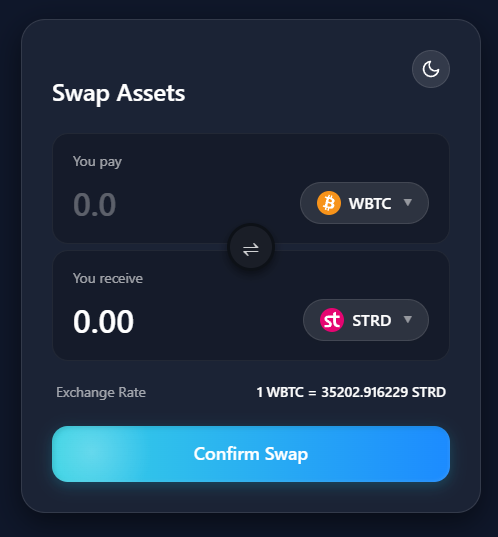
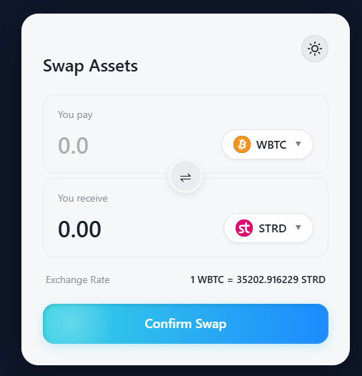

For this problem i have create a new react project with vite and tailwind css and create a form for currency swap.
The form get the current exchange rate from the backend and display the estimated amount to be received.
When subitmitting the form, it will call the swap api from backend and display the result.

My solution uses the following features:

- The form have 2 UI modes.
- React Hooks: useState, useEffect, useRef for state management and event handling.
- Tailwind CSS: For styling and responsive design.
- Axios: For API calls.
- Loading indicator: For submit button.
- Error messages: For input validation and error handling.

For the seed data, i used the token icons from [Switcheo token-icons repository](https://github.com/Switcheo/token-icons/tree/main/tokens)
And the mock data for exchange rate from [interview.switcheo.com](https://interview.switcheo.com/prices.json)
In both i generated seed data
Here is some result
The component is in [SwapPage.tsx](../../frontend/src/pages/SwapPage.tsx)

