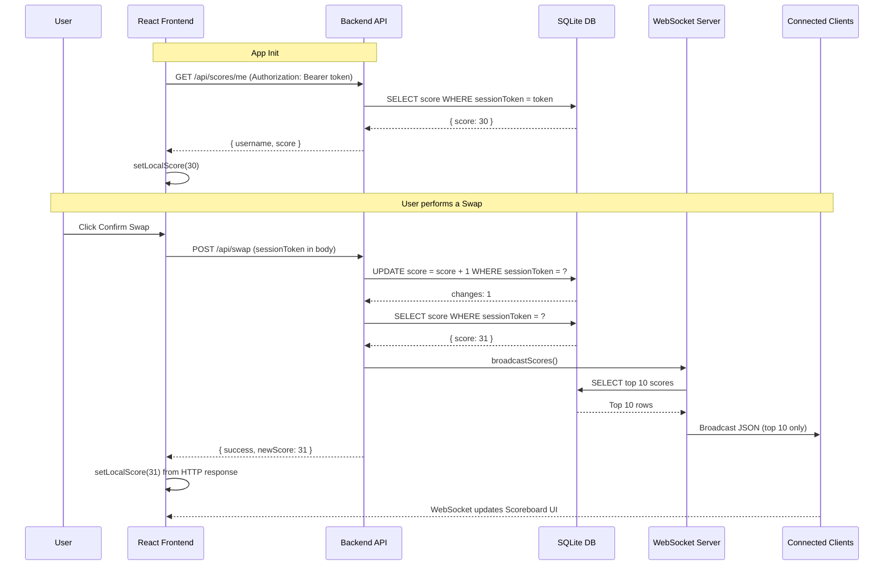

For this problem i have generated and updated a detail architecture. The solution was using token based authentication and WebSockets for real-time updates.
As we need to prevent user from increasing scores without authorisation.
There are many way to achive this such as with sever scoring or validation on every score update,rate limiting, signed request, replay events, etc.

I choosed token based authentication and serverside scoring. It is minimal and secure enough for this problem.

## Trigger action

My action will be the swap action from problem2 whenever you swap a coin you will get +1 score.

## Related file:

[scores.ts](../../backend/src/routes/scores.ts)
[scoreboard.ts](../../backend/src/websocket/scoreboard.ts)
[ScoreboardPage.tsx](../../frontend/src/pages/ScoreboardPage.tsx)

## Architecture Overview

Our implementation spans a full-stack solution utilizing React on the frontend and Node.js/Express with WebSockets on the backend.

### 1. Security & Anti-Cheat Mechanisms

A primary requirement for this architecture is preventing users from sending arbitrary scores to the server (e.g., `{"score": 999999}`).

To solve this, we implemented a **Token-Based Authentication & Server-Side Validation** model:

- **Session Creation**: When a user first opens the app, the frontend calls `POST /api/scores/session`. The server generates a random username, a secure `sessionToken`, and initializes their score to `30` in the SQLite database. Only the `username` and `token` are stored in `localStorage` — **the score is never cached client-side**.
- **Score on Init**: After restoring a session from `localStorage`, the frontend immediately calls `GET /api/scores/me` with the token in the `Authorization` header. The server returns the current live score for that user. If the token is invalid (e.g., the database was wiped), the frontend automatically creates a fresh session.
- **Action Verification**: When the user performs an action (e.g., executing a token swap), they do _not_ send their new score. Instead, the swap endpoint (`POST /api/swap`) receives the `sessionToken` and the server atomically increments the score.
- **Server-Side Increment**: The server executes `UPDATE scores SET score = score + 1 WHERE sessionToken = ?` and then returns `{ newScore }` in the HTTP response. The frontend updates the header score directly from this value — no WebSocket lookup required.

### 2. Real-Time Updates (WebSockets)

Instead of relying on inefficient frontend HTTP polling to keep the top 10 list fresh, we implemented a push-based WebSocket architecture.

- **WebSocket Server**: Attached to the Express HTTP server using the `ws` library.
- **Broadcasting Mechanism**: Whenever an action successfully alters _any_ user's score in the database, the server invokes a `broadcastScores()` function. This queries the database for the new `LIMIT 10` top scores and pushes a JSON stringified array to all active WebSocket connections.
- **Frontend Hook (`useWebSocket.ts`)**: The React frontend maintains a persistent connection to `ws://localhost:3001`. Upon receiving a message, it updates the local `scores` React state for the leaderboard display.
- **User's Own Score**: The WebSocket only broadcasts the **top 10**. New users with 30 points will not appear there. Their personal score is managed separately via `GET /api/scores/me` on init and via `newScore` in the swap response.

### 3. Database (SQLite)

- A `scores` table stores `id`, `username`, `sessionToken`, and `score`.
- Queries fetching the scoreboard are optimized using `ORDER BY score DESC LIMIT 10`.

---

## Data Flow Diagram

