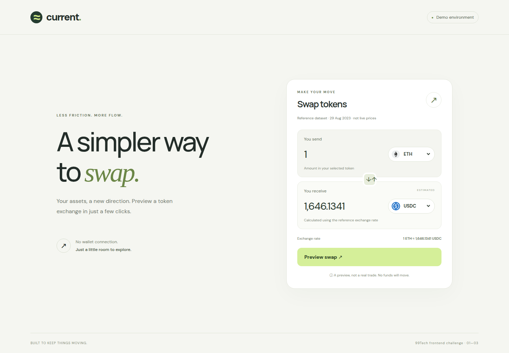

# 99Tech Code Challenge #1 #

Note that if you fork this repository, your responses may be publicly linked to this repo.  
Please submit your application along with the solutions attached or linked.   

It is important that you minimally attempt the problems, even if you do not arrive at a working solution.

## Submission ##
You can either provide a link to an online repository, attach the solution in your application, or whichever method you prefer.
We're cool as long as we can view your solution without any pain.

## Frontend submission

**Candidate:** [khanhlecavies](https://github.com/khanhlecavies)

**Track:** Frontend — Problems 1, 2 and 3

| Problem | Solution |
| --- | --- |
| 1 · Three ways to sum to n | [Implementations, complexity and assumptions](src/problem1/README.md) |
| 2 · Fancy Form | [React + TypeScript token swap UI and running instructions](src/problem2/README.md) |
| 3 · Messy React | [Issue-by-issue review and typed refactor](src/problem3/README.md) |

### Run locally

Requires Bun 1.3+. The Vite scripts explicitly use the Bun runtime.

```sh
bun install --frozen-lockfile --ignore-scripts
bun run dev
```

Open the local URL printed by Vite. The form uses the price endpoint specified in
the challenge, labels the historical data, and only simulates submission.

```sh
bun test
bun run typecheck
bun run build
bun run preview
```

Only the Frontend problems (1–3) are in scope. Backend placeholders are unchanged.
Dependencies are pinned in `package.json` and `bun.lock`; installation does not
require lifecycle scripts. The initial tracked template contained only HTML/CSS
and empty placeholders, with no dependency manifests, executables or install hooks.
This source inspection is not a guarantee that third-party code is malware-free.

### Preview



[Mobile screenshot](docs/swap-mobile.png) · [Browser verification checklist](docs/verification.md)
