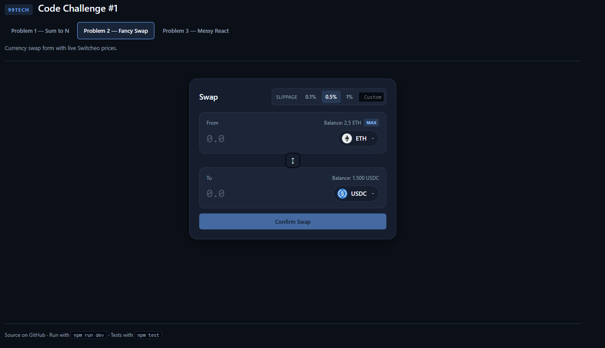

# 99Tech Code Challenge #1

> **Live demo:** **https://code-challenge-lake.vercel.app/** — want a quick
> look without cloning? Open the link, all three problems are reachable
> from the tabs at the top (`#/problem1`, `#/problem2`, `#/problem3`).

Solutions to the three problems, bundled as one React + Vite + TypeScript
app with a tab per problem.

---

## Problem 1 — Sum to N

Four implementations of `sum_to_n(n)`. The first three obey the original
constraint (result fits in `Number.MAX_SAFE_INTEGER`); the fourth lifts
that constraint by doing every arithmetic step on decimal strings, so it
handles inputs whose answer has hundreds of digits.

| Function     | Approach                       | Time   | Space | Range of `n`                  |
| ------------ | ------------------------------ | ------ | ----- | ----------------------------- |
| `sum_to_n_a` | Iterative loop                 | O(n)   | O(1)  | `\|n\|` ≤ 134,217,727         |
| `sum_to_n_b` | Gauss formula `n·(n+1)/2`      | O(1)   | O(1)  | `\|n\|` ≤ 134,217,727         |
| `sum_to_n_c` | `Array.from` + `reduce`        | O(n)   | O(n)  | `\|n\|` ≤ 1,000,000           |
| `sum_to_n_d` | Big-number formula on strings  | O(d²)  | O(d)  | unbounded (d = digits of `n`) |

Negative `n` returns the negation of the positive sum:
`sum_to_n(-5) === -15`.

### Why the bounds

- `a`, `b`, `c` need `n·(n+1)/2 ≤ 2^53 − 1`, which solves to
  `n ≤ 134_217_727`. The UI rejects values above that with an explicit
  error before invoking the function, so nothing overflows silently and
  the browser tab never freezes.
- `c` is additionally bounded by array memory: `Array.from({ length: n })`
  allocates `n` slots, so the practical cap is ~1M elements.
- `d` is bounded only by available memory and patience — the helpers are
  O(d²), and a 1000-digit `n` still finishes in well under a second.

### sum_to_n_a — iterative loop

```js
var sum_to_n_a = function (n) {
  if (n < 0) return -sum_to_n_a(-n);
  let sum = 0;
  for (let i = 1; i <= n; i++) sum += i;
  return sum;
};
```

The direct reading of "add every number from 1 to n". `n` additions,
constant memory.

### sum_to_n_b — Gauss formula

```js
var sum_to_n_b = function (n) {
  if (n < 0) return -sum_to_n_b(-n);
  return (n * (n + 1)) / 2;
};
```

Pair `1 + n`, `2 + (n−1)`, … each pair sums to `n + 1` and there are
`n / 2` pairs, so the total is `n · (n + 1) / 2`. Constant time, no
loop. The right answer whenever the result fits in
`Number.MAX_SAFE_INTEGER`.

### sum_to_n_c — functional reduce

```js
var sum_to_n_c = function (n) {
  if (n < 0) return -sum_to_n_c(-n);
  return Array.from({ length: n }, (_, i) => i + 1)
              .reduce((a, b) => a + b, 0);
};
```

Builds `[1, 2, …, n]` and folds it with `reduce`. Same number of
additions as the loop, but allocates an array of length `n` — included
as a "functional style" contrast, not because it is faster.

### sum_to_n_d — big-number Gauss

Same identity as `sum_to_n_b`, but every arithmetic step is performed on
decimal strings so the answer is not bounded by `Number.MAX_SAFE_INTEGER`:

1. Parse the input string, peel off the sign.
2. `addBigNumbers(n, "1")` — schoolbook addition right-to-left, carry
   into the next column.
3. `mulBigNumbers(n, n+1)` — long multiplication, `O(d²)` where `d` is
   the digit count.
4. `divBy2(product)` — single-digit long division by 2. The product is
   always even (`n` and `n+1` are consecutive, so exactly one is even),
   so the floor division is exact.
5. Reattach the sign.

```js
sum_to_n_d('123456789012345678901234567890')
// → '7620789614188397919306039269735013345025385542661216720495'
```

The string-addition core (from the prompt) is:

```js
function addBigNumbers(a, b) {
  let i = a.length - 1, j = b.length - 1, carry = 0, result = '';
  while (i >= 0 || j >= 0 || carry > 0) {
    let sum = carry;
    if (i >= 0) sum += a.charCodeAt(i--) - 48;
    if (j >= 0) sum += b.charCodeAt(j--) - 48;
    carry = (sum / 10) | 0;
    result = (sum % 10) + result;
  }
  return result;
}
```

The signed version in [`lib/bigNumber.ts`](src/problem1/lib/bigNumber.ts)
reduces mixed-sign cases to a magnitude subtraction via a separate
`subAbs` helper, but the additive core is exactly the snippet above.

### Tests

`npm test` runs 294 vitest cases:
[`src/problem1/tests/sumToN.test.ts`](src/problem1/tests/sumToN.test.ts).
The big-number variant is verified against `BigInt` for a 30-digit input.

---

## Problem 2 — Fancy Currency Swap

A currency swap form backed by the live
[Switcheo price feed](https://interview.switcheo.com/prices.json) and a
mock wallet that gets actually debited / credited per swap.



### Pipeline

```
prices.json  ──► fetchPrices ──► dedupeLatest ──► meta[]
                                                    │
balances.json ──► loadInitialBalances ──► balances ─┤
                                                    ▼
                                                tokens = meta ⋈ balances
                                                    │
                                                    ▼
                                              ┌─────────────┐
                                              │  SWAP FORM  │
                                              └─────────────┘
                                                    │
                                       onSubmit ────┤
                                                    ▼
                                       applySwap(balances, ...)
                                                    │
                                              setBalances(new)
```

- `meta` is the static per-token info (symbol, price, icon URL) computed
  once after fetch.
- `balances` is a mutable `Record<symbol, number>` seeded from
  [`data/balances.json`](src/problem2/data/balances.json) and updated
  immutably by `applySwap` on every successful submit. The FROM token is
  debited, the TO token credited, so subsequent swaps see the new
  numbers everywhere (dropdown, `MAX` button, "Insufficient balance"
  validation).
- `tokens` is a memo joining the two so React re-renders the UI whenever
  either input changes.

### Quote math

```ts
rate         = priceFrom / priceTo
grossOut     = amount * rate
feeAmount    = grossOut * 0.003           // mock 0.30% protocol fee
amountOut    = grossOut - feeAmount
minReceived  = amountOut * (1 - slippage / 100)
```

`slippage` is the user-selectable tolerance (0.1% / 0.5% / 1% / custom)
shown under the form. `minReceived` is what a real AMM would enforce
on-chain to prevent the user from receiving worse-than-expected output
if the pool ratio shifts before the tx lands.

### Validation

- Both tokens required.
- FROM and TO must be different.
- Amount must parse as a positive number.
- Amount must not exceed `balances[FROM]`.

All four checks short-circuit the submit button and surface a single
inline message under the summary.

### Loading + submit

Token prices are fetched on first render; an error state offers a
single-button retry. On submit the form goes into a `submitting` state
for 1.5s (per the problem's "mock backend with a loading indicator"
hint), then commits the balance update and shows a success toast that
auto-dismisses.

### Files of interest

- [`view.tsx`](src/problem2/view.tsx) — the form, all state, the
  quote/validation memos
- [`api.ts`](src/problem2/api.ts) — fetch + dedupe to latest price per
  currency
- [`balances.ts`](src/problem2/balances.ts) — JSON seed, hash fallback
  for unlisted symbols, `applySwap` immutable update
- [`components/TokenSelect.tsx`](src/problem2/components/TokenSelect.tsx)
  — searchable dropdown with icon + balance + USD price
- [`components/TokenIcon.tsx`](src/problem2/components/TokenIcon.tsx) —
  Switcheo SVG icon with a coloured letter-avatar fallback

---

## Problem 3 — Messy React

The prompt asks for **(a)** a list of inefficiencies / anti-patterns in
the supplied `WalletPage` and **(b)** a refactored version. More points
go to the analysis, so the catalogue is primary and the refactor is
secondary.

### Issues catalogued

17 issues across three severities, surfaced in the UI as filterable
cards. Highlights:

| # | Severity     | Issue                                                            |
| - | ------------ | ---------------------------------------------------------------- |
| 1 | bug          | Filter references undefined variable `lhsPriority`               |
| 2 | bug          | Filter logic inverted — keeps balances with `amount <= 0`        |
| 3 | bug          | `formattedBalances` computed but never consumed by `rows`        |
| 4 | bug          | Sort comparator returns `undefined` for equal priorities         |
| 5 | bug          | `WalletBalance` is missing the `blockchain` field                |
| 6 | anti-pattern | `getPriority(blockchain: any)` defeats the type system           |
| 7 | perf         | `getPriority` re-declared every render                           |
| 8 | perf         | Sort runs `getPriority` O(n log n) times                         |
| 9 | perf         | `useMemo` depends on `prices` but doesn't use it                 |
| 10 | perf        | `formattedBalances` not memoised                                 |
| 11 | anti-pattern | `key={index}` for a sorted list                                  |
| 12 | bug          | `prices[balance.currency]` may be undefined → `NaN` in the UI    |
| 13 | anti-pattern | Empty `interface Props extends BoxProps {}`                      |
| 14 | anti-pattern | `children` destructured but never rendered                       |
| 15 | bug          | `toFixed()` without precision argument                           |
| 16 | bug          | `rows.map` types items as `FormattedWalletBalance`               |
| 17 | perf         | `usdValue` recomputed inside the render path                     |

Full text for each issue lives in
[`src/problem3/analysis.ts`](src/problem3/analysis.ts) and is rendered
verbatim in the Problem 3 tab.

### Original code, annotated

Same numbering as the table above — every `// #N` comment lines up with
the row of matching number.

```tsx
interface WalletBalance {
  currency: string;
  amount: number;
  // #5 bug: missing `blockchain` field — the component reads
  //         `balance.blockchain` below, so the type is a lie.
}

interface FormattedWalletBalance {
  currency: string;
  amount: number;
  formatted: string;
}

interface Props extends BoxProps {
  // #13 anti-pattern: empty interface, redundant alias for BoxProps.
}

const WalletPage: React.FC<Props> = (props: Props) => {
  const { children, ...rest } = props;
  // #14 anti-pattern: `children` destructured but never rendered — any
  //                   JSX a parent passes silently disappears.

  const balances = useWalletBalances();
  const prices = usePrices();

  const getPriority = (blockchain: any): number => {
    // #6 anti-pattern: `any` defeats the type system — should be a
    //                  `Blockchain` union.
    // #7 perf:         function re-declared on every render — pure and
    //                  closure-free, hoist it to module scope.
    switch (blockchain) {
      case 'Osmosis':  return 100;
      case 'Ethereum': return 50;
      case 'Arbitrum': return 30;
      case 'Zilliqa':  return 20;
      case 'Neo':      return 20;
      default:         return -99;
    }
  };

  const sortedBalances = useMemo(() => {
    return balances
      .filter((balance: WalletBalance) => {
        const balancePriority = getPriority(balance.blockchain);
        if (lhsPriority > -99) {
          // #1 bug: `lhsPriority` is not defined in scope — should be
          //         `balancePriority`. ReferenceError in strict mode,
          //         silently `undefined > -99 === false` otherwise.
          if (balance.amount <= 0) {
            // #2 bug: keeps balances with amount <= 0 — inverted; the
            //         intent is `balance.amount > 0`.
            return true;
          }
        }
        return false;
      })
      .sort((lhs: WalletBalance, rhs: WalletBalance) => {
        const leftPriority  = getPriority(lhs.blockchain);
        const rightPriority = getPriority(rhs.blockchain);
        // #8 perf: getPriority runs twice per comparison → O(n log n)
        //          calls total. Precompute once per row via .map first.
        if (leftPriority > rightPriority)  return -1;
        else if (rightPriority > leftPriority) return 1;
        // #4 bug: no `return 0` for equal priorities — comparator
        //         implicitly returns `undefined`, violating the sort
        //         contract.
      });
  }, [balances, prices]);
  // #9 perf: `prices` is in the dependency array but the memoised
  //          callback never reads it — recomputes on every price tick.

  const formattedBalances = sortedBalances.map((balance: WalletBalance) => {
    // #10 perf: not memoised — re-runs every render.
    return {
      ...balance,
      formatted: balance.amount.toFixed(),
      // #15 bug: `toFixed()` defaults to 0 decimals → "1.5" becomes "2".
    };
  });
  // #3 bug: `formattedBalances` is built but never used — `rows` below
  //         maps `sortedBalances` instead, so `balance.formatted` is
  //         `undefined` at render time.

  const rows = sortedBalances.map(
    (balance: FormattedWalletBalance, index: number) => {
      // #16 bug: items are typed as FormattedWalletBalance but the
      //          array is WalletBalance[] — the cast hides #3.
      const usdValue = prices[balance.currency] * balance.amount;
      // #12 bug:  `prices[currency]` may be undefined → `NaN` in UI.
      // #17 perf: usdValue is recomputed in the render path on every
      //           pass — belongs in the memoised pipeline.
      return (
        <WalletRow
          className={classes.row}
          key={index}
          // #11 anti-pattern: index as React key breaks reconciliation
          //                   when items reorder or get inserted.
          amount={balance.amount}
          usdValue={usdValue}
          formattedAmount={balance.formatted}
        />
      );
    },
  );

  return <div {...rest}>{rows}</div>;
};
```

### What the refactor does

[`Refactored.tsx`](src/problem3/Refactored.tsx) addresses every issue
above:

- `Blockchain` union type and `WalletBalance` extended with
  `blockchain: Blockchain`.
- `getPriority` hoisted to module scope, backed by a `Record` lookup.
- Single `useMemo` that filters → maps to `(balance, priority, price)`
  → sorts by precomputed priority (Schwartzian transform, so the
  lookup is O(n) instead of O(n log n)) → formats with `toFixed(4)` and
  computes `usdValue`.
- `key={balance.currency}` instead of `key={index}`.
- Null-safe `prices[currency] ?? 0`.
- The empty `Props` interface and the unused `children` destructure
  are dropped; the component just spreads `...props` so the wrapping
  `<div>` stays transparent.

The refactored component actually mounts in the Problem 3 tab, with
`useWalletBalances`, `usePrices`, `WalletRow`, and `BoxProps` provided
by [`mocks.tsx`](src/problem3/mocks.tsx).

---

## Demo / running the project

```bash
npm install
npm run dev        # interactive UI at http://localhost:5173
npm test           # vitest (294 tests, problem 1)
npm run typecheck  # tsc --noEmit
npm run build      # static build into ./dist
```

Tabs use hash routing — go straight to a problem via
`#/problem1`, `#/problem2`, or `#/problem3`.

### Stack

- Vite 5 + React 18 + TypeScript 5 (strict mode)
- Vitest for the Problem 1 algorithm tests
- No runtime deps beyond React + ReactDOM

### Layout

```
code-challenge/
├── package.json, tsconfig.json, vite.config.ts, index.html
├── assets/
│   └── solution2-preview.png
├── src/
│   ├── main.tsx, App.tsx, shell.css            # tab shell
│   ├── problem1/
│   │   ├── lib/{sumToN,bigNumber}.ts           # 4 implementations + helpers
│   │   ├── tests/sumToN.test.ts                # vitest, 294 tests
│   │   ├── solutions.ts                        # algorithm metadata
│   │   ├── view.tsx, style.css
│   ├── problem2/
│   │   ├── view.tsx, style.css
│   │   ├── api.ts, types.ts                    # fetch + dedupe prices
│   │   ├── balances.ts                         # JSON seed + applySwap
│   │   ├── data/balances.json                  # initial wallet snapshot
│   │   ├── format.ts, tokenIcon.ts
│   │   └── components/{TokenSelect,TokenIcon}.tsx
│   └── problem3/
│       ├── analysis.ts                         # 17 catalogued issues
│       ├── Refactored.tsx                      # working WalletPage
│       ├── mocks.tsx                           # useWalletBalances / usePrices / ...
│       ├── original.tsx.txt                    # prompt code, raw-imported
│       ├── view.tsx, style.css
```

### Submission

Either link to this repository or attach the build output — every problem
has its source under `src/` and is reachable from the tabbed UI started
with `npm run dev`.
