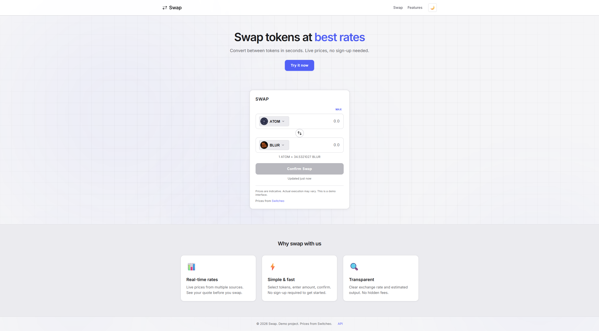
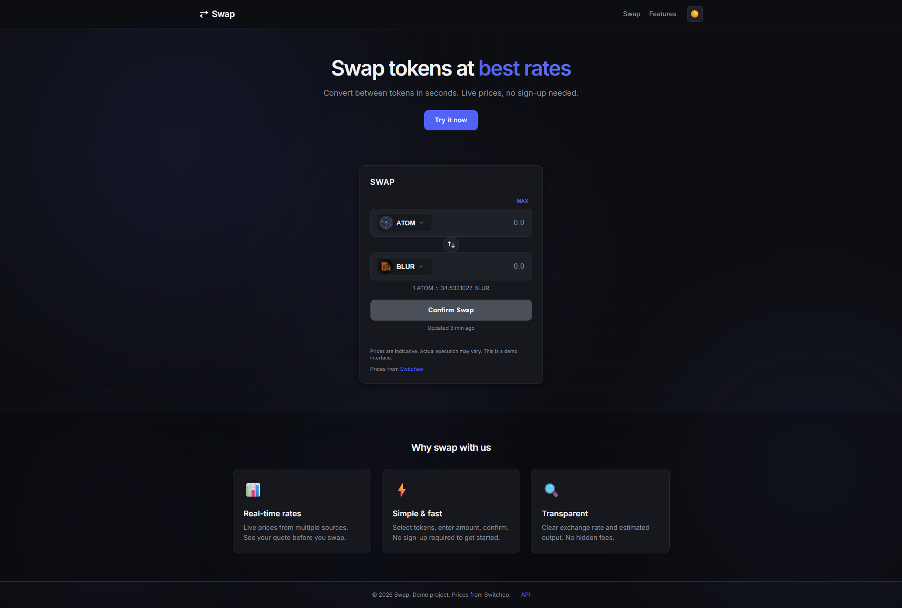
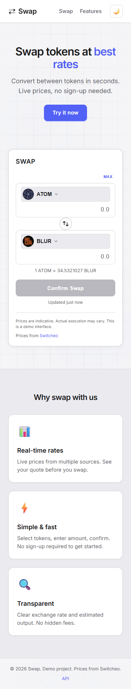

# Currency Swap

Token exchange at best rates — convert between tokens with live prices.

**Demo:** https://fe-code-challenge-9ixy.onrender.com/

## Screenshots

**Desktop (light)**



**Dark mode**



**Mobile**



## Tech

- React 18 + TypeScript
- Vite 5
- Vanilla CSS (no Tailwind)

## Run locally

```bash
yarn install
yarn dev
```

Open http://localhost:3000

Build: `yarn build` → output in `dist/`

## Features

- **Landing** — Hero, swap section, feature cards (“Why swap with us”), footer
- **Swap form** — Pick From/To token, enter amount; see estimated output and “1 FROM ≈ X TO” rate
- **Swap direction** — One-click button to swap From and To tokens
- **Max** — Button to fill a demo max amount
- **Token modal** — Open from token dropdown: search, token icons, price and last updated per token
- **Result modal** — Success or error with swap summary; form resets on close
- **Validation** — Positive amount only; From and To must differ; errors after input or submit
- **Loading** — Skeleton while prices load; retry button if fetch fails; “Last updated” relative time
- **Dark/light theme** — Toggle in header; preference saved in browser; respects system preference
- **Animations** — Hero entrance, scroll-triggered sections, button and modal transitions
- **Accessibility** — ARIA, keyboard support, focus management
- **Performance** — Lazy-loaded swap form, single price API call (deduped)

## Data

- Prices: https://interview.switcheo.com/prices.json
- Icons: Switcheo token-icons repo (fallback to letter if missing)
