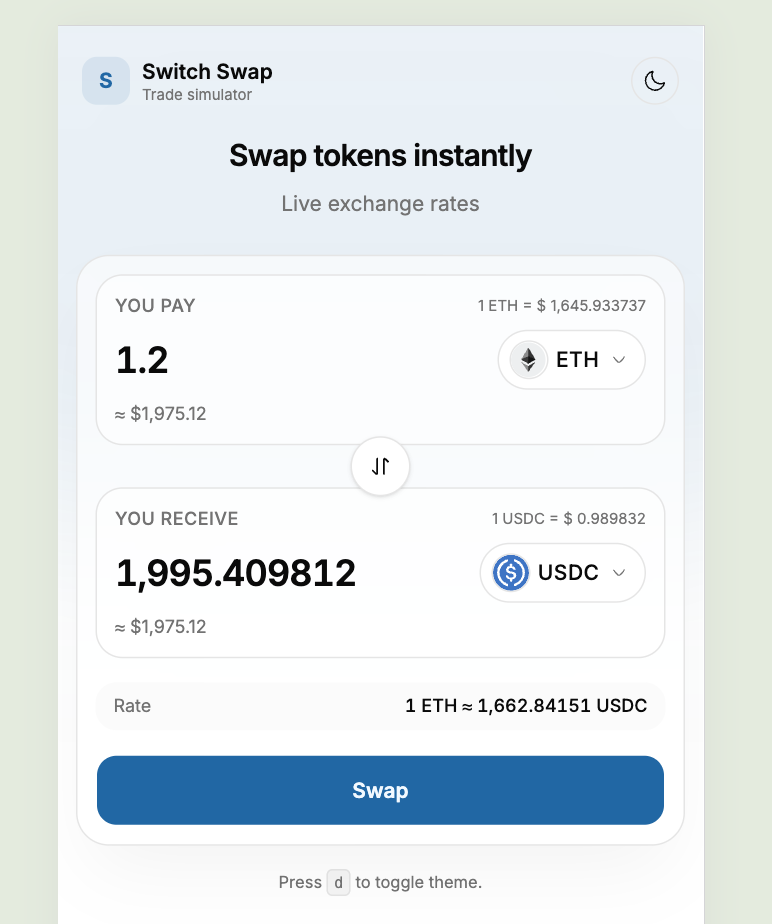
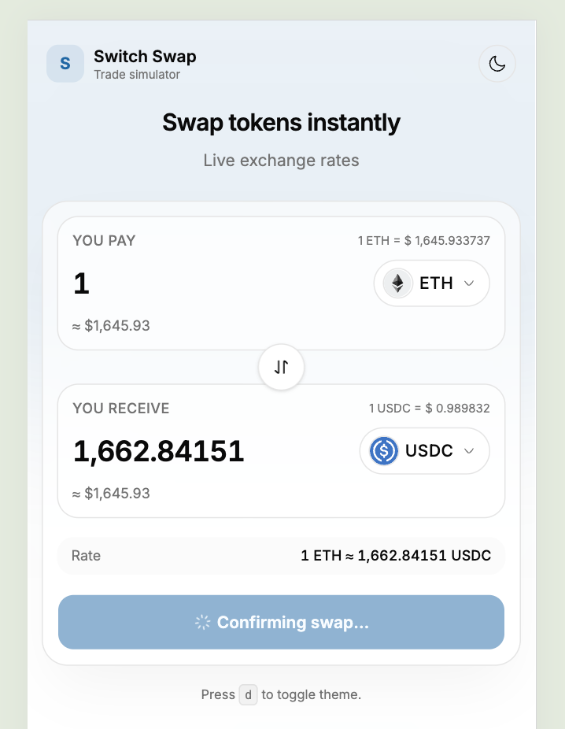
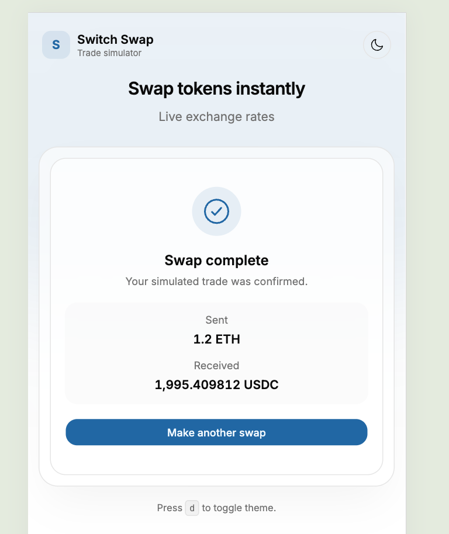

# Switch Swap

A small currency-swap form that lets you trade between any two tokens listed in
Switcheo's public price feed. The "to" amount is computed live from the
`priceFrom / priceTo` ratio, and submitting simulates a backend swap with a
loading state and a success summary.

## Screenshots

| Form | Submitting | Complete |
| :--: | :--------: | :------: |
|  |  |  |

## Tech stack

- [Vite](https://vitejs.dev/) + React 19 + TypeScript
- [Tailwind CSS v4](https://tailwindcss.com/) (with `tw-animate-css`)
- [shadcn/ui](https://ui.shadcn.com/) primitives (`Button`, theme provider)
- [Radix UI](https://www.radix-ui.com/) (`Popover` for the token picker)
- [Hugeicons](https://hugeicons.com/) for iconography
- Inter Variable via `@fontsource-variable/inter`

## Getting started

```bash
cd src/problem2
npm install
npm run dev
```

The dev server prints the local URL (defaults to <http://localhost:5173>; Vite
picks the next free port if it's already taken).

## Scripts

| Script              | Purpose                            |
| ------------------- | ---------------------------------- |
| `npm run dev`       | Start the Vite dev server          |
| `npm run build`     | Type-check (`tsc -b`) and build    |
| `npm run preview`   | Serve the production build locally |
| `npm run lint`      | Run ESLint                         |
| `npm run typecheck` | Run TypeScript only (no emit)      |
| `npm run format`    | Format with Prettier               |

## Features

- Searchable token combobox with keyboard navigation (up/down/enter)
- Auto-computed "you receive" amount from live prices
- Direction-swap button with subtle rotate animation
- Inline validation with specific messages for empty / zero / negative /
  non-numeric / same-token cases. Invalid keystrokes (letters, multiple dots,
  minus signs, scientific notation) are filtered out before reaching state.
- Loading skeleton while prices fetch, retry panel on failure
- Simulated submit with spinner and success summary
- Light/dark theme (press `d` to toggle)
- Responsive down to **320px** viewport width: card padding, font sizes, and
  the token-picker popover all collapse to fit small screens without
  horizontal scroll

## Code layout

```
src/
  components/swap/
    SwapForm.tsx           # Presentational form, ~130 lines
    SwapStatusPanels.tsx   # Skeleton / Error / Success panels
    TokenAmountField.tsx   # Single amount input + token select
    TokenSelect.tsx        # Searchable combobox built on Radix Popover
    TokenIcon.tsx          # SVG icon with initials fallback
  hooks/
    useSwapForm.ts         # All form state, derivation, and actions
    useTokens.ts           # Async fetch + reload via reducer
  lib/
    format.ts              # Number formatting + permissive parsing
    validation.ts          # Pure amount validator + onChange sanitiser
    prices.ts              # Live Switcheo price endpoint adapter
```

## Data sources

- Prices: <https://interview.switcheo.com/prices.json>
  (deduplicated by symbol, keeping the most recent valid quote)
- Token icons:
  `https://raw.githubusercontent.com/Switcheo/token-icons/main/tokens/<SYMBOL>.svg`
  with a graceful initial-letters fallback when a symbol has no icon.
