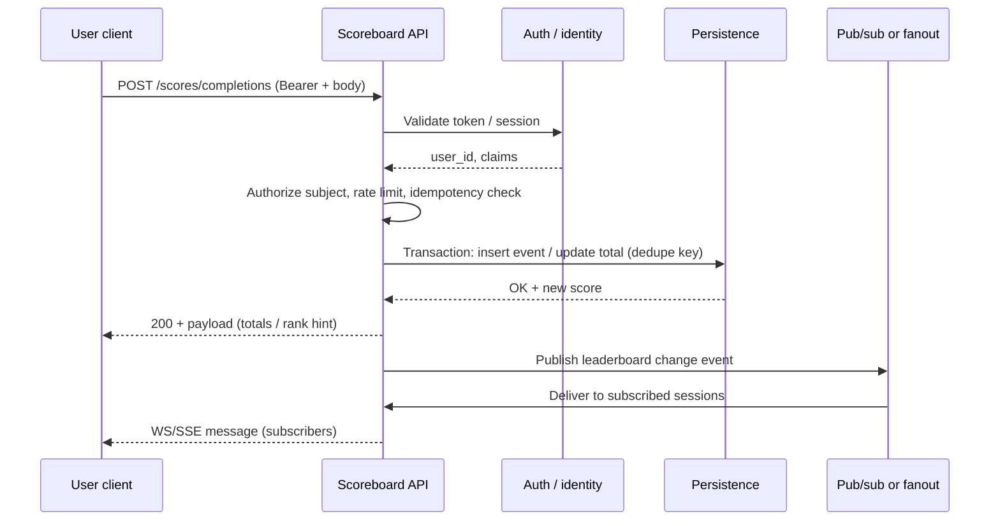
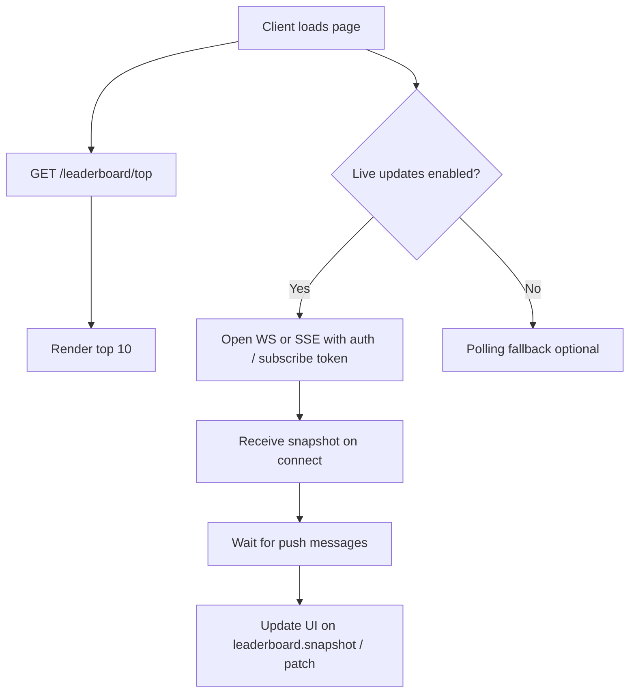
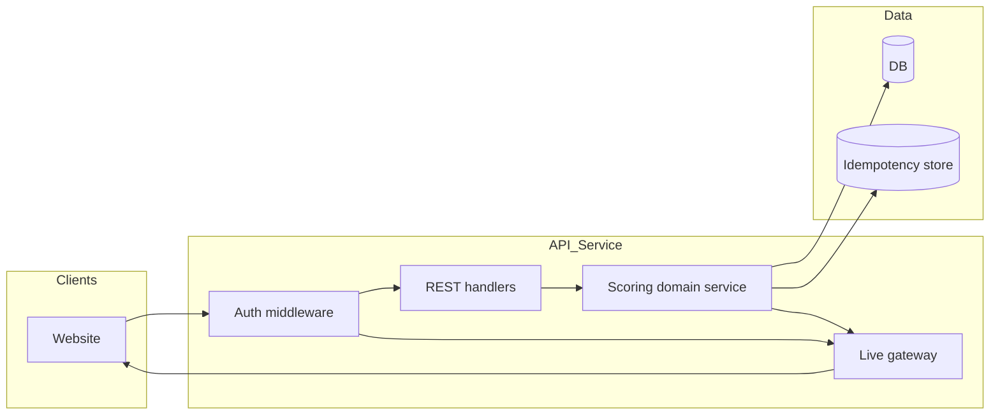

# Live Scoreboard API Module — Specification

This document specifies a backend module for an application server that maintains user scores, exposes a **top-10 leaderboard**, supports **live updates** to connected clients, and **prevents unauthorized score manipulation**.

**Audience:** backend engineering team implementing the service and its integrations.

**Out of scope for this module:** the concrete nature of the “action” users perform in the product; only the **contract** for reporting completion and securing increments is defined here.

---

## 1. Goals and non-goals

### Goals

- Persist per-user scores (or derive them deterministically from an append-only event log—see [Data model](#4-data-model)).
- Return the **top 10** users by score for the scoreboard UI.
- Push **near-real-time** updates when the leaderboard set or ordering relevant to the top 10 changes (or on every accepted score change—product choice; see [Improvements](#10-improvements-and-open-questions)).
- Accept **authenticated** completion notifications and apply **server-authoritative** score changes.
- Mitigate abuse: forged requests, replay, inflated deltas, and unauthenticated writes.

### Non-goals

- Defining UX, frontend framework, or exact WebSocket/SSE client libraries.
- Implementing the action itself or client-side anti-cheat beyond “do not trust the client for score values.”

---

## 2. Actors and trust boundaries

| Actor | Trust |
|--------|--------|
| **Browser / mobile app** | Untrusted: can call APIs with arbitrary payloads. |
| **Application server (this module)** | Trusted for business rules, authentication verification, persistence, and broadcasting. |
| **Identity provider / session store** | Trusted for “who is this user?” after the client proves identity (e.g. OAuth2/OIDC, session cookie, JWT validation). |

**Principle:** the client must **never** be the source of truth for “how much to add” unless that value is **cryptographically bound** to a server-issued, short-lived token for a specific action instance (optional hardening—see §6.3).

---

## 3. Functional requirements

### 3.1 Scoreboard (read)

- The API SHALL return the **top 10** entries ordered by score **descending**, with a stable tie-breaker (e.g. lower user id first, or “earlier achievement time”—must be documented in implementation).
- Each entry SHOULD include at minimum: **user id** (or opaque public id), **display name** (or placeholder), **score**, and **rank** (1–10).

### 3.2 Live updates

- Clients that have opened a **live channel** (WebSocket recommended; SSE acceptable) SHALL receive messages when the server considers the top-10 view **materially updated** (see §5.2).
- The channel MUST be **authenticated** (same identity as REST) or use a **short-lived, scoped subscribe token** derived from an authenticated session (see §6.2).

### 3.3 Score update on action completion

- When a user completes the in-product action, the client SHALL call a **dedicated HTTP endpoint** on this module (or a façade that routes to it).
- The server SHALL:
  - Authenticate the caller.
  - Authorize that the **authenticated user** is the subject of the score change.
  - Validate the request (schema, idempotency, rate limits, optional action proof—see §6).
  - Apply the score change **atomically** and durably.
  - Trigger the **broadcast** path for subscribers (§5).

### 3.4 Security / abuse prevention

- Unauthenticated score writes SHALL be rejected (`401`).
- Authenticated users SHALL NOT be able to change **another user’s** score via this endpoint (`403`).
- The server SHALL NOT apply unbounded score increases from a single request without policy (fixed increment, server-side lookup of allowed increment for action type, or signed server token—see §6.3).
- Replay of the same completion event SHALL NOT double-apply scores when **idempotency** is used correctly (`409` or idempotent no-op—policy choice; document in API).

---

## 4. Data model

Minimal logical model (implementation may normalize differently):

- **User** — stable identifier, optional display name.
- **Score state** — either:
  - **Option A (simple):** `user_id`, `total_score`, `updated_at`; or  
  - **Option B (audit-friendly):** append-only **ScoreEvent** rows (`user_id`, `delta`, `reason`, `idempotency_key`, `created_at`) with `total_score` as a cached aggregate or computed view.

**Recommendation:** Option B for forensics and dispute resolution; maintain a materialized/cached total for fast leaderboard queries.

---

## 5. Interfaces

### 5.1 REST (indicative)

> Exact paths and naming are for the implementing team; keep them versioned (e.g. `/v1/...`).

| Method | Endpoint | Purpose |
|--------|----------|---------|
| `GET` | `/v1/leaderboard/top` | Snapshot of top 10 (JSON). |
| `POST` | `/v1/scores/completions` | Report action completion for the **authenticated** user. |
| `POST` | `/v1/live/subscribe-token` *(optional)* | Issue a short-lived token for WebSocket/SSE subscription. |

**`POST /v1/scores/completions` (illustrative body)**

```json
{
  "idempotency_key": "uuid-v4-client-generated",
  "action_instance_id": "opaque-id-from-action-pipeline",
  "client_event_time": "2026-05-10T12:00:00.000Z"
}
```

- **`idempotency_key`:** REQUIRED; unique per logical completion; server stores key per user (or globally per action_instance_id) to dedupe.
- **`action_instance_id`:** REQUIRED if the action system can generate unique ids; ties completion to a single run of the action.
- **Do not** accept a raw `score_delta` from the client unless paired with a **server-signed** completion token (§6.3).

**Responses (illustrative)**

- `200` / `201` — applied; body includes new total and optionally updated top-10 fragment.
- `401` — missing/invalid auth.
- `403` — wrong subject or token scope.
- `409` — duplicate idempotency key (idempotent replay: return prior result).
- `429` — rate limited.

### 5.2 Live channel

- **WebSocket** (preferred): e.g. connect to `/v1/live/ws` with `Authorization: Bearer` or query param **only if** paired with TLS and short-lived subscribe token (prefer header).
- **Message types (illustrative):**
  - `leaderboard.snapshot` — full top 10 (on connect and on major resync).
  - `leaderboard.patch` — minimal diff (optional optimization).
- **Broadcast trigger:** after a successful completion transaction **and** when the top-10 set or order changes **or** on a debounced schedule if many events arrive (implementation detail; see §10).

---

## 6. Security controls

### 6.1 Authentication and authorization

- All write endpoints and live subscriptions MUST require **strong authentication** (industry-standard session or bearer JWT with validation of issuer, audience, expiry, and signature).
- Authorization rule: **only the subject user** may record their own completion (derive `user_id` from auth context; ignore any client-supplied `user_id` or treat it as a cross-check that MUST match).

### 6.2 Transport and tokens

- TLS 1.2+ everywhere; HSTS for public APIs.
- Prefer **short-lived access tokens** + refresh where applicable; rotate signing keys for JWTs.

### 6.3 Server-authoritative scoring

Pick one (or combine) of these patterns:

1. **Fixed server rule:** each valid completion adds a **constant** known only to the server (e.g. +1). Client sends only idempotency + action instance id.
2. **Action pipeline callback:** the system that **actually** validates the action calls an **internal** “apply score” API with **mTLS** or service JWT; the public internet client never calls score apply directly.
3. **Signed completion token:** when the action completes, a trusted component issues a **one-time, signed JWT** (or mac) embedding `user_id`, `action_instance_id`, `allowed_delta`, `exp`. The client posts that token to the public API; the server verifies signature and claims before applying.

### 6.4 Abuse controls

- **Rate limiting** per user and per IP on `POST /completions`.
- **Idempotency** storage with TTL ≥ maximum client retry window.
- **Anomaly detection** hooks (optional): flag sudden score velocity for review.

---

## 7. Execution flows (diagrams)

### 7.1 Action completion → score update → optional live push



### 7.2 Client loads scoreboard and subscribes for live updates



### 7.3 High-level component view



---

## 8. Consistency, performance, and reliability

- **Leaderboard reads:** cache top 10 in memory with short TTL **or** maintain a sorted set in Redis if scale requires sub-millisecond reads; invalidate/update on write path.
- **Writes:** use DB transactions to enforce uniqueness on `(user_id, idempotency_key)` or `(action_instance_id)`.
- **Live layer:** horizontal scale via **sticky sessions** or a **shared pub/sub** (Redis, NATS, Kafka, etc.) so all API instances fan out the same events.
- **Ordering:** document tie-breaking for equal scores to avoid UI flicker.

---

## 9. Observability

- Structured logs: `user_id` (hashed if PII policy), `idempotency_key`, `action_instance_id`, outcome, latency.
- Metrics: completion rate, `429`/`401`/`409` counts, broadcast lag p95, DB transaction errors.
- Tracing: single trace across REST → DB → publish for latency diagnosis.

---

## 10. Improvements and open questions

These items are **intentional** follow-ups for product and engineering; they are not blockers for an initial implementation but reduce risk at scale.

1. **Event-sourced scores:** Prefer append-only events with a cached total to simplify audits and replays without double-counting when replaying logs.
2. **Minimal push payload:** Sending only “version + changed rows” reduces bandwidth; full snapshot on reconnect only.
3. **Debounce broadcasts:** Under bursty traffic, coalesce multiple writes into one leaderboard push per N ms to protect clients and pub/sub.
4. **Cross-region:** If users are global, define whether leaderboard is **per-region** or **global** and how replication lag affects “live” semantics.
5. **Signed completion tokens (§6.3):** Strongest model when the action validator is separate from the score service; avoids trusting constant increments for complex games.
6. **Internal vs public apply path:** For high-stakes leaderboards, consider **no public score mutation**—only internal callbacks from the validated action service.
7. **Privacy:** Decide whether display names on the public leaderboard require consent and whether user ids should be opaque public ids.
8. **GDPR / deletion:** Define behavior when a user is deleted or anonymized (remove from leaderboard vs retain scores).
9. **Testing contract:** Provide conformance tests for idempotency, auth failure, cross-user tampering attempts, and concurrent completion races.
10. **WebSocket backpressure:** Define max message rate per connection and disconnect policy for abusive subscribers.

---

## 11. Acceptance criteria (implementation checklist)

- [ ] Top 10 endpoint returns stable ordering with documented tie-break.
- [ ] Score completion requires authentication; cross-user updates impossible.
- [ ] Idempotent completion handling verified under retries.
- [ ] Rate limiting enforced on completion endpoint.
- [ ] Live channel receives updates after writes (integration test with two clients).
- [ ] No trusted `score_delta` from client unless signed-token path is implemented and tested.
- [ ] Metrics and logs cover success/failure paths for writes and broadcasts.

---

*End of specification.*
