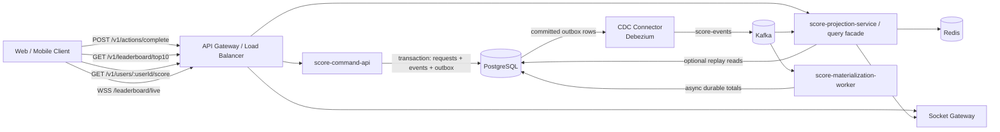
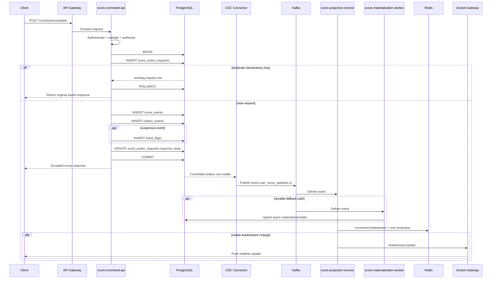
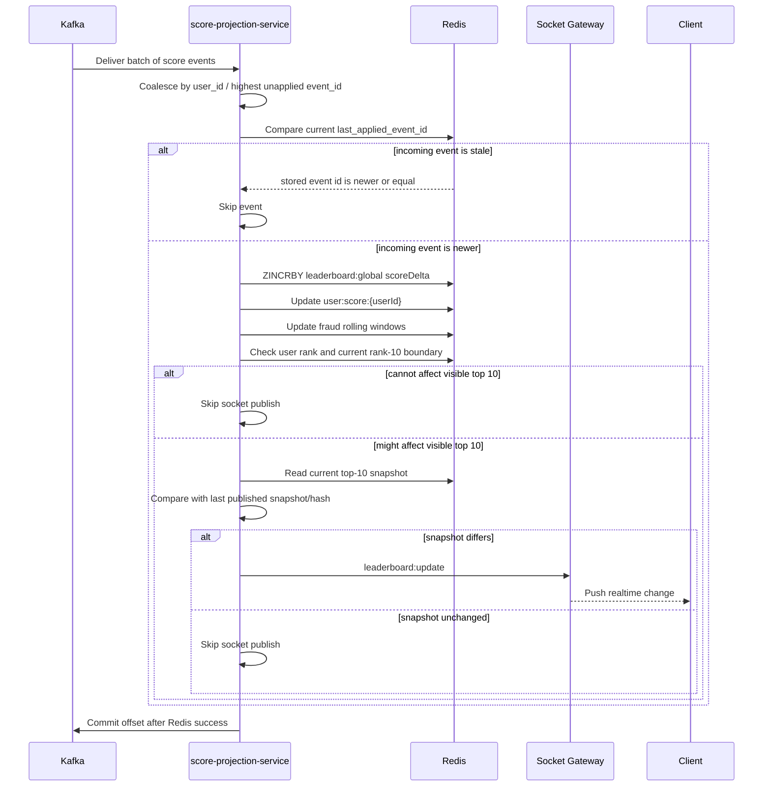
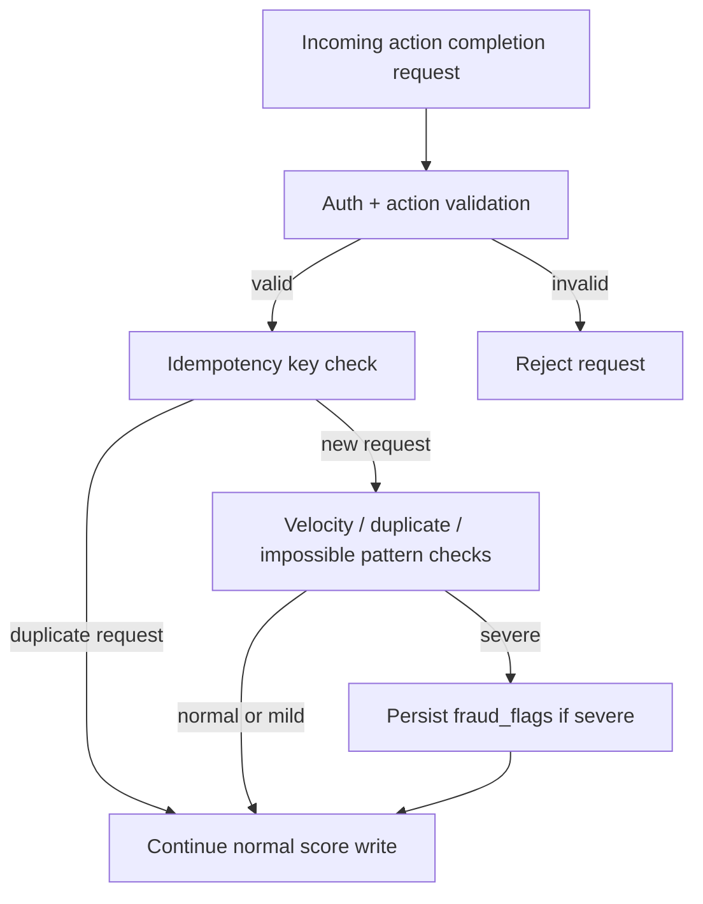
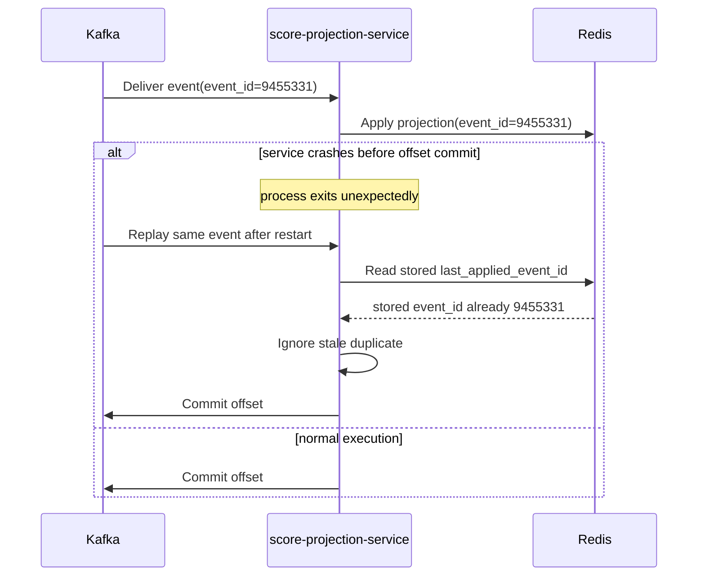

# Problem 6: Architecture & Execution Flows

This document is the detailed visual companion to `README.md`.

The goal is to make the system implementation concrete enough for a backend team to build without needing to infer the critical write-path, projection, fraud, and recovery behavior.

Unlike the passed example, this design does not update PostgreSQL, Redis, and realtime sockets in one synchronous chain. PostgreSQL remains authoritative, and downstream state is projected asynchronously through outbox + CDC + Kafka.

This revision also removes the synchronous write-side total row. The authoritative write path is append-only:

- accepted score events are written to PostgreSQL
- Redis computes the live query model
- an asynchronous PostgreSQL materialization worker can persist durable fallback totals outside the write transaction

---

## 1. High-Level System Architecture

### 1.1 Topology at a glance

```text
Clients
  |
  v
┌────────────────────────────────────────────────────────────┐
│ API Gateway / Load Balancer                               │
│ - TLS termination                                         │
│ - request routing                                         │
│ - coarse rate limiting                                    │
│ - auth pre-check hooks                                    │
└───────────────┬──────────────────────┬────────────────────┘
                │                      │
                │ HTTP                 │ WSS
                ▼                      ▼
     ┌──────────────────────┐   ┌──────────────────────┐
     │ score-command-api    │   │ socket gateway       │
     │ - auth + validation  │   │ - connection auth    │
     │ - append score event │   │ - channel fanout     │
     │ - write outbox in tx │   └──────────▲───────────┘
     └──────────┬───────────┘              │
                │                          │ leaderboard:initial
                ▼                          │ leaderboard:update
     ┌──────────────────────┐              │
     │ PostgreSQL           │              │
     │ - users / sessions   │              │
     │ - requests / events  │              │
     │ - outbox / flags     │              │
     │ - materialized totals│              │
     └──────────┬───────────┘              │
                │ committed outbox rows    │
                ▼                          │
     ┌──────────────────────┐              │
     │ CDC Connector        │              │
     │ Debezium / similar   │              │
     │ - reads committed    │              │
     │   outbox rows        │              │
     └──────────┬───────────┘              │
                ▼                          │
     ┌──────────────────────┐              │
     │ Kafka                │──────────────┼──────────────────────┐
     │ - score-events topic │              │                      │
     │ - replay source      │              │                      │
     │ - per-user ordering  │              │                      │
     └───────┬────────┬─────┘              │                      │
             │        │                    │                      │
             ▼        ▼                    │                      │
  ┌──────────────────┐  ┌──────────────────────┐                  │
  │ score-projection │  │ score-materialization│                  │
  │ service / query  │  │ worker               │                  │
  │ facade           │  │ - async PG totals    │                  │
  │ - Kafka consumer │  │ - replay checkpoint  │                  │
  │ - read APIs      │  └──────────┬───────────┘                  │
  │ - Redis updater  │             │ writes fallback state        │
  │ - fanout decision│─────────────┘ into PostgreSQL              │
  └──────────┬───────┘                                            │
             │ read / write                                       │
             ▼                                                    │
     ┌──────────────────────┐                                     │
     │ Redis                │─────────────────────────────────────┘
     │ - leaderboard        │      visible leaderboard updates only
     │ - user projections   │
     │ - fraud windows      │
     └──────────────────────┘
```

```text
Clients
  |
  v
API Gateway / Load Balancer
  |
  +--> POST /v1/actions/complete
  |      |
  |      v
  |    score-command-api
  |      |
  |      +--> authenticate + validate
  |      +--> append score_events
  |      +--> write outbox_events in same tx
  |      |
  |      v
  |    PostgreSQL
  |      |
  |      v
  |    CDC Connector
  |      |
  |      v
  |    Kafka score-events
  |      |
  |      +--> score-projection-service / query facade
  |      |      |
  |      |      +--> update Redis leaderboard + user projections + fraud windows
  |      |      +--> decide leaderboard fanout
  |      |      +--> push leaderboard:* to socket gateway
  |      |
  |      +--> score-materialization-worker
  |             |
  |             +--> upsert async PostgreSQL materialized totals
  |
  +--> GET /v1/leaderboard/top10
  |    GET /v1/users/:userId/score
  |      |
  |      v
  |    score-projection-service / query facade
  |      |
  |      +--> read Redis live projections
  |      +--> optional degraded fallback from PostgreSQL materialized totals
  |
  +--> WSS /leaderboard/live
         |
         v
       socket gateway
         |
         +--> authenticate connection
         +--> deliver leaderboard:initial / leaderboard:update
```

Current system truth:

- `POST /v1/actions/complete` goes through `score-command-api` and commits only to PostgreSQL in the write transaction.
- PostgreSQL outbox rows are streamed by CDC into Kafka after commit.
- Kafka feeds both the Redis projection path and the asynchronous PostgreSQL materialization path.
- `GET /v1/leaderboard/top10` and `GET /v1/users/:userId/score` are served from the projection/query side backed by Redis.
- WebSocket clients connect to `socket gateway`, which receives `leaderboard:*` fanout from the projection service, not directly from the write transaction.

### 1.2 Mermaid view



### 1.2.1 ASCII alternative

```text
Clients
  |
  v
API Gateway / Load Balancer
  |
  +--> POST /v1/actions/complete --> score-command-api --> PostgreSQL --> CDC Connector --> Kafka
  |
  +--> GET /v1/leaderboard/top10 --> score-projection-service / query facade --> Redis
  |
  +--> GET /v1/users/:userId/score --> score-projection-service / query facade --> Redis
  |
  +--> WSS /leaderboard/live --> Socket Gateway

Kafka --> score-projection-service / query facade --> Redis
Kafka --> score-projection-service / query facade --> Socket Gateway
Kafka --> score-materialization-worker --> PostgreSQL durable totals
```

### 1.3 Component responsibilities

| Component                      | Primary responsibility                                                  | Must not own                               |
| ------------------------------ | ----------------------------------------------------------------------- | ------------------------------------------ |
| API Gateway                    | routing, TLS, coarse throttling                                         | authoritative score mutation               |
| `score-command-api`            | auth, action validation, transactional score writes, outbox writes      | direct Redis leaderboard truth             |
| PostgreSQL                     | source of truth for accepted writes and durable fallback state          | low-latency top-10 serving                 |
| CDC connector                  | move committed outbox rows into Kafka                                   | business validation                        |
| Kafka                          | durable event transport and replay                                      | authoritative score state                  |
| `score-projection-service`     | consume events, update Redis, serve read APIs or power thin query layer | deciding whether a score mutation is valid |
| `score-materialization-worker` | persist durable PostgreSQL materialized totals asynchronously           | synchronous write-path correctness         |
| Redis                          | low-latency ranking and rolling fraud windows                           | authoritative score record                 |
| Socket gateway                 | fanout to subscribed clients                                            | transaction processing                     |

### 1.4 Why the topology is split this way

- The command side is optimized for correctness.
- The read side is optimized for speed and fanout.
- Kafka sits between them so failures on the read side do not invalidate accepted writes.
- Redis is intentionally disposable. If it is lost, the system should rebuild it.
- Durable PostgreSQL materialized totals are optional asynchronous helpers, not the source of truth.

---

## 2. Detailed Score Update Flow

### 2.1 Scenario

User completes an action in the product. The client calls `POST /v1/actions/complete`. The system must:

- verify the user is allowed to claim that action
- reject duplicates or replays
- update the authoritative score exactly once from the user’s perspective
- publish the resulting score change downstream without dual-write risk

### 2.2 Step-by-step execution flow

```text
TIME │ COMPONENT                    │ ACTION
─────┼──────────────────────────────┼────────────────────────────────────────────────────────────
  1  │ Client                       │ User completes action
     │                              │ Send POST /v1/actions/complete
     │                              │ Body: { actionId, idempotencyKey, actionInstanceId, ... }
     │
  2  │ API Gateway                  │ Apply coarse request throttling / bot filtering
     │                              │ Forward request to score-command-api
     │
  3  │ Auth Layer                   │ Validate access token
     │                              │ Resolve authenticated userId
     │                              │ Optionally load session / refresh state from PostgreSQL
     │                              │ Reject with 401 if invalid
     │
  4  │ Request Validation           │ Validate schema
     │                              │ Validate idempotencyKey presence and length
     │                              │ Validate actionId is supported
     │                              │ Reject with 400 on malformed input
     │
  5  │ Business Eligibility         │ Load action metadata
     │                              │ Check action is enabled
     │                              │ Check caller may claim it
     │                              │ Reject with 403 / 422 when not allowed
     │
  6  │ PostgreSQL Transaction Start │ BEGIN
     │                              │ Start the authoritative mutation boundary
     │
  7  │ Idempotency Insert           │ INSERT score_action_requests(...)
     │                              │ Unique key: (user_id, idempotency_key)
     │                              │ If duplicate exists, return saved prior response
     │
  8  │ Business/Fraud Checks        │ Evaluate lightweight checks using request metadata
     │                              │ Example: invalid grant, impossible repetition, suspicious burst
     │                              │ No total-score row is locked here
     │
  9  │ Ledger Append                │ INSERT immutable row into score_events
     │                              │ Return generated event_id from PostgreSQL
     │
 10  │ Outbox Write                 │ INSERT outbox_events(payload...)
     │                              │ Same transaction as the score event
     │
 11  │ Fraud Flag Persistence       │ INSERT fraud_flags if the event is suspicious enough
     │                              │ This does not block the scoreboard path unless policy says so
     │
 12  │ Idempotent Response Save     │ Save the accepted response body onto score_action_requests
     │                              │ So duplicate retries can return the original result verbatim
     │
 13  │ Commit                       │ COMMIT
     │                              │ Score event is now durably accepted in PostgreSQL
     │
 14  │ Response to Client           │ Return acceptedEventId + scoreDelta
     │                              │ The projected total may appear slightly later
     │
 15  │ CDC Connector                │ Detect committed outbox row
     │                              │ Publish event into Kafka
     │
 16  │ Projection Service           │ Consume score event
     │                              │ Apply ZINCRBY / HINCRBY style projection in Redis
     │
 17  │ Materialization Worker       │ Optionally persist durable PostgreSQL totals asynchronously
     │
 18  │ Socket Gateway               │ Broadcast coalesced leaderboard:update if visible state changed
     │
 19  │ Clients                      │ Re-render leaderboard / user score in realtime
```

### 2.3 Write-flow Mermaid sequence



### 2.3.1 ASCII alternative

```text
Client
  |
  v
API Gateway
  |
  v
score-command-api
  |
  +--> authenticate + validate + authorize
  |
  +--> PostgreSQL BEGIN
          |
          +--> INSERT score_action_requests
          |
          +--> duplicate idempotency key?
                 |
                 +--> yes: read stored response -> ROLLBACK -> return original result
                 |
                 +--> no:
                        |
                        +--> INSERT score_events (append-only)
                        +--> INSERT outbox_events
                        +--> optionally INSERT fraud_flags
                        +--> save response body on request row
                        +--> COMMIT
  |
  +--> return acceptedEventId + scoreDelta to client

After commit:
PostgreSQL -> CDC Connector -> Kafka -> projection service -> Redis -> Socket Gateway -> Clients
                                              \
                                               -> materialization worker -> PostgreSQL durable totals
```

### 2.4 Why this flow is safer than direct synchronous cache updates

- The user gets a correct committed score as soon as PostgreSQL commits.
- Redis and sockets can lag briefly without losing the authoritative state.
- The API process never has to solve “database commit succeeded but Kafka publish failed.”
- Duplicate client retries are absorbed by the database uniqueness rule.
- The write path avoids a hot per-user total row, which is better aligned with heavy append traffic.

---

## 3. Transaction + Outbox + CDC Flow

### 3.1 Core idea

The command API must never perform:

- `INSERT score_events`
- then separately `publish("score-updated")`

as two unrelated operations.

If the process crashes between them, the database and event stream diverge.

### 3.2 ASCII flow

```text
┌──────────────────────────────────────────────────────────────────────┐
│ score-command-api                                                    │
│                                                                      │
│ BEGIN                                                                │
│   1. INSERT score_action_requests                                    │
│   2. INSERT score_events                                             │
│   3. INSERT outbox_events                                            │
│ COMMIT                                                               │
└───────────────────────────────┬──────────────────────────────────────┘
                                │ committed rows only
                                ▼
┌──────────────────────────────────────────────────────────────────────┐
│ CDC Connector                                                        │
│ - watches committed outbox rows                                      │
│ - transforms row into event payload                                  │
│ - publishes to Kafka topic keyed by user_id                          │
└───────────────────────────────┬──────────────────────────────────────┘
                                ▼
┌──────────────────────────────────────────────────────────────────────┐
│ Kafka                                                                │
│ - durable event log                                                  │
│ - replay source for projection consumers                             │
│ - isolates write path from read-side failure                         │
└──────────────────────────────────────────────────────────────────────┘
```

### 3.3 Design rules

- `outbox_events` must be written in the same PostgreSQL transaction as the accepted score event.
- CDC must only read committed rows.
- Kafka topic partition key should be `user_id` to preserve per-user ordering.
- Consumers must assume at-least-once delivery and deduplicate using `event_id` or another monotonic applied-position marker.
- Durable PostgreSQL totals, if present, must be maintained asynchronously and never move back into the write transaction.

### 3.4 What the outbox payload should contain

- event id
- event type
- user id
- action id
- score delta
- occurred at
- metadata for fraud and auditing

---

## 4. Projection, Leaderboard Query, and Live Update Flow

### 4.1 Responsibilities of the projection service

- consume `score-events`
- update Redis leaderboard state
- update per-user read models
- compute or refresh top-10 snapshot
- decide whether a socket broadcast is necessary
- expose read APIs directly, or back a thin read-only API layer
- optionally feed a durable PostgreSQL materialization worker

### 4.2 Projection execution flow

```text
TIME │ COMPONENT                  │ ACTION
─────┼────────────────────────────┼─────────────────────────────────────────────────────────────
  1  │ Kafka                      │ score.user_score_updated.v1 is available
     │
  2  │ Projection Service         │ Poll batch from assigned partition(s)
     │                            │ Buffer for 100-250ms or until N events
     │
  3  │ Projection Service         │ Coalesce multiple events for same user if possible
     │                            │ Keep highest unapplied event_id per user in the batch
     │
  4  │ Redis Dedup Check          │ Read current last_applied_event_id for user
     │                            │ Ignore stale or duplicate events
     │
  5  │ Redis Leaderboard Update   │ ZINCRBY leaderboard:global scoreDelta userId
     │                            │ HINCRBY or script-update user:score:{userId}
     │                            │ Refresh leaderboard:top10:snapshot if needed
     │
  6  │ Fraud Window Update        │ ZADD fraud:user:{userId}:events timestamp eventId
     │                            │ ZADD fraud:ip:{ip}:events timestamp eventId
     │
  7  │ Broadcast Decision         │ Use rank-10 boundary checks as a cheap prefilter
     │                            │ If visibility might be affected, recompute visible top 10
     │                            │ Compare with last published snapshot or snapshot hash
     │                            │ Emit one coalesced leaderboard:update only on real diff
     │
  8  │ Durable Materialization    │ Optionally upsert PostgreSQL materialized totals in batch
     │                            │ using last included event_id as checkpoint
     │
  9  │ Offset Commit              │ Commit Kafka offset only after required projection work succeeds
```

### 4.3 Projection Mermaid sequence



### 4.3.1 ASCII alternative

```text
Kafka
  |
  v
score-projection-service
  |
  +--> poll batch
  +--> coalesce by user_id / highest event_id
  +--> compare incoming event_id with stored last_applied_event_id
         |
         +--> stale or duplicate -> skip
         |
         +--> newer event:
                |
                +--> ZINCRBY Redis leaderboard:global
                +--> update Redis user:score:{userId}
                +--> update Redis fraud windows
                +--> check user rank + current rank-10 boundary
                       |
                       +--> cannot affect visible top 10 -> skip socket publish
                       |
                       +--> might affect visible top 10:
                              |
                              +--> read current top-10 snapshot
                              +--> compare with last published snapshot/hash
                                     |
                                     +--> unchanged -> skip socket publish
                                     |
                                     +--> changed:
                                            |
                                            +--> emit leaderboard:update to Socket Gateway
                                                   |
                                                   +--> push update to clients
  |
  +--> commit Kafka offset only after Redis work succeeds
```

### 4.3.2 Recommended broadcast rule

- Do not publish purely because one user score changed.
- Use rank-10 boundary checks only as a cheap prefilter.
- Final publish truth should be:
  - recompute the visible top-10 payload
  - compare it with the last published snapshot or a stored snapshot hash
  - publish only if the visible payload changed

Why this is the safer default:

- It catches a user entering top 10.
- It catches a user leaving top 10.
- It catches a displaced rank-10 user.
- It catches reordering among already-visible users.
- It remains correct for micro-batches where multiple users move together.

Recommended implementation shape:

- Keep the last published top-10 payload or a deterministic hash of it.
- After a batch update, only perform the snapshot diff if at least one affected user:
  - was already in top 10
  - moved near the rank-10 cutoff
  - or could displace the current rank-10 entry
- If the prefilter says the batch cannot affect visibility, skip the socket publish path entirely.

### 4.4 Query path

```text
GET /v1/leaderboard/top10
  |
  v
score-projection-service or thin query API
  |
  +--> try Redis live projection (leaderboard:top10 or leaderboard:global)
  |
  +--> if Redis available:
  |      |
  |      +--> return latest projected leaderboard
  |
  +--> if Redis unavailable:
         |
         +--> read PostgreSQL user_score_materialized_totals
         +--> return stale/degraded response with freshness metadata
```

```text
GET /v1/users/:userId/score
  |
  v
score-projection-service or thin query API
  |
  +--> try Redis user projection (user:score:{userId})
  |
  +--> if Redis available:
  |      |
  |      +--> return latest projected user score + rank metadata
  |
  +--> if Redis unavailable:
         |
         +--> read PostgreSQL user_score_materialized_totals
         +--> compute degraded rank if supported, or return score-only fallback
```

### 4.5 Why batching matters

- It reduces Redis write volume.
- It reduces socket fanout pressure.
- It keeps the system stable when many users score at once.
- The product still gets near-real-time updates because the buffer window is small.

---

## 5. Fraud Detection and Abuse Evaluation

### 5.1 Fraud goals

The system must make malicious score inflation harder without turning the write path into a slow manual-review workflow.

### 5.2 Fraud decision flow

```text
                              Is access token valid?
                                       │
                             ┌─────────┴─────────┐
                             │                   │
                            YES                  NO
                             │                   │
                             ▼                   ▼
                       Is action allowed?   Return 401
                             │
                    ┌────────┴────────┐
                    │                 │
                   YES                NO
                    │                 │
                    ▼                 ▼
            Is idempotency key new?  Return 403 / 422
                    │
             ┌──────┴──────┐
             │             │
            YES            NO
             │             │
             ▼             ▼
    Evaluate fraud indicators     Return original response
             │
    ┌────────┼─────────────────────────────────────────────────────┐
    │        │                     │                │              │
    ▼        ▼                     ▼                ▼              ▼
 user burst  duplicate device/IP   impossible rate  score jump     rank jump
 in window   reuse across users    for action       too large      too sudden
    │        │                     │                │              │
    └────────┴──────────────┬──────┴────────────────┴──────────────┘
                            │
                            ▼
                  Severity threshold exceeded?
                            │
                   ┌────────┴────────┐
                   │                 │
                  NO                YES
                   │                 │
                   ▼                 ▼
          continue normal write   persist fraud_flags
          and tag metadata        optionally emit fraud event
```

### 5.3 Fraud signal sources

- current request metadata
- action frequency per user
- action frequency by IP or device
- known cooldown violations
- impossible action sequences
- extreme score velocity

### 5.4 Fraud state ownership

- Redis owns rolling windows and fast signal evaluation.
- PostgreSQL owns durable `fraud_flags`.
- Admin or moderation tools should read from durable PostgreSQL state, not Redis-only signals.

### 5.5 Fraud Mermaid view



### 5.5.1 ASCII alternative

```text
Incoming action completion request
  |
  v
Auth + action validation
  |
  +--> invalid --------------------> Reject
  |
  v
Idempotency key check
  |
  +--> duplicate request ----------> Return original accepted result
  |
  v
Velocity / duplicate / impossible-pattern checks
  |
  +--> severe ---------------------> Persist fraud_flags
  |                                    |
  |                                    v
  +--------------------------------> Continue normal score write
```

---

## 6. Crash Recovery and Replay Flow

### 6.1 Failure scenarios we care about

1. API crashes before PostgreSQL commit.
2. API crashes after PostgreSQL commit but before the client receives the response.
3. CDC connector or Kafka is temporarily unavailable.
4. Projection service crashes after Redis write but before Kafka offset commit.
5. Redis is lost and must be rebuilt.
6. Durable PostgreSQL materialized totals lag behind the live Redis projection.

### 6.2 Recovery behavior by scenario

| Failure point                                | Expected behavior                                                     | Why it is safe                                             |
| -------------------------------------------- | --------------------------------------------------------------------- | ---------------------------------------------------------- |
| before DB commit                             | client retries                                                        | no committed score exists yet                              |
| after DB commit, before client sees response | client retries with same idempotency key                              | original response is returned from `score_action_requests` |
| CDC lag or Kafka outage                      | write path still commits to PostgreSQL                                | outbox rows remain durable until streamed                  |
| projection crash before offset commit        | Kafka replays event                                                   | Redis last-applied-event check ignores stale duplicate     |
| Redis wipe                                   | rebuild from Kafka retention or PostgreSQL ledger/materialized totals | Redis is derived state                                     |
| materialized totals lag                      | serve Redis as primary; use PG only as degraded fallback              | materialized totals are intentionally asynchronous         |

### 6.3 Replay flow ASCII

```text
┌──────────────────────────────────────────────────────────────────────┐
│ Event consumed from Kafka                                            │
└───────────────────────────────┬──────────────────────────────────────┘
                                ▼
                   ┌───────────────────────────────┐
│ Apply Redis projection        │
│ event_id = 9455331            │
                   └───────────────┬───────────────┘
                                   │
                    crash before offset commit?
                                   │
                         ┌─────────┴─────────┐
                         │                   │
                        YES                  NO
                         │                   │
                         ▼                   ▼
             process restarts          commit offset normally
                         │
                         ▼
                Kafka redelivers event
                         │
                         ▼
        Redis already has last_applied_event_id >= incoming event_id
                         │
                         ▼
                Ignore stale duplicate safely
                         │
                         ▼
                    Commit offset
```

### 6.4 Replay Mermaid sequence



### 6.4.1 ASCII alternative

```text
Kafka delivers event(event_id=9455331)
  |
  v
score-projection-service applies Redis projection
  |
  +--> crash before offset commit?
         |
         +--> no  -> commit offset
         |
         +--> yes -> process restarts
                     |
                     v
               Kafka redelivers same event
                     |
                     v
               projection service reads Redis last_applied_event_id
                     |
                     +--> stored event_id already 9455331
                     |
                     v
               ignore stale duplicate safely
                     |
                     v
               commit offset
```

### 6.5 Redis rebuild strategy

```text
Option A: Kafka retained history available
  Kafka replay -> projection service -> rebuild Redis

Option B: durable PostgreSQL materialized totals available
  load materialized totals -> replay later events only -> rebuild Redis

Option C: Kafka history insufficient and no recent materialized seed
  PostgreSQL score_events backfill job -> synthetic replay -> rebuild Redis
```

This rebuild path should be documented before production launch. Otherwise Redis stops being safely disposable in practice.

---

## 7. Authentication and Session Flow

### 7.1 Why PostgreSQL-backed session state is included

The user asked for a design that highlights database skill. Storing refresh/session state in PostgreSQL shows:

- revocation capability
- device and IP correlation
- auditability for security incidents

### 7.2 Auth flow

```text
┌──────────────────────────────────────────────────────────────────────┐
│ 1. User authenticates                                                │
└───────────────────────────────┬──────────────────────────────────────┘
                                ▼
                 ┌────────────────────────────────┐
                 │ Server issues short-lived JWT  │
                 │ and stores refresh/session row │
                 │ in PostgreSQL user_sessions    │
                 └───────────────┬────────────────┘
                                 │
                ┌────────────────┴────────────────┐
                │                                 │
                ▼                                 ▼
      ┌─────────────────────┐          ┌─────────────────────────┐
      │ HTTP score mutation │          │ WebSocket connection    │
      │ Authorization: Bearer JWT      │ token in header/query   │
      └────────────┬────────┘          └────────────┬────────────┘
                   │                                 │
                   ▼                                 ▼
      ┌─────────────────────┐          ┌─────────────────────────┐
      │ Verify JWT          │          │ Verify JWT              │
      │ Check revocation if │          │ Reject unauthorized     │
      │ policy requires it  │          │ connections             │
      └─────────────────────┘          └─────────────────────────┘
```

### 7.3 Session-related checks

- rejected if token invalid or expired
- optionally rejected if backing session is revoked
- action request stores session, device, and IP metadata for later analysis

---

## 8. Error Handling and Consistency Boundaries

### 8.1 Error handling map

```text
                         Incoming request
                                │
        ┌───────────────────────┼────────────────────────┐
        │                       │                        │
        ▼                       ▼                        ▼
   schema invalid         token invalid             forbidden action
        │                       │                        │
        ▼                       ▼                        ▼
   return 400              return 401               return 403 / 422
                                │
                                ▼
                    database transaction starts
                                │
               duplicate idempotency key detected?
                                │
                    ┌───────────┴───────────┐
                    │                       │
                   YES                      NO
                    │                       │
                    ▼                       ▼
        return stored original response    continue write
```

### 8.2 Consistency notes

- The success response from `POST /v1/actions/complete` is authoritative.
- The success response confirms event acceptance, not immediate query-side total score.
- `GET /v1/leaderboard/top10` is eventually consistent.
- WebSocket updates are projection-driven, not transaction-driven.
- The product should expect small propagation delay under normal operation.
- Durable PostgreSQL materialized totals can lag Redis and should be treated as fallback, not primary live ranking state.

### 8.3 Client-facing implications

- If a client cares about “my new score right now,” it should use the write response.
- If a client needs immediate UI feedback, it can optimistically add `scoreDelta` locally until the projection catches up.
- If a client cares about “global top 10 right now,” it should use the projected read API or realtime update stream.

---

## 9. Deployment and Scaling Architecture

### 9.1 Deployment topology

```text
                               ┌──────────────────┐
                               │ Internet Users   │
                               └────────┬─────────┘
                                        ▼
                         ┌────────────────────────────┐
                         │ API Gateway / Load Balancer│
                         └──────────────┬─────────────┘
                                        │
          ┌─────────────────────────────┼─────────────────────────────┬──────────────────────┐
          │                             │                             │                      │
          ▼                             ▼                             ▼                      ▼
┌──────────────────┐        ┌────────────────────┐       ┌──────────────────┐     ┌──────────────────┐
│ command-api pod 1│        │ query/projection   │       │ socket gateway 1 │     │ socket gateway N │
│ command-api pod 2│        │ pod 1              │       │ socket gateway 2 │     └──────────────────┘
│ command-api pod N│        │ pod N              │       └─────────▲────────┘
└─────────┬────────┘        └─────────┬──────────┘                 │
          │                           │                            │ leaderboard fanout
          ▼                           │                            │
    ┌──────────────┐                  │                            │
    │ PostgreSQL   │                  │                            │
    │ primary      │                  │                            │
    │ + replicas   │                  │                            │
    └──────┬───────┘                  │                            │
           │                          │                            │
           │ committed outbox rows    │                            │
           ▼                          │                            │
    ┌──────────────┐                  │                            │
    │ CDC Connector│                  │                            │
    │ Debezium     │                  │                            │
    └──────┬───────┘                  │                            │
           ▼                          │                            │
    ┌──────────────┐                  │                            │
    │ Kafka        │──────────────────┘                            │
    │ cluster      │───────────────────────────────────────────────┘
    └──────┬───────┘
           │
           ├──> consumed by query/projection pods (scale by Kafka partitions)
           │
           └──> consumed by materialization worker
                        |
                        v
                 ┌──────────────┐
                 │ PostgreSQL   │
                 │ materialized │
                 │ totals       │
                 └──────┬───────┘
                        │
                        v
                 ┌──────────────┐
                 │ backups / DR │
                 └──────────────┘

query/projection pods
  |
  +--> serve GET read APIs
  +--> update Redis live query model
  +--> publish leaderboard fanout to socket gateways

Redis live query model
  |
  +--> leaderboard keys
  +--> user score projections
  +--> fraud windows
```

### 9.2 Primary scaling dimensions

- `score-command-api`
  - scale by incoming write request volume
- projection consumers
  - scale by Kafka partition count and event throughput
- materialization workers
  - scale by replay and durable-fallback throughput needs
- socket gateways
  - scale by concurrent live connections
- PostgreSQL
  - scale carefully; keep transactions append-heavy on the write path and batch materialized updates
- Redis
  - scale by read QPS, top-N traffic, and socket fanout support

### 9.3 Operational note

The write path and read path can scale independently. That is one of the main reasons to keep them separated.

---

## 10. Suggested Monitoring and Alerts

### 10.1 Key metrics

- API latency for `POST /v1/actions/complete`
- database transaction latency
- idempotency replay rate
- outbox backlog growth
- CDC lag
- Kafka consumer lag
- Redis update latency
- leaderboard projection freshness
- socket broadcast latency
- fraud flag rate

### 10.2 Alert examples

| Metric                  | Threshold example             | Response                                  |
| ----------------------- | ----------------------------- | ----------------------------------------- |
| command API p99 latency | > 500ms sustained             | inspect DB contention, slow queries       |
| outbox backlog          | growing for 5+ minutes        | inspect CDC connector                     |
| Kafka consumer lag      | above agreed SLO              | scale projection workers or inspect Redis |
| Redis latency           | > 50-100ms sustained          | inspect hot keys / cluster pressure       |
| projection freshness    | older than live-update target | degrade banner or alert on-call           |
| fraud rate spike        | above baseline                | inspect abuse campaign or client bug      |

### 10.3 Runbook expectations

Before production, the team should have runbooks for:

- Kafka lag spike
- Redis rebuild
- projection consumer poison event
- revoked-session incident
- admin score correction or reversal

---

## 11. Final Implementation Guidance

If the backend team follows this document:

- PostgreSQL remains the single source of truth.
- the write path stays correct under retries and concurrency.
- downstream failure does not lose accepted scores.
- Redis stays fast but disposable.
- leaderboard updates remain near-real-time without coupling correctness to socket fanout.

That is the core difference between an interview-level CRUD answer and a production-oriented scoreboard design.
