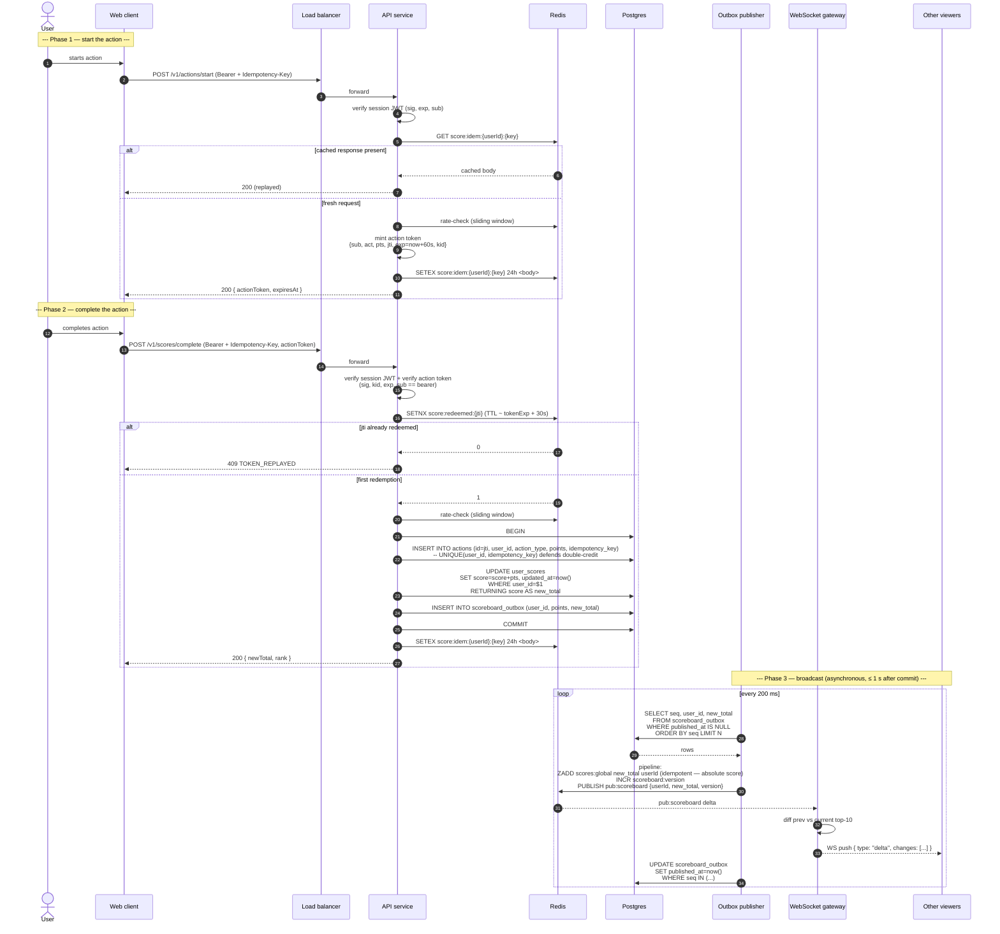
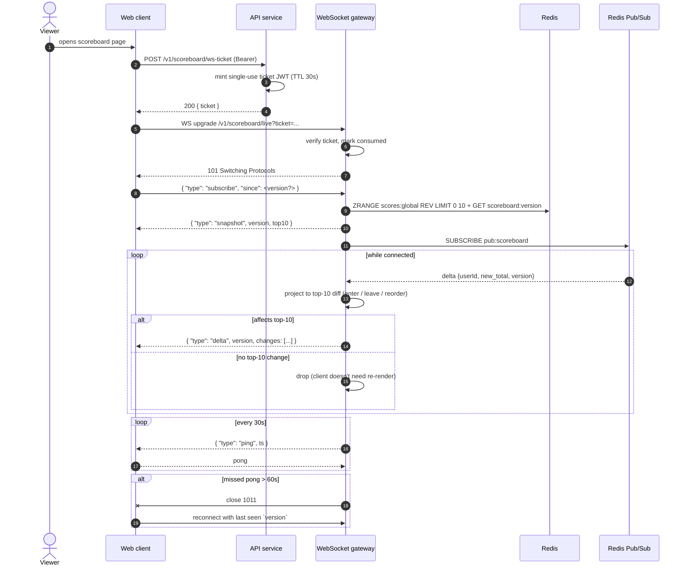
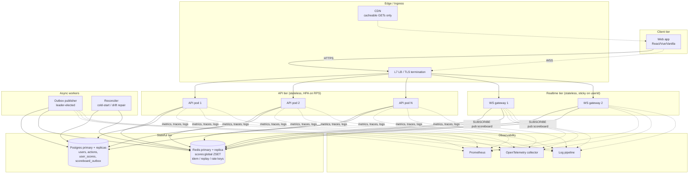
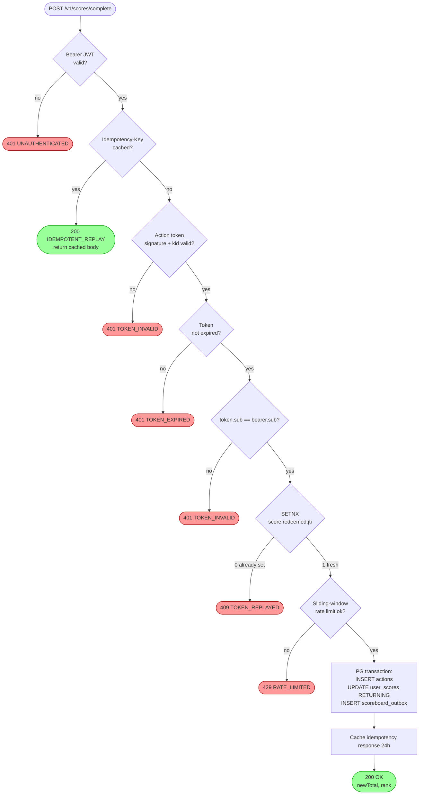

# Problem 6 — Flow of Execution

This document illustrates the flow of execution for the Live Scoreboard
module. It complements `README.md` (the full specification) by isolating
the runtime flows so an implementing engineer can keep the diagrams open
on a second screen while writing code.

The diagrams use [Mermaid](https://mermaid.js.org). Render in any
Mermaid-aware viewer (GitHub, GitLab, VS Code preview).

---

## 1. End-to-end: action start → score credited → live update

### Crash safety summary

| Crash point                                          | Effect                                                                                     |
| ---------------------------------------------------- | ------------------------------------------------------------------------------------------ |
| Before PG `COMMIT`                                   | Nothing happened. Client retries with the same Idempotency-Key — safe.                     |
| After PG `COMMIT`, before publisher reads            | Outbox row is durable. Publisher picks it up on next tick (≤ 1 s).                         |
| Publisher wrote Redis but didn't flag `published_at` | Re-publish on next tick. `ZADD <new_total>` is idempotent (absolute, not increment). Safe. |

---

## 2. Live channel lifecycle (WebSocket)

---

## 3. Component interaction (deployment view)

---

## 4. Authentication & anti-cheat decision flow

---

## 5. Outbox publisher state machine

```mermaid
stateDiagram-v2
  [*] --> Idle
  Idle --> Polling: tick (every 200ms)
  Polling --> Idle: no rows
  Polling --> Publishing: rows fetched
  Publishing --> Marking: Redis pipeline succeeded
  Publishing --> Backoff: Redis error
  Marking --> Idle: published_at set
  Marking --> Backoff: PG error
  Backoff --> Polling: exponential backoff (1s → 30s cap)
  Backoff --> Alerting: backlog > 1000 rows OR lag > 5s
  Alerting --> Polling: keep trying; humans paged
```

Key invariants:

- The publisher is **leader-elected** (e.g. via Postgres advisory lock or
  Kubernetes Lease). Exactly one publisher writes Redis at a time so
  `INCR scoreboard:version` produces a strict monotonic sequence.
- Re-publishing a row before `published_at` is set is **always safe** —
  the Redis side uses absolute `ZADD`, not `ZINCRBY`.
- The publisher never blocks the API write path. API latency is decoupled
  from Redis health.
