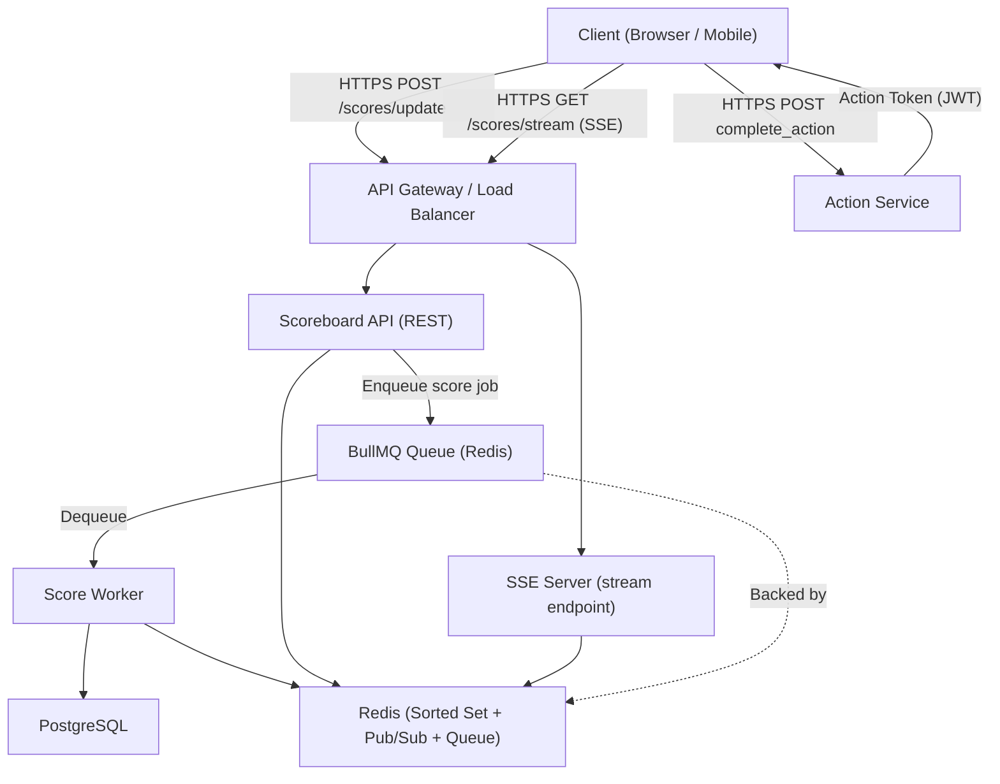
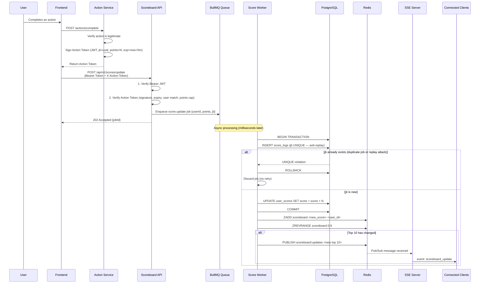
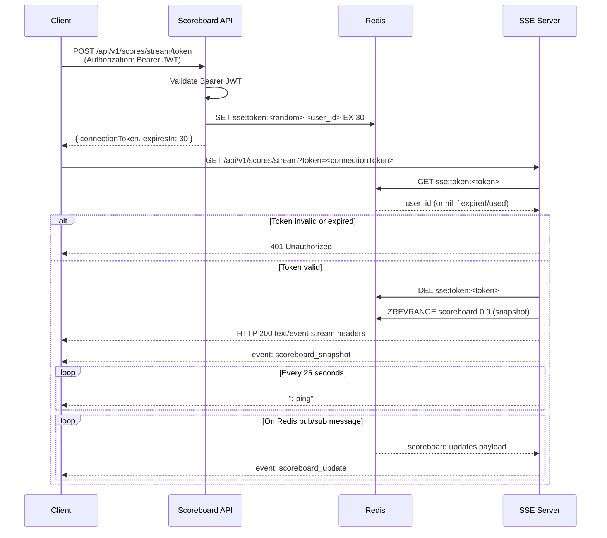
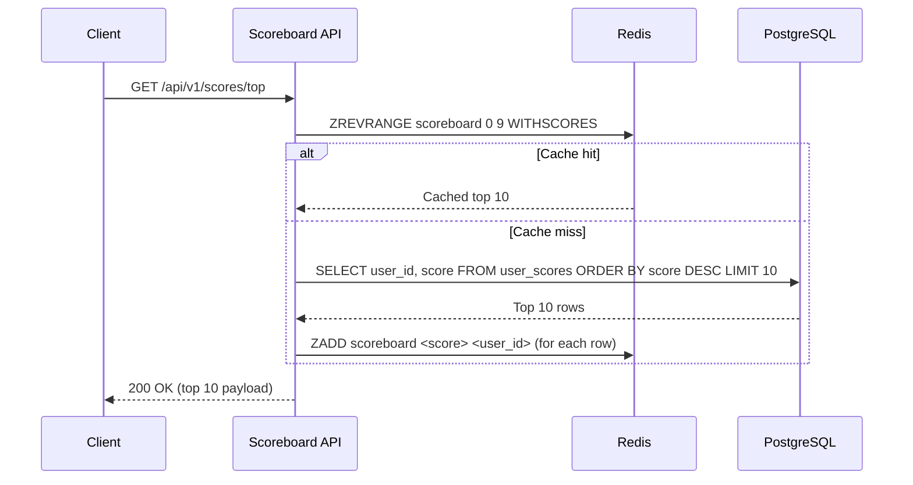

# Problem 6 — Live Scoreboard Module: Architecture Specification

## 1. Overview

This document describes the backend architecture for a **Live Scoreboard Module** — a service that maintains real-time top-10 user scores and pushes updates to connected clients.

### Core Responsibilities

- Persist user scores in a relational database
- Accept score update requests after a user completes a legitimate action; **validate synchronously, write asynchronously via a job queue**
- Serve the top-10 leaderboard via REST API (cache-backed for speed)
- Stream real-time leaderboard changes to subscribed clients via **Server-Sent Events (SSE)**
- Prevent score manipulation — clients must never be able to increment scores arbitrarily

### Why SSE over WebSocket

The scoreboard update channel is inherently **unidirectional**: the server pushes data, the client only listens. SSE is a better fit than WebSocket for this pattern because:

| Concern | SSE | WebSocket |
|---------|-----|-----------|
| Direction | Server → Client (perfect for push-only) | Bidirectional (unnecessary complexity here) |
| Protocol | Plain HTTP/1.1 or HTTP/2 | Upgrade handshake required |
| Load balancer support | Standard HTTP sticky sessions or stateless (HTTP/2) | Requires WS-aware proxies |
| Browser reconnection | Built into `EventSource` with `Last-Event-ID` | Must be implemented manually |
| Library overhead | None — native browser API + plain `res.write()` | Needs Socket.IO or `ws` library |
| Firewall/proxy traversal | No issues (HTTP traffic) | Some corporate proxies block upgrade |

### Why BullMQ over Other Queue Options

The score write path (DB insert → Redis update → SSE broadcast) is decoupled from the HTTP request using **BullMQ**. The alternatives and the reasoning:

| Option | Why Not Chosen |
|--------|---------------|
| **Bee-Queue** | Largely unmaintained; no delayed jobs, priorities, or dead-letter queues |
| **RabbitMQ** | Better message routing, but requires a separate broker — adds infra overhead when Redis is already in the stack |
| **SQS** | Fully managed and great on AWS, but higher latency (~1–10 ms) vs sub-ms Redis; vendor lock-in |
| **Kafka** | Designed for millions of events/sec; excellent for event sourcing, but operationally heavy for this scale |
| **BullMQ** ✓ | **Redis-backed** (reuses the Redis already required for the sorted set and pub/sub — zero extra infra); first-class TypeScript support; built-in retries with exponential backoff, dead-letter queues, job priorities, and Bull Board for observability |

**BullMQ gives us at-least-once delivery, automatic retries, and an ops dashboard with no additional infrastructure cost.**

### Terminology

| Term | Definition |
|------|-----------|
| **Client** | Browser or mobile application |
| **Action Service** | Backend service that validates a completed user action and issues an Action Token |
| **Scoreboard Service** | This module |
| **Action Token** | Short-lived JWT issued by the Action Service after verifying a legitimate action; carries the points value and a unique `jti` |
| **Connection Token** | Short-lived, single-use token exchanged for an SSE connection (solves the `EventSource` custom-header limitation) |
| **Score Job** | A BullMQ job enqueued after JWT validation, processed asynchronously by the Score Worker |
| **Score Worker** | BullMQ worker that executes the DB transaction, Redis update, and SSE broadcast |

---

## 2. High-Level Architecture



### Component Responsibilities

| Component | Role |
|-----------|------|
| **Action Service** | Validates that an action was genuinely completed, then signs an Action Token |
| **Scoreboard API** | Validates both JWTs synchronously; enqueues a `score.update` job; returns 202 immediately |
| **BullMQ Queue** | Persists score jobs in Redis; guarantees at-least-once delivery with configurable retries |
| **Score Worker** | Dequeues jobs; runs the anti-replay DB transaction; updates Redis sorted set; publishes SSE broadcast |
| **SSE Server** | Holds open HTTP response streams; subscribes to Redis pub/sub and writes `data:` events to each connected client |
| **Redis** | Sorted set (leaderboard cache), pub/sub (SSE broadcast bus), BullMQ job store, SSE connection tokens, rate-limit counters |
| **PostgreSQL** | Source of truth for all scores and an immutable audit log of every score change |

---

## 3. Technology Stack

| Layer | Choice | Rationale |
|-------|--------|-----------|
| Runtime | Node.js + TypeScript | Non-blocking I/O keeps thousands of SSE connections open cheaply; native async model suits queue workers |
| HTTP | Express.js | Lightweight; SSE needs only `res.setHeader` + `res.write` — no extra library |
| Real-time | Native SSE (`text/event-stream`) | Zero library overhead; `EventSource` is a W3C standard supported by all modern browsers |
| **Job Queue** | **BullMQ** | Redis-backed (reuses existing Redis); TypeScript-native; retries, backoff, dead-letter queues, Bull Board UI |
| Database | PostgreSQL | ACID transactions essential for the anti-replay + score update atomicity |
| Cache / Queue store | Redis | Sorted sets (leaderboard), pub/sub (SSE fan-out), BullMQ job storage — single Redis cluster covers all three |
| Auth | JWT (RS256) | Asymmetric — the public key can be distributed to validate tokens without sharing secrets |

---

## 4. Data Model

### 4.1 `user_scores` — Current aggregate score per user

```sql
CREATE TABLE user_scores (
    user_id     UUID PRIMARY KEY REFERENCES users(id),
    score       INTEGER NOT NULL DEFAULT 0 CHECK (score >= 0),
    updated_at  TIMESTAMPTZ NOT NULL DEFAULT NOW()
);

-- Covering index for top-N queries
CREATE INDEX idx_user_scores_score_desc ON user_scores (score DESC);
```

### 4.2 `score_logs` — Immutable audit trail of every change

```sql
CREATE TABLE score_logs (
    id              UUID PRIMARY KEY DEFAULT gen_random_uuid(),
    user_id         UUID NOT NULL REFERENCES users(id),
    action_token_id VARCHAR(255) NOT NULL UNIQUE,   -- jti from Action Token
    points          INTEGER NOT NULL,
    score_before    INTEGER NOT NULL,
    score_after     INTEGER NOT NULL,
    job_id          VARCHAR(255),                   -- BullMQ job ID for tracing
    created_at      TIMESTAMPTZ NOT NULL DEFAULT NOW()
);

CREATE INDEX idx_score_logs_user_time ON score_logs (user_id, created_at DESC);
```

The `UNIQUE` constraint on `action_token_id` is the database-level anti-replay guard. Even under concurrent retries from the queue worker, the second attempt to insert the same `jti` raises a unique violation and the job is discarded — the score is never double-incremented.

### 4.3 `sse_connection_tokens` — Short-lived tokens for SSE auth

```sql
CREATE TABLE sse_connection_tokens (
    token      VARCHAR(64) PRIMARY KEY,   -- cryptographically random
    user_id    UUID NOT NULL REFERENCES users(id),
    expires_at TIMESTAMPTZ NOT NULL,
    used       BOOLEAN NOT NULL DEFAULT FALSE
);
```

Rows are deleted by a background job after expiry. Alternatively, these can be stored in Redis with a TTL for lower latency (see Section 5.3).

### 4.4 Redis Data Structures

```
# Leaderboard sorted set — O(log N) insert, O(K) top-K retrieval
ZADD  scoreboard <score> <user_id>
ZREVRANGE scoreboard 0 9 WITHSCORES

# Pub/Sub channel for broadcasting to all SSE server instances
PUBLISH  scoreboard:updates  <JSON payload>

# SSE connection tokens (30-second TTL, single use)
SET  sse:token:<random_token>  <user_id>  EX 30

# BullMQ internal keys (managed automatically by BullMQ)
bull:score-updates:wait          # queued jobs
bull:score-updates:active        # jobs being processed
bull:score-updates:completed     # completed jobs (TTL-trimmed)
bull:score-updates:failed        # dead-letter jobs
```

---

## 5. API Design

### Authentication

All REST endpoints require a Bearer JWT in the `Authorization` header, issued by the Auth Service and signed with RS256. The Scoreboard Service validates the signature using the Auth Service's public key (loaded at startup; rotated via JWKS endpoint).

The SSE endpoint uses a different mechanism (see Section 5.3) because the browser's `EventSource` API does not support custom request headers.

### 5.1 `GET /api/v1/scores/top`

Returns the current top-N scores (default 10).

**Query Parameters:**

| Param | Type | Default | Max |
|-------|------|---------|-----|
| limit | integer | 10 | 100 |

**Response 200:**
```json
{
  "data": [
    { "rank": 1, "userId": "uuid-1", "displayName": "Alice", "score": 1520 },
    { "rank": 2, "userId": "uuid-2", "displayName": "Bob",   "score": 1480 }
  ],
  "limit": 10,
  "generatedAt": "2025-01-15T10:30:00Z"
}
```

**Caching strategy:** Served from Redis sorted set on a cache hit. On a cache miss (cold start or after Redis flush), falls back to a PostgreSQL query and repopulates Redis.

### 5.2 `POST /api/v1/scores/update`

Validates the request synchronously and enqueues an async job. Returns **202 Accepted** immediately — the actual score increment happens in the background worker. The client learns the new leaderboard via the SSE stream.

**Headers:**
```
Authorization:  Bearer <access_token>
X-Action-Token: <action_token_jwt>
```

**Optional body (metadata only — not trusted for score logic):**
```json
{ "actionType": "complete_level" }
```

> The `points` value comes exclusively from the Action Token's payload. The request body carries only optional metadata for logging.

**Synchronous validation steps (done in the API before enqueuing):**
1. Verify Bearer JWT signature and expiry
2. Verify Action Token signature, expiry, and user match (`sub` equality)
3. Verify `points` ≤ configured maximum

**Response 202 — job enqueued:**
```json
{
  "message": "Score update accepted",
  "jobId": "bull:score-updates:42"
}
```

The actual leaderboard change arrives via the SSE `scoreboard_update` event shortly after the worker commits.

**Error codes (returned synchronously — before enqueue):**

| HTTP | Code | Condition |
|------|------|-----------|
| 400 | `MISSING_ACTION_TOKEN` | `X-Action-Token` header absent |
| 401 | `INVALID_BEARER_TOKEN` | Bearer JWT invalid or expired |
| 403 | `INVALID_ACTION_TOKEN` | Action Token signature/expiry invalid |
| 403 | `USER_MISMATCH` | Action Token `sub` ≠ Bearer Token `sub` |
| 429 | `RATE_LIMIT_EXCEEDED` | Too many requests |
| 500 | `INTERNAL_ERROR` | Failed to enqueue job |

> **Note on `TOKEN_ALREADY_USED`:** Duplicate `jti` detection now happens inside the worker's DB transaction (via the `UNIQUE` constraint on `score_logs.action_token_id`). If a duplicate is detected, the worker marks the job as failed without retrying — no 403 is sent to the client since the response is already 202. The duplicate is recorded in the failed jobs list for audit.

### 5.3 SSE: `GET /api/v1/scores/stream`

Establishes a persistent HTTP connection that streams scoreboard updates using the `text/event-stream` content type.

#### Why Not Pass the JWT Directly in the URL?

The browser's `EventSource` API sends no custom headers; only the URL is controllable. Embedding a long-lived Bearer JWT as a query parameter risks:
- JWT exposure in server access logs, CDN logs, and browser history
- Token leakage via `Referer` header

#### Solution: Two-Step SSE Connection

**Step 1 — Exchange Bearer JWT for a short-lived connection token:**

```http
POST /api/v1/scores/stream/token
Authorization: Bearer <access_token>
```

Response 200:
```json
{ "connectionToken": "c8f2a1d9e7b3...", "expiresIn": 30 }
```

The connection token is a 32-byte cryptographically random string stored in Redis with a 30-second TTL. It is single-use and bound to the user ID.

**Step 2 — Open the SSE stream using the connection token:**

```http
GET /api/v1/scores/stream?token=c8f2a1d9e7b3...
Accept: text/event-stream
```

The server:
1. Looks up the token in Redis — rejects if missing, expired, or already used
2. Deletes the token (marks as used)
3. Sends headers and begins streaming

**Response headers:**
```
HTTP/1.1 200 OK
Content-Type: text/event-stream
Cache-Control: no-cache
Connection: keep-alive
X-Accel-Buffering: no        ← disables Nginx response buffering
```

**Event format — initial snapshot (sent immediately on connect):**
```
id: 1736934600000
event: scoreboard_snapshot
data: {"scores":[{"rank":1,"userId":"uuid-1","displayName":"Alice","score":1520}],"generatedAt":"2025-01-15T10:30:00Z"}

```

**Event format — incremental update (sent when top-N changes):**
```
id: 1736934605000
event: scoreboard_update
data: {"scores":[{"rank":1,"userId":"uuid-1","displayName":"Alice","score":1521}],"updatedAt":"2025-01-15T10:30:05Z"}

```

**Heartbeat (every 25 s, prevents proxy/firewall timeouts):**
```
: ping

```

**Client-side (browser):**
```javascript
const es = new EventSource("/api/v1/scores/stream?token=c8f2a1d9e7b3...");

es.addEventListener("scoreboard_snapshot", (e) => renderBoard(JSON.parse(e.data)));
es.addEventListener("scoreboard_update",   (e) => renderBoard(JSON.parse(e.data)));

es.onerror = () => {
  // EventSource reconnects automatically with exponential back-off.
  // The Last-Event-ID header is sent on reconnection so the server
  // can replay any missed events.
};
```

**Connection management:**

| Concern | Approach |
|---------|---------|
| Keepalive | Server writes `: ping\n\n` every 25 s |
| Automatic reconnection | Built into `EventSource` — browser retries with `Last-Event-ID` |
| Retry interval hint | Server sends `retry: 3000\n\n` on connect (3 s minimum backoff) |
| Max connections per user | 3 concurrent SSE connections tracked in Redis; 4th attempt returns 429 |
| Connection timeout | Server closes after 1 h; client reconnects automatically |
| Clean close on auth expiry | Server sends `event: auth_expired\ndata: {}\n\n` then closes the stream |

---

## 6. BullMQ Job Queue

### 6.1 Queue Configuration

```typescript
import { Queue, Worker, QueueEvents } from "bullmq";

const connection = { host: "redis", port: 6379 };

export const scoreQueue = new Queue("score-updates", {
  connection,
  defaultJobOptions: {
    attempts: 5,
    backoff: { type: "exponential", delay: 1000 }, // 1s, 2s, 4s, 8s, 16s
    removeOnComplete: { age: 3600 },  // keep completed jobs for 1 h
    removeOnFail:    { age: 86400 },  // keep failed jobs for 24 h (audit)
  },
});
```

### 6.2 Job Payload

```typescript
interface ScoreUpdateJobData {
  userId:      string;
  points:      number;
  jti:         string;   // Action Token unique ID — anti-replay key
  actionType?: string;   // metadata only
  requestedAt: string;   // ISO timestamp of the original HTTP request
}
```

### 6.3 Worker Logic

```typescript
const scoreWorker = new Worker<ScoreUpdateJobData>(
  "score-updates",
  async (job) => {
    const { userId, points, jti } = job.data;

    // 1. Atomic anti-replay + score update in one transaction
    await db.transaction(async (trx) => {
      const before = await trx("user_scores")
        .where({ user_id: userId })
        .select("score")
        .first();

      await trx("score_logs").insert({
        user_id:         userId,
        action_token_id: jti,          // UNIQUE — throws on duplicate
        points,
        score_before:    before.score,
        score_after:     before.score + points,
        job_id:          job.id,
      });

      await trx("user_scores")
        .where({ user_id: userId })
        .increment("score", points);
    });

    // 2. Update Redis sorted set
    const newScore = await db("user_scores")
      .where({ user_id: userId })
      .select("score")
      .first();
    await redis.zadd("scoreboard", newScore.score, userId);

    // 3. Check if top 10 changed and broadcast via pub/sub
    const top10 = await redis.zrevrange("scoreboard", 0, 9, "WITHSCORES");
    await redis.publish("scoreboard:updates", JSON.stringify(buildTop10(top10)));
  },
  {
    connection,
    concurrency: 10,   // process up to 10 jobs in parallel
  }
);

// Handle duplicate jti — do not retry, just discard
scoreWorker.on("failed", (job, err) => {
  if (err.message.includes("unique constraint")) {
    job?.discard();   // move to failed list without further retries
    logger.warn({ jti: job?.data.jti }, "Duplicate action token discarded");
  }
});
```

### 6.4 Dead-Letter Handling

Jobs that exhaust all 5 retry attempts (e.g. due to a database outage) land in the `bull:score-updates:failed` list. An operator can inspect and replay them via **Bull Board** (the BullMQ UI dashboard) once the outage is resolved — no score events are permanently lost.

---

## 7. Execution Flow Diagrams

### 7.1 Score Update Flow (with BullMQ)



### 7.2 SSE Connection Flow



### 7.3 Top-10 Query Flow



---

## 8. Security

### 8.1 Action Token Design

The Action Token is the central anti-fraud mechanism. By keeping point values inside a server-signed token, the client can never modify how many points an action is worth.

| Property | Value |
|----------|-------|
| Issuer | Action Service (server-side only) |
| Algorithm | RS256 (asymmetric — public key distributed to Scoreboard Service) |
| Lifetime | 5 minutes (long enough for a slow network; short enough to limit replay window) |
| Key claims | `jti` (UUID), `sub` (user ID), `points` (integer, 1–10), `iat`, `exp` |
| Single-use | `jti` stored in `score_logs` (UNIQUE); duplicate → job discarded |

**Validation checklist (all verified synchronously in the API before enqueue):**

1. RS256 signature valid
2. Token not expired (`exp`)
3. `sub` in Action Token matches `sub` in Bearer Token
4. `points` ≤ configured maximum (defence-in-depth)

**Duplicate `jti` check:** Performed by the worker's DB `INSERT` — if the constraint fires, the job is discarded immediately without retrying, and the event is logged for audit.

### 8.2 SSE Connection Token Security

| Property | Value |
|----------|-------|
| Format | 32 bytes from `crypto.randomBytes` — URL-safe base64 |
| Storage | Redis with 30-second TTL |
| Single-use | Deleted from Redis immediately on first use |
| Binding | Bound to `user_id`; the SSE server tracks the authenticated user per stream |
| Leak mitigation | Short TTL means a stolen token is useless after 30 s; consumed on use |

### 8.3 Rate Limiting

Implemented via Redis sliding-window counters.

| Scope | Limit | Window |
|-------|-------|--------|
| Score updates per user | 30 requests | 1 hour |
| Top-scores reads per user | 120 requests | 1 minute |
| SSE connection token issuance per user | 10 requests | 1 minute |
| Concurrent SSE connections per user | 3 streams | — |
| All endpoints per IP | 200 requests | 1 minute |

### 8.4 Atomicity — Preventing TOCTOU

The anti-replay check and the score increment run inside a single PostgreSQL transaction **inside the worker**:

```
BEGIN
  INSERT INTO score_logs (action_token_id = jti, ...)  -- UNIQUE — fails on duplicate
  UPDATE user_scores SET score = score + points WHERE user_id = ?
COMMIT
```

Because this runs in the worker (not the API handler), multiple concurrent worker instances processing the same `jti` are still safe — only one INSERT can succeed; the other(s) receive a unique violation and discard the job.

### 8.5 Additional Hardening

- **HTTPS only** — SSE runs over HTTPS just like any other endpoint
- **CORS** — restricted to trusted frontend origins
- **`X-Accel-Buffering: no`** — prevents Nginx from buffering SSE responses
- **Input validation** — all request fields validated before enqueue
- **Structured logging** — every job logged with userId, jti, jobId, and outcome
- **Stream close on auth expiry** — if the user's Bearer JWT expires while an SSE stream is open, the server sends an `auth_expired` event and closes

---

## 9. Error Response Format

All REST error responses share a consistent envelope:

```json
{
  "status": "error",
  "code": "INVALID_ACTION_TOKEN",
  "message": "Action token signature is invalid or expired",
  "timestamp": "2025-01-15T10:30:00Z"
}
```

SSE stream errors are sent as named events before the connection is closed:

```
event: error
data: {"code":"AUTH_EXPIRED","message":"Session expired, please reconnect"}

```

---

## 10. Operational Considerations

### Horizontal Scaling

The Scoreboard API is stateless — any instance can handle any REST request and enqueue jobs to the shared BullMQ queue. Workers can scale independently of the API; adding more worker instances increases throughput linearly. Redis pub/sub keeps all SSE server nodes in sync.

```
                  ┌──────────────┐
                  │ Load Balancer│
                  └──────┬───────┘
          ┌───────────────┼───────────────┐
   ┌──────┴──────┐ ┌──────┴──────┐ ┌─────┴───────┐
   │  API Node 1 │ │  API Node 2 │ │  SSE Node 1 │
   └──────┬──────┘ └──────┬──────┘ └─────┬───────┘
          └───────────────┼───────────────┘
                  ┌───────┴────────┐
                  │ Redis (Cluster)│   ← queue + sorted set + pub/sub + tokens
                  └───────┬────────┘
              ┌───────────┴───────────┐
       ┌──────┴──────┐        ┌───────┴──────┐
       │  Worker 1   │        │  Worker 2    │   ← scale independently
       └─────────────┘        └──────────────┘
```

### Resilience

| Failure | Mitigation |
|---------|-----------|
| Redis unavailable | API cannot enqueue jobs → returns 503; workers pause and resume when Redis recovers; no jobs are lost (BullMQ persists to Redis AOF) |
| PostgreSQL slow / down | Worker retries with exponential backoff (up to 5 attempts); jobs accumulate in the queue and drain when DB recovers |
| Worker crash mid-job | BullMQ moves the job back to the `waiting` state after a stall timeout; another worker picks it up — at-least-once guarantee |
| SSE node crash | `EventSource` reconnects automatically; client receives a fresh snapshot on reconnection |
| All workers down | Jobs queue up in Redis; leaderboard reads and SSE still work (Redis sorted set is untouched); score updates are delayed, not lost |

---

## 11. Possible Improvements

| Improvement | Benefit |
|-------------|---------|
| **Event replay with `Last-Event-ID`** | Store the last N emitted events in Redis (`LPUSH sse:history` + `LTRIM`). On reconnection, replay events since the client's `Last-Event-ID` so no update is missed. |
| **Bull Board dashboard** | Mount the `@bull-board/express` adapter to get a real-time UI for monitoring queue depth, failed jobs, and retry status — zero extra infra. |
| **CQRS** | Separate write model (PostgreSQL, strict consistency) from read model (Redis sorted set, eventual consistency). Reads never touch the DB. |
| **Category leaderboards** | Daily / weekly / all-time boards using separate Redis sorted sets with TTL rotation. |
| **User rank endpoint** | `GET /api/v1/scores/rank/:userId` via `ZREVRANK` — O(log N), no pagination needed. |
| **Anomaly detection** | Flag accounts with abnormally high action completion rates or score changes from multiple geographic regions. |
| **Circuit breaker** | Wrap Redis and PostgreSQL calls; serve stale data rather than cascading failures when a dependency is degraded. |
| **JWKS key rotation** | Poll the Auth Service's JWKS endpoint on a schedule; rotate public keys without redeploying. |
