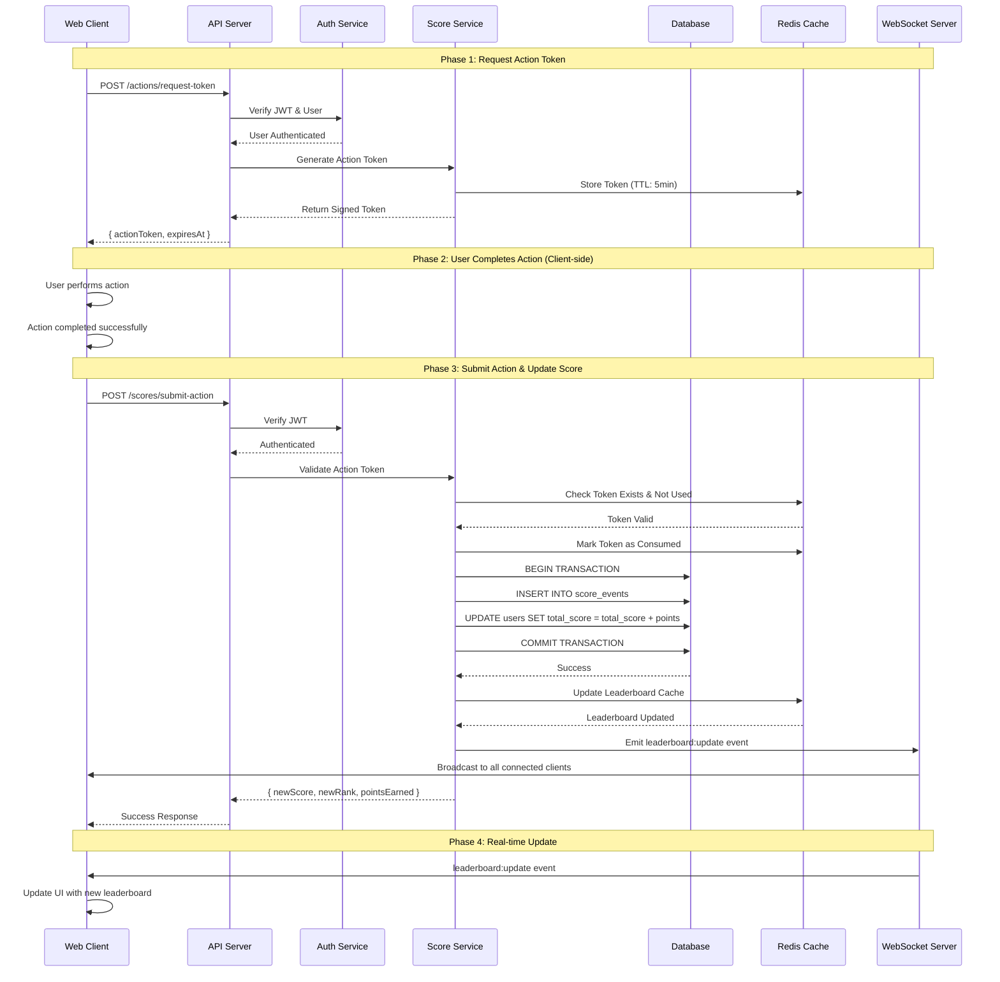

# Problem 6: Real-Time Score Board API Service - Architecture Specification

## 📋 Table of Contents

- [Overview](#overview)
- [System Architecture](#system-architecture)
- [Component Design](#component-design)
- [API Specifications](#api-specifications)
- [Data Models](#data-models)
- [Execution Flow Diagrams](#execution-flow-diagrams)
- [Security & Authorization](#security--authorization)
- [Real-Time Updates](#real-time-updates)
- [Performance Considerations](#performance-considerations)
- [Deployment Architecture](#deployment-architecture)
- [Improvements & Recommendations](#improvements--recommendations)

---

## Overview

This document specifies the architecture for a **Real-Time Score Board API Service** that enables:
- Live score updates for users performing actions
- Top 10 leaderboard display
- Secure, authorized score increments
- Real-time updates to all connected clients
- Protection against malicious score manipulation

### Key Requirements

1. ✅ Display top 10 users on a live score board
2. ✅ Real-time score board updates across all clients
3. ✅ User actions trigger score increments
4. ✅ API calls to backend server for score updates
5. ✅ Prevention of unauthorized score manipulation

---

## System Architecture

### High-Level Architecture

```
┌─────────────────────────────────────────────────────────────────┐
│                         Client Layer                            │
│  ┌──────────────┐  ┌──────────────┐  ┌──────────────┐           │
│  │   Web App    │  │   Web App    │  │   Web App    │           │
│  │  (Browser)   │  │  (Browser)   │  │  (Browser)   │           │
│  └──────┬───────┘  └──────┬───────┘  └──────┬───────┘           │
│         │                  │                  │                 │
│         │ WebSocket        │ WebSocket        │ WebSocket       │
│         │ REST API         │ REST API         │ REST API        │
└─────────┼──────────────────┼──────────────────┼─────────────────┘
          │                  │                  │
          ▼                  ▼                  ▼
┌─────────────────────────────────────────────────────────────────┐
│                      Load Balancer (Optional)                   │
└─────────────────────────────────────────────────────────────────┘
          │
          ▼
┌─────────────────────────────────────────────────────────────────┐
│                      Application Server                         │
│  ┌──────────────────────────────────────────────────────────┐   │
│  │              API Gateway / Express Server                │   │
│  │  ┌────────────┐  ┌────────────┐  ┌──────────────────┐    │   │
│  │  │  REST API  │  │ WebSocket  │  │  Auth Middleware │    │   │
│  │  │ Endpoints  │  │   Server   │  │                  │    │   │
│  │  └────────────┘  └────────────┘  └──────────────────┘    │   │
│  └──────────────────────────────────────────────────────────┘   │
│  ┌──────────────────────────────────────────────────────────┐   │
│  │                  Business Logic Layer                    │   │
│  │  ┌──────────────┐  ┌─────────────┐  ┌───────────────┐    │   │
│  │  │Score Service │  │Auth Service │  │  Leaderboard  │    │   │
│  │  │              │  │             │  │   Service     │    │   │
│  │  └──────────────┘  └─────────────┘  └───────────────┘    │   │
│  └──────────────────────────────────────────────────────────┘   │
│  ┌──────────────────────────────────────────────────────────┐   │
│  │                     Cache Layer (Redis)                  │   │
│  │  - Top 10 Leaderboard Cache                              │   │
│  │  - User Session Data                                     │   │
│  │  - Rate Limiting Counters                                │   │
│  └──────────────────────────────────────────────────────────┘   │
└─────────────────────────────────────────────────────────────────┘
          │
          ▼
┌─────────────────────────────────────────────────────────────────┐
│                      Database Layer                             │
│  ┌──────────────────┐         ┌────────────────────────┐        │
│  │  Primary DB      │◄───────►│   Read Replicas        │        │
│  │  (PostgreSQL/    │         │   (Optional for scale) │        │
│  │   MySQL)         │         │                        │        │
│  │  - Users         │         │                        │        │
│  │  - Scores        │         │                        │        │
│  │  - Actions Log   │         │                        │        │
│  └──────────────────┘         └────────────────────────┘        │
└─────────────────────────────────────────────────────────────────┘
```

---

## Component Design

### 1. **API Gateway / Express Server**

**Responsibilities:**
- Handle incoming HTTP/HTTPS requests
- Route requests to appropriate services
- Manage WebSocket connections for real-time updates
- Apply authentication and authorization middleware
- Rate limiting and request validation

**Tech Stack:**
- **Framework**: Express.js or Fastify
- **WebSocket**: Socket.io or ws
- **Language**: Node.js (TypeScript)

### 2. **Authentication & Authorization Service**

**Responsibilities:**
- Verify user identity (JWT tokens, session tokens)
- Validate action authorization (ensure user can perform the action)
- Generate and verify cryptographic signatures for action completion
- Maintain session state

**Security Mechanisms:**
- JWT (JSON Web Tokens) with short expiration
- Action tokens with HMAC signatures
- CSRF protection
- Rate limiting per user

### 3. **Score Service**

**Responsibilities:**
- Process score increment requests
- Validate action completion proofs
- Update user scores in database
- Emit events for leaderboard updates
- Maintain audit log of score changes

**Key Features:**
- Idempotency keys to prevent duplicate submissions
- Atomic database transactions
- Action validation against server-side rules

### 4. **Leaderboard Service**

**Responsibilities:**
- Fetch and cache top 10 users
- Broadcast updates to connected clients via WebSocket
- Handle leaderboard queries efficiently
- Maintain real-time ranking calculations

### 5. **Cache Layer (Redis)**

**Purpose:**
- Store top 10 leaderboard (Sorted Set)
- Cache user session data
- Rate limiting counters
- Action completion tokens (with TTL)

### 6. **Database Layer**

**Primary Database Schema:**

```sql
-- Users table
CREATE TABLE users (
    id UUID PRIMARY KEY DEFAULT gen_random_uuid(),
    username VARCHAR(50) UNIQUE NOT NULL,
    email VARCHAR(255) UNIQUE NOT NULL,
    total_score BIGINT DEFAULT 0,
    created_at TIMESTAMP DEFAULT CURRENT_TIMESTAMP,
    updated_at TIMESTAMP DEFAULT CURRENT_TIMESTAMP
);

-- Scores/Actions table
CREATE TABLE score_events (
    id UUID PRIMARY KEY DEFAULT gen_random_uuid(),
    user_id UUID REFERENCES users(id),
    action_type VARCHAR(50) NOT NULL,
    points_earned INT NOT NULL,
    action_token VARCHAR(255) UNIQUE NOT NULL,
    metadata JSONB,
    created_at TIMESTAMP DEFAULT CURRENT_TIMESTAMP,
    INDEX idx_user_id (user_id),
    INDEX idx_created_at (created_at),
    INDEX idx_action_token (action_token)
);

-- Leaderboard materialized view (for performance)
CREATE MATERIALIZED VIEW leaderboard_top_100 AS
SELECT 
    u.id,
    u.username,
    u.total_score,
    RANK() OVER (ORDER BY u.total_score DESC) as rank
FROM users u
ORDER BY u.total_score DESC
LIMIT 100;

-- Index for fast leaderboard queries
CREATE INDEX idx_users_score ON users(total_score DESC);
```

---

## API Specifications

### Base URL
```
https://api.example.com/v1
```

### Authentication
All API requests require authentication via JWT token in the `Authorization` header:
```
Authorization: Bearer <jwt_token>
```

---

### 1. **Get Top 10 Leaderboard**

```http
GET /leaderboard/top10
```

**Response:**
```json
{
  "success": true,
  "data": {
    "leaderboard": [
      {
        "rank": 1,
        "userId": "uuid-123",
        "username": "player1",
        "score": 15000
      },
      {
        "rank": 2,
        "userId": "uuid-456",
        "username": "player2",
        "score": 12500
      }
      // ... up to 10 users
    ],
    "lastUpdated": "2026-01-25T10:30:00Z"
  }
}
```

---

### 2. **Request Action Token (Pre-authorization)**

Before a user performs an action, they request a cryptographically signed token:

```http
POST /actions/request-token
```

**Request Body:**
```json
{
  "actionType": "complete_task"
}
```

**Response:**
```json
{
  "success": true,
  "data": {
    "actionToken": "eyJhbGc...",  // HMAC-signed token
    "expiresAt": "2026-01-25T10:35:00Z",  // 5 minutes TTL
    "expectedPoints": 100
  }
}
```

**Purpose:** 
- Server pre-authorizes the action
- Token contains: userId, actionType, timestamp, nonce
- Token is stored in Redis with TTL
- Prevents replay attacks

---

### 3. **Submit Action Completion (Update Score)**

After completing the action, client submits the token:

```http
POST /scores/submit-action
```

**Request Body:**
```json
{
  "actionToken": "eyJhbGc...",  // Token from step 2
  "actionProof": {
    "completedAt": "2026-01-25T10:33:00Z",
    "metadata": {
      // Optional action-specific data
    }
  }
}
```

**Response:**
```json
{
  "success": true,
  "data": {
    "pointsEarned": 100,
    "newTotalScore": 5600,
    "newRank": 15,
    "wasInTop10": false
  }
}
```

**Server-side Processing:**
1. Verify JWT authentication
2. Validate `actionToken` signature
3. Check token hasn't been used (idempotency)
4. Verify token hasn't expired
5. Mark token as consumed in Redis
6. Update user score in database (atomic transaction)
7. Update leaderboard cache
8. Broadcast WebSocket event if top 10 changed
9. Return result

---

### 4. **Get User Profile & Score**

```http
GET /users/me
```

**Response:**
```json
{
  "success": true,
  "data": {
    "userId": "uuid-123",
    "username": "player1",
    "totalScore": 5600,
    "rank": 15,
    "recentActions": [
      {
        "actionType": "complete_task",
        "points": 100,
        "timestamp": "2026-01-25T10:33:00Z"
      }
    ]
  }
}
```

---

### 5. **WebSocket Events**

**Connection:**
```javascript
const socket = io('wss://api.example.com', {
  auth: {
    token: 'jwt_token_here'
  }
});
```

**Server → Client Events:**

```javascript
// Leaderboard update
socket.on('leaderboard:update', (data) => {
  // {
  //   leaderboard: [...top 10 users],
  //   updatedAt: "2026-01-25T10:33:00Z"
  // }
});

// User's score updated
socket.on('score:updated', (data) => {
  // {
  //   userId: "uuid-123",
  //   newScore: 5700,
  //   pointsEarned: 100,
  //   newRank: 14
  // }
});

// User entered top 10
socket.on('leaderboard:entry', (data) => {
  // {
  //   userId: "uuid-123",
  //   username: "player1",
  //   rank: 10,
  //   score: 10000
  // }
});
```

---

## Data Models

### TypeScript Interfaces

```typescript
// User Model
interface User {
  id: string;
  username: string;
  email: string;
  totalScore: number;
  createdAt: Date;
  updatedAt: Date;
}

// Score Event Model
interface ScoreEvent {
  id: string;
  userId: string;
  actionType: string;
  pointsEarned: number;
  actionToken: string;
  metadata?: Record<string, any>;
  createdAt: Date;
}

// Leaderboard Entry
interface LeaderboardEntry {
  rank: number;
  userId: string;
  username: string;
  score: number;
}

// Action Token Payload
interface ActionTokenPayload {
  userId: string;
  actionType: string;
  expectedPoints: number;
  nonce: string;
  issuedAt: number;
  expiresAt: number;
}

// Action Submission
interface ActionSubmission {
  actionToken: string;
  actionProof: {
    completedAt: Date;
    metadata?: Record<string, any>;
  };
}
```

---

## Execution Flow Diagrams

### Flow 1: User Action Completion & Score Update



### Flow 2: Real-Time Leaderboard Updates

```
┌─────────────┐
│   User A    │
│  (Client)   │
└──────┬──────┘
       │
       │ 1. Complete Action
       ├──────────────────────────────────┐
       │                                   ▼
       │                          ┌────────────────┐
       │                          │  API Server    │
       │                          │  Score Service │
       │                          └────────┬───────┘
       │                                   │
       │                          2. Update Database
       │                                   │
       │                                   ▼
       │                          ┌────────────────┐
       │                          │   PostgreSQL   │
       │                          │  total_score++ │
       │                          └────────┬───────┘
       │                                   │
       │                          3. Update Cache
       │                                   │
       │                                   ▼
       │                          ┌────────────────┐
       │                          │ Redis (ZADD)   │
       │                          │  Leaderboard   │
       │                          └────────┬───────┘
       │                                   │
       │                          4. Broadcast Event
       │                                   │
       │                                   ▼
       │                          ┌────────────────┐
┌──────▼──────┐                  │  WebSocket Hub │
│   User A    │◄─────────────────┤                ├─────────────┐
│  (Updated)  │   5. WS Event    │  Socket.io     │  5. WS Event│
└─────────────┘                  └────────────────┘             │
                                                                 │
┌─────────────┐                                        ┌────────▼──────┐
│   User B    │◄───────────────────────────────────────│   User C      │
│ (Spectator) │              5. WS Event               │  (Spectator)  │
└─────────────┘                                        └───────────────┘

All users see updated leaderboard in real-time!
```

### Flow 3: Security Token Validation

```
Client Request
      │
      ▼
┌─────────────────────────────────────┐
│   1. Extract JWT from Header        │
│      Authorization: Bearer <token>  │
└──────────────┬──────────────────────┘
               │
               ▼
┌─────────────────────────────────────┐
│   2. Verify JWT Signature           │
│      - Check expiration             │
│      - Validate issuer              │
│      - Extract userId               │
└──────────────┬──────────────────────┘
               │
               ├── Invalid ──► 401 Unauthorized
               │
               ▼ Valid
┌─────────────────────────────────────┐
│   3. Verify Action Token (HMAC)     │
│      - Signature validation         │
│      - Check expiration (5 min)     │
│      - Extract payload              │
└──────────────┬──────────────────────┘
               │
               ├── Invalid ──► 400 Bad Request
               │
               ▼ Valid
┌─────────────────────────────────────┐
│   4. Check Token Usage (Redis)      │
│      GET action_token:<token>       │
└──────────────┬──────────────────────┘
               │
               ├── Already Used ──► 409 Conflict
               │
               ▼ Not Used
┌─────────────────────────────────────┐
│   5. Mark Token as Consumed         │
│      SET action_token:<token> 1     │
│      EXPIRE 3600 (1 hour TTL)       │
└──────────────┬──────────────────────┘
               │
               ▼
┌─────────────────────────────────────┐
│   6. Process Score Update           │
│      (Atomic Transaction)           │
└─────────────────────────────────────┘
```

---

## Security & Authorization

### 1. **Action Token System (Preventing Unauthorized Score Increases)**

**Problem:** Prevent users from directly calling the score update API without actually completing actions.

**Solution: Two-Phase Token System**

**Phase 1: Token Request**
```typescript
// Server generates a cryptographically signed token
const actionToken = {
  userId: user.id,
  actionType: 'complete_task',
  expectedPoints: 100,
  nonce: crypto.randomBytes(16).toString('hex'),
  issuedAt: Date.now(),
  expiresAt: Date.now() + 5 * 60 * 1000 // 5 minutes
};

// Sign with HMAC
const signature = crypto
  .createHmac('sha256', process.env.ACTION_SECRET)
  .update(JSON.stringify(actionToken))
  .digest('hex');

const signedToken = `${Buffer.from(JSON.stringify(actionToken)).toString('base64')}.${signature}`;

// Store in Redis with TTL
await redis.setex(`action_token:${signature}`, 300, JSON.stringify(actionToken));
```

**Phase 2: Token Submission**
```typescript
// Client submits the token after completing action
// Server verifies:
1. Token signature is valid
2. Token hasn't expired
3. Token hasn't been used before (check Redis)
4. User ID in token matches authenticated user
5. Action type is allowed
```

**Benefits:**
- Server controls when actions can be performed
- Tokens expire quickly (5 minutes)
- One-time use only (idempotency)
- Cryptographic signature prevents tampering
- No client-side score calculation

### 2. **Rate Limiting**

**Per-User Rate Limiting:**
```typescript
// Using Redis
const rateLimitKey = `rate_limit:${userId}:${actionType}`;
const requestCount = await redis.incr(rateLimitKey);

if (requestCount === 1) {
  await redis.expire(rateLimitKey, 60); // 1 minute window
}

if (requestCount > 10) { // Max 10 actions per minute
  throw new TooManyRequestsError();
}
```

**Global Rate Limiting:**
```typescript
// Using middleware like express-rate-limit
import rateLimit from 'express-rate-limit';

const apiLimiter = rateLimit({
  windowMs: 15 * 60 * 1000, // 15 minutes
  max: 100, // Limit each IP to 100 requests per windowMs
  standardHeaders: true,
  legacyHeaders: false,
});

app.use('/api/', apiLimiter);
```

### 3. **Input Validation**

```typescript
import { z } from 'zod';

const ActionSubmissionSchema = z.object({
  actionToken: z.string().min(1),
  actionProof: z.object({
    completedAt: z.string().datetime(),
    metadata: z.record(z.any()).optional()
  })
});

// Validate request body
const validatedData = ActionSubmissionSchema.parse(req.body);
```

### 4. **SQL Injection Prevention**

Use parameterized queries or ORM:
```typescript
// ✅ Good: Parameterized query
const result = await db.query(
  'UPDATE users SET total_score = total_score + $1 WHERE id = $2',
  [points, userId]
);

// ❌ Bad: String concatenation
// const result = await db.query(`UPDATE users SET total_score = total_score + ${points} WHERE id = '${userId}'`);
```

### 5. **Audit Logging**

```typescript
// Log all score changes
await db.query(`
  INSERT INTO score_events (user_id, action_type, points_earned, action_token, metadata)
  VALUES ($1, $2, $3, $4, $5)
`, [userId, actionType, points, actionToken, metadata]);

// Benefits:
// - Detect suspicious patterns
// - Forensic analysis
// - Fraud detection
// - Compliance
```

---

## Real-Time Updates

### WebSocket Implementation (Socket.io)

**Server Setup:**
```typescript
import { Server } from 'socket.io';
import { verify } from 'jsonwebtoken';

const io = new Server(httpServer, {
  cors: {
    origin: process.env.CLIENT_URL,
    credentials: true
  }
});

// Authentication middleware
io.use(async (socket, next) => {
  try {
    const token = socket.handshake.auth.token;
    const decoded = verify(token, process.env.JWT_SECRET);
    socket.data.userId = decoded.userId;
    next();
  } catch (err) {
    next(new Error('Authentication failed'));
  }
});

// Connection handler
io.on('connection', (socket) => {
  console.log(`User ${socket.data.userId} connected`);
  
  // Join user's personal room
  socket.join(`user:${socket.data.userId}`);
  
  // Join global leaderboard room
  socket.join('leaderboard');
  
  socket.on('disconnect', () => {
    console.log(`User ${socket.data.userId} disconnected`);
  });
});

// Broadcast leaderboard updates
export function broadcastLeaderboardUpdate(leaderboard: LeaderboardEntry[]) {
  io.to('leaderboard').emit('leaderboard:update', {
    leaderboard,
    updatedAt: new Date().toISOString()
  });
}

// Notify specific user
export function notifyUserScoreUpdate(userId: string, data: any) {
  io.to(`user:${userId}`).emit('score:updated', data);
}
```

**Client Implementation:**
```typescript
import io from 'socket.io-client';

const socket = io('wss://api.example.com', {
  auth: {
    token: localStorage.getItem('jwt_token')
  }
});

socket.on('connect', () => {
  console.log('Connected to WebSocket');
});

socket.on('leaderboard:update', (data) => {
  // Update UI with new leaderboard
  updateLeaderboardUI(data.leaderboard);
});

socket.on('score:updated', (data) => {
  // Update user's score display
  updateUserScore(data.newScore, data.pointsEarned);
});

socket.on('disconnect', () => {
  console.log('Disconnected from WebSocket');
  // Implement reconnection logic
});
```

---

## Performance Considerations

### 1. **Leaderboard Caching Strategy**

**Redis Sorted Set:**
```typescript
// Update leaderboard in Redis when score changes
async function updateLeaderboardCache(userId: string, username: string, newScore: number) {
  await redis.zadd('leaderboard:global', newScore, `${userId}:${username}`);
  
  // Keep only top 100 for efficiency
  await redis.zremrangebyrank('leaderboard:global', 0, -101);
}

// Fetch top 10
async function getTop10() {
  const top10 = await redis.zrevrange('leaderboard:global', 0, 9, 'WITHSCORES');
  
  return top10.map((entry, index) => {
    const [userId, username] = entry.split(':');
    const score = top10[index + 1];
    return { rank: Math.floor(index / 2) + 1, userId, username, score };
  });
}
```

**Cache Invalidation:**
- Update cache on every score change
- Set TTL of 5 minutes as fallback
- Rebuild from database if cache miss

### 2. **Database Optimization**

**Indexes:**
```sql
-- Fast leaderboard queries
CREATE INDEX idx_users_score ON users(total_score DESC);

-- Fast user lookups
CREATE INDEX idx_users_id ON users(id);

-- Fast score event queries
CREATE INDEX idx_score_events_user_id ON score_events(user_id);
CREATE INDEX idx_score_events_token ON score_events(action_token);
```

**Materialized Views:**
```sql
-- Pre-computed leaderboard
CREATE MATERIALIZED VIEW leaderboard_top_100 AS
SELECT 
    u.id,
    u.username,
    u.total_score,
    RANK() OVER (ORDER BY u.total_score DESC) as rank
FROM users u
ORDER BY u.total_score DESC
LIMIT 100;

-- Refresh every minute
REFRESH MATERIALIZED VIEW CONCURRENTLY leaderboard_top_100;
```

### 3. **Horizontal Scaling**

**Stateless API Servers:**
- Store sessions in Redis, not in-memory
- Use load balancer for distributing requests
- Enable WebSocket sticky sessions

**Redis Cluster:**
- Shard data across multiple Redis nodes
- Use Redis Sentinel for high availability

**Database Read Replicas:**
- Direct read queries to replicas
- Write operations to primary
- Eventual consistency acceptable for leaderboard

### 4. **Connection Pooling**

```typescript
// PostgreSQL connection pool
import { Pool } from 'pg';

const pool = new Pool({
  host: process.env.DB_HOST,
  port: 5432,
  database: process.env.DB_NAME,
  user: process.env.DB_USER,
  password: process.env.DB_PASSWORD,
  max: 20, // Maximum pool size
  idleTimeoutMillis: 30000,
  connectionTimeoutMillis: 2000,
});
```

---

## Deployment Architecture

### Production Environment

```
┌──────────────────────────────────────────────────────────┐
│                     Cloud Provider (AWS/GCP/Azure)       │
│                                                           │
│  ┌────────────────────────────────────────────────────┐  │
│  │  CDN (CloudFront / CloudFlare)                     │  │
│  │  - Cache static assets                             │  │
│  │  - DDoS protection                                 │  │
│  └────────────┬───────────────────────────────────────┘  │
│               │                                           │
│  ┌────────────▼───────────────────────────────────────┐  │
│  │  Load Balancer (ALB / NLB)                         │  │
│  │  - SSL/TLS termination                             │  │
│  │  - Health checks                                   │  │
│  │  - Sticky sessions for WebSocket                   │  │
│  └────────┬───────────────────────┬───────────────────┘  │
│           │                       │                       │
│  ┌────────▼────────┐     ┌───────▼──────────┐           │
│  │  API Server 1   │     │  API Server 2    │           │
│  │  (Container)    │     │  (Container)     │           │
│  │  - Express.js   │     │  - Express.js    │           │
│  │  - Socket.io    │     │  - Socket.io     │           │
│  └────────┬────────┘     └───────┬──────────┘           │
│           │                       │                       │
│           └───────────┬───────────┘                       │
│                       │                                   │
│  ┌────────────────────▼────────────────────────────────┐ │
│  │  Redis Cluster (ElastiCache / Memorystore)         │ │
│  │  - Primary + Replicas                              │ │
│  │  - Automatic failover                              │ │
│  └─────────────────────────────────────────────────────┘ │
│                       │                                   │
│  ┌────────────────────▼────────────────────────────────┐ │
│  │  PostgreSQL (RDS / Cloud SQL)                      │ │
│  │  - Primary + Read Replicas                         │ │
│  │  - Automated backups                               │ │
│  │  - Multi-AZ deployment                             │ │
│  └─────────────────────────────────────────────────────┘ │
└──────────────────────────────────────────────────────────┘
```

### Container Orchestration (Kubernetes)

```yaml
apiVersion: apps/v1
kind: Deployment
metadata:
  name: scoreboard-api
spec:
  replicas: 3
  selector:
    matchLabels:
      app: scoreboard-api
  template:
    metadata:
      labels:
        app: scoreboard-api
    spec:
      containers:
      - name: api
        image: scoreboard-api:latest
        ports:
        - containerPort: 3000
        env:
        - name: DATABASE_URL
          valueFrom:
            secretKeyRef:
              name: db-credentials
              key: url
        - name: REDIS_URL
          valueFrom:
            secretKeyRef:
              name: redis-credentials
              key: url
        resources:
          requests:
            memory: "256Mi"
            cpu: "250m"
          limits:
            memory: "512Mi"
            cpu: "500m"
        livenessProbe:
          httpGet:
            path: /health
            port: 3000
          initialDelaySeconds: 30
          periodSeconds: 10
```

---

## Improvements & Recommendations

### 1. **Enhanced Security**

#### Implement Device Fingerprinting
```typescript
// Track devices to detect suspicious activity
const deviceFingerprint = crypto
  .createHash('sha256')
  .update(userAgent + ipAddress + acceptLanguage)
  .digest('hex');

await redis.setex(`device:${userId}:${deviceFingerprint}`, 86400, '1');
```

#### Add Anomaly Detection
```typescript
// Detect unusual score patterns
async function detectAnomalies(userId: string, points: number) {
  const recentScores = await db.query(`
    SELECT points_earned, created_at 
    FROM score_events 
    WHERE user_id = $1 
    AND created_at > NOW() - INTERVAL '1 hour'
    ORDER BY created_at DESC
    LIMIT 20
  `, [userId]);
  
  // Check for:
  // - Too many actions in short time
  // - Unusually high point values
  // - Perfect timing patterns (bot-like behavior)
  
  if (isAnomaly(recentScores, points)) {
    await flagForReview(userId);
    await notifyAdmin(userId, 'Suspicious activity detected');
  }
}
```

#### Implement CAPTCHA for Suspicious Users
```typescript
// Require CAPTCHA verification if flagged
if (user.isFlagged) {
  const captchaValid = await verifyCaptcha(req.body.captchaToken);
  if (!captchaValid) {
    throw new Error('CAPTCHA verification failed');
  }
}
```

### 2. **Performance Enhancements**

#### Implement Pagination for History
```typescript
// GET /users/me/history?page=1&limit=20
app.get('/users/me/history', async (req, res) => {
  const page = parseInt(req.query.page) || 1;
  const limit = parseInt(req.query.limit) || 20;
  const offset = (page - 1) * limit;
  
  const history = await db.query(`
    SELECT * FROM score_events
    WHERE user_id = $1
    ORDER BY created_at DESC
    LIMIT $2 OFFSET $3
  `, [req.user.id, limit, offset]);
  
  res.json({ data: history, page, limit });
});
```

#### Add GraphQL for Flexible Queries
```typescript
// Allow clients to request exactly what they need
type Query {
  leaderboard(top: Int = 10): [LeaderboardEntry!]!
  user(id: ID!): User
  me: User
}

type User {
  id: ID!
  username: String!
  score: Int!
  rank: Int!
  recentActions(limit: Int = 10): [ScoreEvent!]!
}
```

#### Implement CDN for Static Leaderboard
```typescript
// Cache leaderboard HTML/JSON at edge locations
// Update cache every 5 seconds via webhook
app.get('/leaderboard/static', async (req, res) => {
  res.set('Cache-Control', 'public, max-age=5');
  const leaderboard = await getTop10FromCache();
  res.json(leaderboard);
});
```

### 3. **Monitoring & Observability**

#### Add Comprehensive Logging
```typescript
import winston from 'winston';

const logger = winston.createLogger({
  level: 'info',
  format: winston.format.json(),
  transports: [
    new winston.transports.File({ filename: 'error.log', level: 'error' }),
    new winston.transports.File({ filename: 'combined.log' })
  ]
});

// Log all score updates
logger.info('Score updated', {
  userId,
  actionType,
  pointsEarned,
  newScore,
  timestamp: new Date()
});
```

#### Implement Metrics Collection
```typescript
import prometheus from 'prom-client';

const scoreUpdatesCounter = new prometheus.Counter({
  name: 'score_updates_total',
  help: 'Total number of score updates',
  labelNames: ['action_type', 'status']
});

const leaderboardCacheHitRatio = new prometheus.Gauge({
  name: 'leaderboard_cache_hit_ratio',
  help: 'Cache hit ratio for leaderboard queries'
});

// Expose metrics endpoint
app.get('/metrics', async (req, res) => {
  res.set('Content-Type', prometheus.register.contentType);
  res.end(await prometheus.register.metrics());
});
```

#### Set Up Alerts
```yaml
# Prometheus alert rules
groups:
  - name: scoreboard_alerts
    rules:
      - alert: HighErrorRate
        expr: rate(http_requests_total{status=~"5.."}[5m]) > 0.05
        annotations:
          summary: "High error rate detected"
      
      - alert: SlowDatabaseQueries
        expr: histogram_quantile(0.95, rate(db_query_duration_seconds_bucket[5m])) > 1
        annotations:
          summary: "Database queries are slow"
```

### 4. **Feature Additions**

#### Add Achievements System
```typescript
// Award badges for milestones
const achievements = [
  { id: 'first_100', name: 'Century', requirement: 100 },
  { id: 'top_10', name: 'Elite Player', requirement: 'rank <= 10' },
  { id: 'streak_7', name: 'Weekly Warrior', requirement: '7 day streak' }
];

async function checkAchievements(userId: string, newScore: number) {
  // Check and award achievements
  // Emit WebSocket event for achievement unlocked
}
```

#### Implement Leaderboard Periods
```typescript
// Multiple leaderboards: daily, weekly, monthly, all-time
app.get('/leaderboard/:period/top10', async (req, res) => {
  const { period } = req.params; // 'daily', 'weekly', 'monthly', 'all-time'
  
  const startDate = getStartDateForPeriod(period);
  
  const leaderboard = await db.query(`
    SELECT 
      u.id, 
      u.username, 
      SUM(se.points_earned) as period_score,
      RANK() OVER (ORDER BY SUM(se.points_earned) DESC) as rank
    FROM users u
    JOIN score_events se ON u.id = se.user_id
    WHERE se.created_at >= $1
    GROUP BY u.id, u.username
    ORDER BY period_score DESC
    LIMIT 10
  `, [startDate]);
  
  res.json({ data: leaderboard });
});
```

#### Add Social Features
```typescript
// Friend system
// Compare scores with friends
// Challenge friends
// Share achievements
```

### 5. **Scalability Improvements**

#### Implement Event-Driven Architecture
```typescript
// Use message queue (RabbitMQ, Kafka) for async processing
import { EventEmitter } from 'events';

const eventBus = new EventEmitter();

// Producer
eventBus.emit('score.updated', {
  userId,
  newScore,
  pointsEarned,
  timestamp: Date.now()
});

// Consumer
eventBus.on('score.updated', async (data) => {
  await updateLeaderboardCache(data);
  await checkAchievements(data.userId, data.newScore);
  await notifyFollowers(data.userId, data);
});
```

#### Database Sharding Strategy
```typescript
// Shard users by ID range
function getShardForUser(userId: string): string {
  const hash = crypto.createHash('md5').update(userId).digest('hex');
  const shardNumber = parseInt(hash.substring(0, 8), 16) % NUM_SHARDS;
  return `shard_${shardNumber}`;
}
```

### 6. **Testing Recommendations**

```typescript
// Unit tests
describe('ScoreService', () => {
  it('should update user score atomically', async () => {
    const result = await scoreService.updateScore(userId, 100);
    expect(result.newScore).toBe(previousScore + 100);
  });
  
  it('should prevent duplicate token usage', async () => {
    await scoreService.submitAction(token);
    await expect(scoreService.submitAction(token)).rejects.toThrow('Token already used');
  });
});

// Integration tests
describe('API Endpoints', () => {
  it('should return top 10 leaderboard', async () => {
    const response = await request(app).get('/leaderboard/top10');
    expect(response.status).toBe(200);
    expect(response.body.data.leaderboard).toHaveLength(10);
  });
});

// Load tests (using k6 or Artillery)
// Performance benchmarks
// Security penetration testing
```

---

## Conclusion

This architecture provides:

✅ **Secure** score update mechanism with cryptographic tokens  
✅ **Real-time** leaderboard updates via WebSocket  
✅ **Scalable** design with caching and horizontal scaling  
✅ **Performant** with Redis caching and database optimization  
✅ **Auditable** with comprehensive logging  
✅ **Extensible** for future features

The two-phase token system ensures that only authorized actions result in score updates, preventing malicious users from artificially inflating their scores. The combination of WebSocket for real-time updates and Redis caching ensures the leaderboard stays responsive even under high load.

### Next Steps for Implementation Team

1. Set up development environment with PostgreSQL + Redis
2. Implement authentication service with JWT
3. Build score service with token generation and validation
4. Develop WebSocket server for real-time updates
5. Create leaderboard cache layer with Redis
6. Implement rate limiting and security measures
7. Add comprehensive testing suite
8. Deploy to staging environment
9. Perform load testing and security audit
10. Deploy to production with monitoring

**Estimated Implementation Time**: 4-6 weeks for MVP with a team of 3-4 backend engineers.
