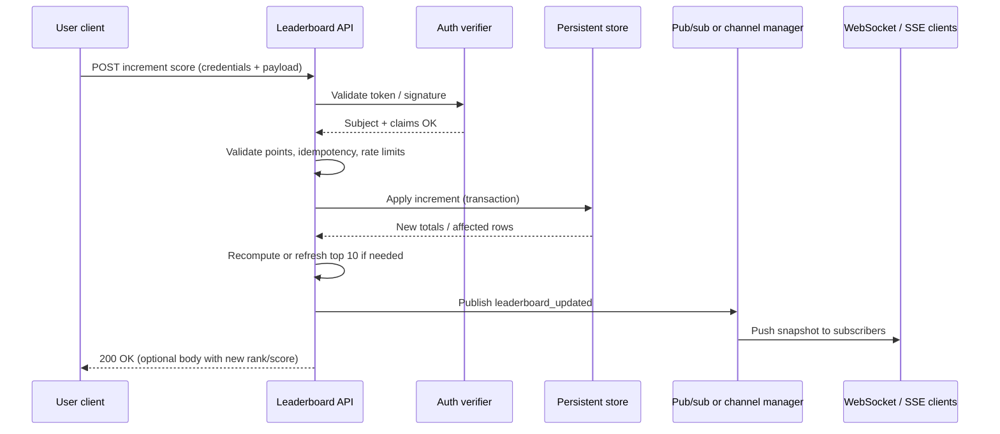
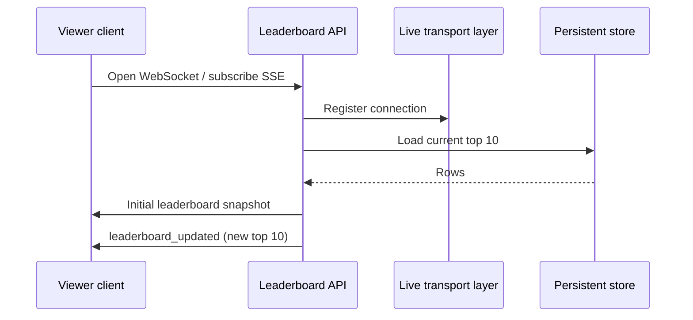
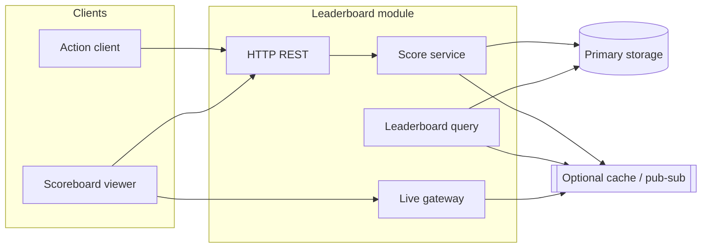

# Live Leaderboard API — Module Specification

This document specifies a backend module for an **API service** that maintains a **top-10 scoreboard**, accepts **authenticated score updates** after user actions, and delivers **live leaderboard updates** to connected clients. It is intended for handoff to a backend engineering team for implementation; technology choices below are **recommendations**, not mandates, unless marked as a hard requirement.

## 1. Goals and scope

### In scope

- Persist and expose the **top 10** users by score (ties broken by a deterministic rule—see [§4](#4-data-model)).
- Provide an HTTP API to **increment a user’s score** only when the caller is **authorised** to do so for that user.
- Support **live refresh** of the scoreboard for viewers (sub-second to low-second latency is desirable).
- **Prevent unauthorised score inflation** (malicious clients cannot arbitrarily increase scores).

### Out of scope (explicit)

- Definition or validation of the **user action** itself (game logic, task completion, anti-cheat on the client).
- User registration, profile management, or full identity lifecycle (assumed to exist or to be stubbed per environment).

---

## 2. Actors

| Actor                                 | Role                                                                                                                                                |
| ------------------------------------- | --------------------------------------------------------------------------------------------------------------------------------------------------- |
| **End user (browser/app)**            | Completes an action; the client then calls this API with credentials.                                                                               |
| **Scoreboard viewer**                 | Reads the leaderboard; may be the same user or anonymous.                                                                                           |
| **API service (this module)**         | Authenticates score updates, updates persisted scores, publishes leaderboard changes.                                                               |
| **Optional: Action / reward service** | May issue a **short-lived, signed “completion token”** proving an action was allowed (recommended pattern—see [§6](#6-security-and-authorisation)). |

---

## 3. Functional requirements

### 3.1 Leaderboard (read)

- The system must return the **current top 10** entries, each including at minimum:
  - **Rank** (1–10)
  - **User identifier** (opaque ID or public display handle—product decision)
  - **Score** (non-negative integer unless product specifies decimals)
- Ordering: **descending by score**; for ties, use a **stable rule** (e.g. earlier “first to reach that score” wins, or lexicographic user id—must be documented in implementation).

### 3.2 Score update (write)

- When a user **completes an action**, the client performs an **API call** to record the score increase.
- The server must **attribute the increase to exactly one user** and apply a **bounded increment** (see [§6](#6-security-and-authorisation)).
- The operation must be **idempotent** when a client retries the same logical completion (e.g. same idempotency key or signed token used once).

### 3.3 Live updates

- Viewers of the scoreboard must receive **updates without manual full-page refresh** when the top 10 **may have changed** (after any successful score update that affects the leaderboard, or on connect).
- Acceptable transports include **WebSocket**, **Server-Sent Events (SSE)**, or **long polling**; WebSocket or SSE are preferred for efficiency.

---

## 4. Data model

Minimal conceptual model (exact schema is an implementation detail):
| Entity / field | Description |
| -------------- | ----------- |
| **User score** | `user_id` (unique), `score` (integer ≥ 0), `updated_at` |
| **Leaderboard cache (optional)** | Materialised top 10 or Redis sorted set for fast read + broadcast |
**Recommendation:** maintain authoritative totals in a durable store; use a cache or periodic query for “top 10” if scale requires it.

---

## 5. API surface (normative behaviour)

Exact paths and JSON field names can be adjusted to fit existing API conventions; **behaviour** must match.

### 5.1 Get leaderboard (HTTP)

- **Method:** `GET`
- **Auth:** **Public** or **optional auth** (product decision). Anonymous viewers must not see anything that violates privacy policy (e.g. internal user ids).
- **Response:** `200` with body containing an ordered list of up to **10** entries (see [§3.1](#31-leaderboard-read)).

### 5.2 Increment score (HTTP)

- **Method:** `POST` (or `PATCH` if aligned with existing APIs)
- **Auth:** **Required** — caller must prove identity and right to increase **that** user’s score.
- **Request body (conceptual):**
  - `user_id` — target user (may be inferred from token instead of body to prevent tampering)
  - `points` — increment amount; **must be validated** (positive integer, **upper cap per request**)
  - Optional: `idempotency_key` or **one-time completion token** (see [§6](#6-security-and-authorisation))
- **Responses:**
  - `200` / `204` — applied; response may include new total and whether leaderboard changed
  - `401` — missing/invalid authentication
  - `403` — authenticated but not allowed to update this score
  - `409` — duplicate idempotency / token replay
  - `422` — invalid payload (e.g. points out of range)
  - `429` — rate limited

### 5.3 Live channel

- **Protocol:** WebSocket or SSE (or documented fallback).
- **Auth for subscribers:** **Public read** is acceptable for a public leaderboard; restrict if scores are sensitive.
- **Events:** At minimum, a **“leaderboard_updated”** (or equivalent) event carrying the **current top 10** snapshot after a relevant write, plus an initial snapshot on subscribe.

---

## 6. Security and authorisation

**Hard requirement:** score increases must not be possible for arbitrary unauthenticated clients.

### 6.1 Recommended patterns (choose one or combine)

1. **Session or JWT bound to user**  
   The client sends a **Bearer token** (or session cookie). The server **ignores `user_id` in the body** and derives the subject from the token, then increments **only that user’s** score. Prevents “change body to another user’s id” attacks.
2. **Signed completion token (service-to-service or client-presented)**  
   The component that **knows** the action completed issues a **short-lived signed JWT** (or HMAC token) including `user_id`, `points` (or allowed range), `exp`, and `jti` (nonce). The leaderboard API **verifies signature** with a shared secret or public key, enforces **one-time use** of `jti`, and applies the increment. Prevents fake completions even if the user tampers with the client.
3. **Rate limiting and caps**  
   Per IP, per user, and global limits; **maximum points per request** and **maximum increments per time window**.
4. **Idempotency**  
   Support `Idempotency-Key` header or intrinsic token `jti` so retries do not double-award.

### 6.2 Threats to mitigate

| Threat                                      | Mitigation                                                             |
| ------------------------------------------- | ---------------------------------------------------------------------- |
| Forged requests increasing any user’s score | AuthN + bind update to token subject or verify signed completion token |
| Replay of the same completion many times    | One-time tokens / idempotency store                                    |
| Brute-force high scores                     | Rate limits + server-side max points per event                         |
| Scraping or DoS on live endpoint            | Connection limits, optional auth, CDN/WAF in front                     |

---

## 7. Execution flow (diagrams)

### 7.1 Score update and broadcast (happy path)

### 7.2 Viewer connects for live leaderboard

### 7.3 Component view (logical)

---

## 8. Non-functional requirements

- **Consistency:** After a successful write, subsequent **GET** and **live** payloads must reflect the update within the **same server** or cluster consistency guarantees (eventual consistency across regions is acceptable if documented).
- **Availability:** Live connections should degrade gracefully (client reconnect with backoff).
- **Observability:** Metrics for update rate, auth failures, broadcast lag; structured logs without leaking secrets.

---

## 9. Open decisions for product / platform

- Public vs authenticated **read** of the leaderboard.
- Display **nickname** vs opaque id; GDPR / COPPA if applicable.
- Whether **anonymous** users have scores (usually no—require login).
