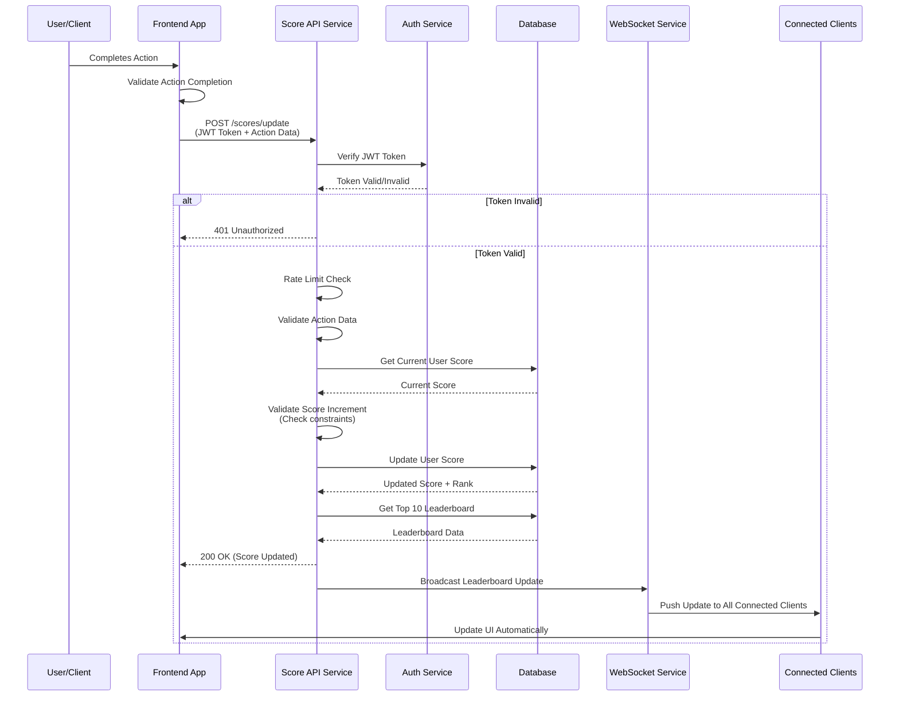

# Scoreboard API Module Specification

## Overview

This module handles score updates and provides real-time scoreboard functionality for a gaming/application website. It ensures secure, authorized score updates and maintains a live-updating leaderboard showing the top 10 user scores.

## Requirements Summary

1. **Scoreboard Display**: Show top 10 user scores in real-time
2. **Live Updates**: Scoreboard updates automatically when scores change
3. **Score Updates**: API endpoint to increment user scores upon action completion
4. **Authorization**: Prevent unauthorized users from manipulating scores
5. **Security**: Protect against malicious score injection

## Architecture Overview

### Components

1. **Score Update API**: REST endpoint to receive score increment requests
2. **Authentication/Authorization Service**: Validates user identity and permissions
3. **Score Storage**: Database/backend storage for user scores
4. **Real-time Notification System**: Pushes scoreboard updates to clients
5. **Rate Limiting**: Prevents abuse and excessive API calls
6. **Score Validation**: Ensures score updates are legitimate and within constraints

## API Endpoints

### 1. Update Score

**Endpoint**: `POST /api/v1/scores/update`

**Description**: Increments a user's score by a specified amount after validating authorization.

**Request Headers**:
```
Authorization: Bearer <JWT_TOKEN>
Content-Type: application/json
```

**Request Body**:
```json
{
  "actionId": "string",          // Unique identifier for the action completed
  "scoreIncrement": number,      // Amount to add to current score (typically 1)
  "timestamp": number            // Unix timestamp of action completion (for validation)
}
```

**Success Response** (200 OK):
```json
{
  "success": true,
  "message": "Score updated successfully",
  "data": {
    "userId": "string",
    "previousScore": number,
    "newScore": number,
    "rank": number               // Current rank in leaderboard
  }
}
```

**Error Responses**:

- `401 Unauthorized`: Invalid or missing authentication token
- `403 Forbidden`: User not authorized to update score
- `400 Bad Request`: Invalid request payload or validation failure
- `429 Too Many Requests`: Rate limit exceeded
- `500 Internal Server Error`: Server error

### 2. Get Scoreboard

**Endpoint**: `GET /api/v1/scores/leaderboard?limit=10`

**Description**: Retrieves the current top N users on the leaderboard.

**Query Parameters**:
- `limit` (optional): Number of top users to return (default: 10, max: 50)

**Success Response** (200 OK):
```json
{
  "success": true,
  "data": {
    "leaderboard": [
      {
        "userId": "string",
        "username": "string",
        "score": number,
        "rank": number,
        "lastUpdated": "ISO8601_timestamp"
      }
    ],
    "generatedAt": "ISO8601_timestamp"
  }
}
```

### 3. WebSocket Connection (Real-time Updates)

**Endpoint**: `WS /api/v1/scores/stream`

**Description**: WebSocket connection for real-time scoreboard updates.

**Authentication**: Token passed in connection query parameter or initial handshake message.

**Messages**:

**Client → Server**: 
```json
{
  "type": "subscribe",
  "token": "JWT_TOKEN"
}
```

**Server → Client** (scoreboard update):
```json
{
  "type": "leaderboard_update",
  "data": {
    "leaderboard": [...],
    "updatedAt": "ISO8601_timestamp"
  }
}
```

## Flow Diagram



## Implementation Details

### 1. Authentication & Authorization

- **JWT Token Validation**: All score update requests must include a valid JWT token in the Authorization header
- **User Identity Verification**: Extract user ID from validated JWT token (do not trust client-provided userId)
- **Action Verification**: Validate that the action being completed is legitimate and authorized for the user

**Implementation Requirements**:
- Token expiration validation
- Token signature verification
- User session validation
- Role-based access control if needed

### 2. Score Update Validation

- **Action ID Validation**: Verify actionId exists and is valid
- **Score Increment Limits**: Enforce maximum increment per action (e.g., typically 1, but configurable)
- **Timestamp Validation**: Verify action timestamp is recent (within reasonable window to prevent replay attacks)
- **Duplicate Prevention**: Check for duplicate action completions using actionId + userId

### 3. Rate Limiting

Implement rate limiting to prevent abuse:
- **Per User**: Maximum X score updates per minute/hour
- **Per IP**: Additional IP-based rate limiting as secondary defense
- **Action-specific**: Different limits for different action types if applicable

**Recommended Limits**:
- Per user: 60 updates/minute, 1000 updates/hour
- Per IP: 100 updates/minute
- Return `429 Too Many Requests` with `Retry-After` header when exceeded

### 4. Real-time Updates

**Option A: WebSocket (Recommended)**
- Maintain persistent WebSocket connections for clients
- Broadcast leaderboard updates when scores change
- Handle connection lifecycle (connect, disconnect, reconnection)

**Option B: Server-Sent Events (SSE)**
- Simpler unidirectional approach
- Easier to implement with HTTP/2
- Suitable if bidirectional communication isn't needed

**Option C: Polling**
- Fallback option, less efficient
- Client polls leaderboard endpoint at intervals (e.g., every 2-5 seconds)
- Higher server load, not true real-time

### 5. Database Schema

**Users Table**:
```sql
CREATE TABLE users (
    user_id VARCHAR(255) PRIMARY KEY,
    username VARCHAR(255) NOT NULL,
    created_at TIMESTAMP DEFAULT CURRENT_TIMESTAMP
);
```

**Scores Table**:
```sql
CREATE TABLE scores (
    user_id VARCHAR(255) PRIMARY KEY,
    score BIGINT NOT NULL DEFAULT 0,
    last_updated TIMESTAMP DEFAULT CURRENT_TIMESTAMP,
    FOREIGN KEY (user_id) REFERENCES users(user_id)
);

-- Index for leaderboard queries
CREATE INDEX idx_score_desc ON scores(score DESC);
```

**Action Logs Table** (for audit trail):
```sql
CREATE TABLE action_logs (
    log_id BIGSERIAL PRIMARY KEY,
    user_id VARCHAR(255) NOT NULL,
    action_id VARCHAR(255) NOT NULL,
    score_increment INT NOT NULL,
    previous_score BIGINT,
    new_score BIGINT,
    ip_address VARCHAR(45),
    timestamp TIMESTAMP DEFAULT CURRENT_TIMESTAMP,
    FOREIGN KEY (user_id) REFERENCES users(user_id),
    UNIQUE(user_id, action_id)  -- Prevent duplicate actions
);

CREATE INDEX idx_user_action ON action_logs(user_id, action_id);
CREATE INDEX idx_timestamp ON action_logs(timestamp);
```

### 6. Security Considerations

1. **Input Sanitization**: Validate and sanitize all input data
2. **SQL Injection Prevention**: Use parameterized queries/ORM
3. **XSS Prevention**: Sanitize data before sending to clients
4. **CSRF Protection**: Use CSRF tokens for state-changing operations
5. **Action Replay Prevention**: Use unique action IDs, timestamps, and nonces
6. **Audit Logging**: Log all score update attempts (successful and failed)
7. **Encryption**: Use HTTPS/TLS for all API communication
8. **Secrets Management**: Store JWT secrets and API keys securely (environment variables, secret managers)

### 7. Error Handling

- Return appropriate HTTP status codes
- Provide clear, actionable error messages (without exposing system details)
- Log errors server-side with sufficient context for debugging
- Implement retry logic for transient failures

### 8. Performance Considerations

- **Database Indexing**: Index scores table for efficient leaderboard queries
- **Caching**: Cache leaderboard in Redis/memory cache with TTL
- **Database Connection Pooling**: Use connection pools for database access
- **Async Processing**: Consider queue-based processing for high-traffic scenarios
- **Load Balancing**: Design for horizontal scalability

## Testing Requirements

### Unit Tests
- Score update logic
- Validation functions
- Rate limiting logic
- Authentication middleware

### Integration Tests
- API endpoint integration
- Database operations
- WebSocket connection handling
- End-to-end score update flow

### Security Tests
- Authentication bypass attempts
- Rate limit enforcement
- SQL injection attempts
- Authorization checks
- Duplicate action prevention

### Performance Tests
- Leaderboard query performance under load
- Concurrent score updates
- WebSocket connection limits
- Database query optimization

## Additional Improvement Comments

### 1. Enhanced Security

- **Two-Factor Verification**: For critical actions, require additional verification
- **Device Fingerprinting**: Track and validate devices to detect unusual patterns
- **Anomaly Detection**: Implement ML-based anomaly detection for suspicious score patterns
- **IP Geolocation**: Track and flag unusual geographic patterns
- **Behavioral Analysis**: Monitor user behavior patterns to detect bots or scripts

### 2. Performance Optimizations

- **Redis Leaderboard**: Use Redis Sorted Sets for O(log N) leaderboard operations
- **Write-Ahead Logging**: Batch score updates for high-traffic scenarios
- **Read Replicas**: Use database read replicas for leaderboard queries
- **CDN Integration**: Cache static leaderboard data at edge locations
- **Compression**: Compress WebSocket messages for bandwidth efficiency

### 3. Feature Enhancements

- **Historical Leaderboards**: Store snapshots for historical rankings
- **Seasonal Leaderboards**: Support time-bound competitions
- **Categories/Leagues**: Multiple leaderboards for different game modes
- **Score Decay**: Implement score decay over time to encourage active participation
- **Achievements**: Badge/achievement system tied to milestones

### 4. Monitoring & Observability

- **Metrics**: Track API response times, error rates, active connections
- **Alerting**: Set up alerts for unusual patterns (sudden score spikes, error rate increases)
- **Logging**: Structured logging with correlation IDs for request tracing
- **Health Checks**: Implement health check endpoints for load balancers
- **Distributed Tracing**: Use tracing tools (e.g., Jaeger, Zipkin) for microservices

### 5. User Experience

- **Pagination**: Support pagination for extended leaderboard views
- **User Search**: Allow users to search for their own ranking
- **Personal Stats**: Provide detailed statistics per user
- **Notification System**: Notify users when they enter/exit top 10
- **Leaderboard History**: Show ranking changes over time

### 6. Scalability Considerations

- **Microservices Architecture**: Split into separate services (Auth, Scores, Real-time)
- **Message Queue**: Use message queue (RabbitMQ, Kafka) for decoupling score updates from notifications
- **Caching Strategy**: Multi-layer caching (application, database query cache, CDN)
- **Database Sharding**: Partition users across multiple database shards if needed
- **Event Sourcing**: Consider event sourcing for audit trail and replay capabilities

### 7. Data Integrity

- **Transaction Management**: Ensure atomic score updates
- **Idempotency**: Make score update operations idempotent (same action won't be processed twice)
- **Consistency Checks**: Periodic jobs to verify score integrity
- **Backup Strategy**: Regular backups with point-in-time recovery capability

### 8. Documentation

- **API Documentation**: Use OpenAPI/Swagger for interactive API docs
- **WebSocket Protocol Docs**: Document WebSocket message formats and connection lifecycle
- **Deployment Guide**: Step-by-step deployment instructions
- **Runbook**: Operational procedures for common issues
- **Architecture Decision Records (ADRs)**: Document key architectural decisions

## Deployment Checklist

- [ ] Environment variables configured (JWT secret, DB connection, etc.)
- [ ] Database migrations applied
- [ ] SSL/TLS certificates configured
- [ ] Rate limiting configured and tested
- [ ] Monitoring and alerting set up
- [ ] Log aggregation configured
- [ ] Backup strategy implemented
- [ ] Load testing completed
- [ ] Security audit performed
- [ ] API documentation published
- [ ] WebSocket load balancer configuration verified

## Technology Stack Recommendations

- **API Framework**: Express.js, Fastify, NestJS (Node.js) or FastAPI, Django (Python)
- **Database**: PostgreSQL (primary), Redis (caching/leaderboard)
- **Real-time**: Socket.io, ws (WebSocket), or Server-Sent Events
- **Authentication**: JWT with refresh tokens
- **Rate Limiting**: express-rate-limit, redis-rate-limit
- **Validation**: Joi, Zod, or class-validator
- **Monitoring**: Prometheus, Grafana, or DataDog
- **Logging**: Winston, Pino, or structured logging framework

---

**Document Version**: 1.0  
**Last Updated**: [Date]  
**Author**: Backend Architecture Team  
**Review Status**: Ready for Implementation
