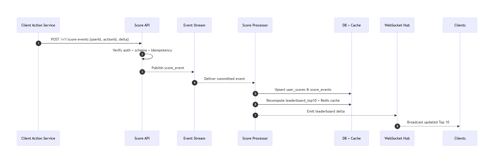
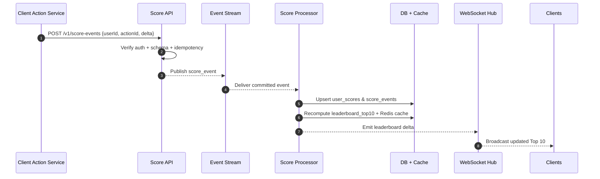

# Problem 6 – Live Scoreboard Module Specification

This document defines the backend module that powers a real-time scoreboard. It will be handed to the backend engineering team for implementation.

## Goals & Scope

- Expose secure APIs for incrementing user scores after an approved action.
- Maintain an always-fresh Top 10 leaderboard suitable for web display.
- Push live updates to connected clients with sub-second latency.
- Block unauthorized or replayed score updates.

## High-Level Requirements Mapping

| Requirement | Design Decision |
|-------------|-----------------|
| Display Top 10 scores on a website | Maintain a materialized `leaderboard_top10` cache refreshed on every score change. |
| Live updates | Provide a WebSocket (or Server-Sent Events) channel that broadcasts leaderboard deltas. |
| User action increases score | Accept signed POST requests that describe the action and awarded points. |
| Prevent malicious increments | Require short-lived auth tokens, enforce idempotency, and run server-side validation before applying scores. |

## Architecture Overview

1. **API Layer** (Express/Fastify/Hapi): validates requests, enforces auth, and publishes canonical score events.
2. **Event Stream** (e.g., Redis Streams, Kafka, or SQS): decouples ingestion from processing so bursts do not overload the DB.
3. **Score Processor**: consumes events, updates persistent storage, recalculates leaderboard cache, and emits update messages.
4. **Data Storage**: transactional database table `user_scores` plus in-memory cache (Redis) for quick Top 10 reads.
5. **Realtime Hub**: WebSocket service that fans out leaderboard updates to subscribed browsers.

## Data Model

### Tables

- `user_scores(user_id PK, score BIGINT, updated_at TIMESTAMP)`
- `score_events(event_id PK, user_id, delta INT, action_id UNIQUE, issued_by, processed_at)` – preserves audit trails.
- `leaderboard_top10(rank INT, user_id, score BIGINT, snapshot_at TIMESTAMP)`

### Caches

- Redis key `scoreboard:top10` storing serialized leaderboard payload.
- Redis key `scoreboard:user:<id>` (optional) for per-user score lookups.

## API Surface

| Method | Path | Purpose | Auth |
|--------|------|---------|------|
| `POST` | `/v1/score-events` | Submit a signed score increment event (`userId`, `actionId`, `delta`) | Required (JWT or HMAC) |
| `GET` | `/v1/leaderboard/top10` | Retrieve the current Top 10 snapshot (fallback for clients that cannot use WebSockets) | Optional read token |
| `GET` | `/v1/leaderboard/stream` | Establish WebSocket/SSE connection for live updates | Required (token in query/header) |

### Request Validation Rules

- `actionId` must be a UUID. Used for idempotency; duplicates return HTTP 200 with prior result but do not reprocess.
- `delta` must be positive and within product-configured max (e.g., `<= 100`). Larger values are rejected.
- `userId` must belong to an active account. Lookups are cached to mitigate DB hits.
- Auth token must include claims: issuer, expiry (≤5 minutes), and permission `score:update`.

## Execution Flow

## Security Controls

- **Authentication:** Short-lived JWT signed by trusted issuer or HMAC signature using per-client secret.
- **Authorization:** Only services with `score:update` scope may hit POST endpoint. WebSocket consumers require `scoreboard:read`.
- **Idempotency:** Enforce unique `actionId` per action. Store latest processed ID to avoid replay.
- **Rate Limiting:** Apply per-user and per-client throttle (e.g., 60 events/min). Bursts are queued to BUS if needed.
- **Input Hardening:** Use strict schema validation (Zod/Valibot/celebrate) and reject negative/overflowing deltas.

## Reliability & Performance

- **Eventual Consistency Bound:** With the BUS + processor design, leaderboard updates should appear within 200 ms under normal load.
- **Retry Strategy:** Failed processor attempts retry with exponential backoff; poison events are parked for manual review.
- **Cache Warmup:** Processor writes to Redis atomically; API GET fallback reads from cache first, then DB if missing.
- **Monitoring:** Emit metrics (`score_event_ingest`, `processing_latency_ms`, `ws_broadcast_failures`). Alert when lag > 1 s or when auth errors spike.

## Deployment Considerations

- Deploy API and processor pods separately so scaling ingestion does not slow WebSocket broadcast workers.
- Keep WebSocket hub sticky sessions behind a load balancer or use a shared pub/sub (Redis Pub/Sub, NATS) for fan-out.
- Database must support row-level locking to avoid race conditions when multiple processors update the same user score.

## Testing Strategy

1. **Unit Tests:** Validate scoring math, auth middleware, and idempotency logic.
2. **Integration Tests:** Run end-to-end flow using an ephemeral Redis + Postgres stack; assert leaderboard ordering.
3. **Security Tests:** Attempt replay attacks, negative delta injections, and token tampering.
4. **Load Tests:** Simulate 10k score events/min to verify processor throughput and WebSocket latency.

## Improvement Ideas & Notes

- Consider adding a **score decay** mechanic (e.g., last 24h) if business wants more dynamic leaderboards.
- Ship an **admin API** for manual score corrections and event inspection.
- Evaluate **gRPC** ingestion if multiple game engines submit score events; HTTP stays for broader compatibility.
- Future enhancement: push personalized notifications when a user enters/leaves the Top 10.

> Comment: If the live-update requirement extends to mobile push, reuse the event stream to fan out notifications, not just WebSocket updates. This avoids creating multiple parallel messaging paths.
