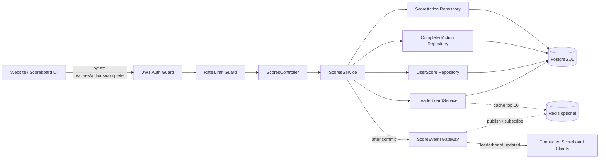
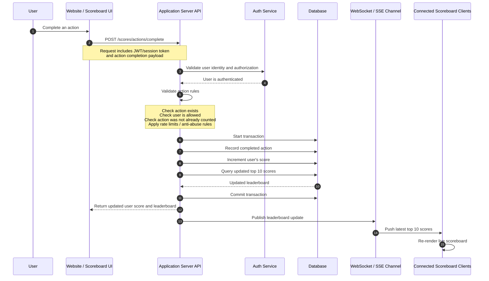

# Problem 6 - Scoreboard API Architecture

## Purpose

This document specifies the backend module responsible for recording completed
user actions, increasing user scores, returning the top 10 scoreboard, and
publishing live scoreboard updates to connected clients.

The module belongs to the application server API. The website calls this module
after a user completes an action. The module must verify the user, prevent
unauthorized or duplicated score updates, persist the score change safely, and
notify live scoreboard clients.

## Scope

This specification covers:

- API endpoint contract for completing a score-increasing action.
- Authentication and authorization requirements.
- Validation and anti-abuse rules.
- Database transaction behavior.
- Top 10 leaderboard query behavior.
- Live update publishing through WebSocket or Server-Sent Events.
- Failure behavior and improvement notes.

This specification does not define the product-specific action itself. The
module only needs enough action metadata to validate that the action is valid,
allowed, and not already counted.

## Recommended Technology

The backend implementation should use:

- NestJS for the API module structure, guards, validation pipes, services, and
  WebSocket gateway.
- PostgreSQL as the source of truth for users, scores, completed actions, and
  leaderboard queries.
- TypeORM, Prisma, or another NestJS-compatible PostgreSQL ORM. Prisma is a good
  choice for strict schema management, while TypeORM is also acceptable if the
  existing backend already uses it.
- `class-validator` and `class-transformer` for request DTO validation.
- Passport JWT or an existing NestJS auth guard for user authentication.
- `@nestjs/throttler` or API gateway rate limiting for anti-abuse protection.
- Redis is optional for caching, distributed rate limits, and WebSocket scaling,
  but PostgreSQL must remain the source of truth.

## Backend Architecture Design

The backend should be designed as a NestJS `ScoresModule` inside the application
server. PostgreSQL is the authoritative data store. Redis is optional, but it is
recommended for distributed rate limiting, leaderboard cache, and WebSocket
fan-out when the API runs on more than one instance.



### Backend Layers

| Layer | Responsibility |
| --- | --- |
| `ScoresController` | Exposes HTTP endpoints and maps request DTOs to service calls. |
| `JwtAuthGuard` | Verifies the user identity before any score-changing logic runs. |
| `ScoreRateLimitGuard` | Blocks excessive requests by user ID, IP address, and action ID. |
| `ScoresService` | Owns the action completion workflow and PostgreSQL transaction. |
| `LeaderboardService` | Reads the top 10 leaderboard and optional user rank. |
| Repositories or ORM delegates | Encapsulate PostgreSQL access for score actions, completed actions, and user scores. |
| `ScoreEventsGateway` | Publishes live leaderboard updates through WebSocket or SSE. |
| PostgreSQL | Source of truth for actions, completed action records, scores, and leaderboard queries. |
| Redis | Optional cache, distributed throttle store, and pub/sub adapter for scaled realtime updates. |

### Backend Request Lifecycle

1. `ScoresController.completeAction()` receives `POST /scores/actions/complete`.
2. `JwtAuthGuard` validates the JWT and attaches the authenticated user to the
   request context.
3. `ScoreRateLimitGuard` checks user/IP/action request frequency.
4. `ValidationPipe` validates `CompleteScoreActionDto` and removes unknown
   fields.
5. `ScoresService.completeAction()` starts a PostgreSQL transaction.
6. The service loads the server-side `score_actions` record and rejects inactive
   or unauthorized actions.
7. The service inserts `completed_score_actions` with unique constraints to
   prevent duplicate scoring.
8. The service increments `user_scores.score` by the server-owned
   `score_delta`.
9. The service reads the updated user score and top 10 leaderboard.
10. After transaction commit, `ScoreEventsGateway` publishes
    `leaderboard.updated` to connected clients.
11. The API returns the updated user score and leaderboard to the requesting
    website.

### Important Design Decisions

- The client never sends score delta or final score. It only sends the completed
  action identity and completion event identity.
- Duplicate prevention must be enforced by PostgreSQL unique constraints, not
  only by application code.
- Score update and completed-action insert must happen in the same transaction.
- Live events must be emitted only after successful commit.
- The leaderboard payload must contain only public display fields.
- If the product later has multiple application server instances, the WebSocket
  gateway needs a Redis adapter or message broker so every instance receives the
  same leaderboard update.

## Execution Flow



## API Contract

Recommended NestJS route ownership:

```text
ScoresModule
  ScoresController
  ScoresService
  LeaderboardService
  ScoreEventsGateway
  ScoreActionRepository
```

The route should be protected by an auth guard before entering controller
business logic.

### Complete Action

`POST /scores/actions/complete`

Records a completed user action and increments the authenticated user's score.

### Headers

```http
Authorization: Bearer <jwt>
Content-Type: application/json
Idempotency-Key: <unique-client-generated-key>
```

`Idempotency-Key` is recommended. If the same request is retried because of a
network issue, the API should return the original result instead of increasing
the score again.

### Request Body

```json
{
  "actionId": "daily-login",
  "completionId": "client-or-system-generated-unique-id",
  "completedAt": "2026-05-15T15:30:00.000Z",
  "metadata": {
    "source": "web"
  }
}
```

### Request Fields

| Field | Type | Required | Description |
| --- | --- | --- | --- |
| `actionId` | string | Yes | Identifier of the action that was completed. |
| `completionId` | string | Yes | Unique identifier for this completion event. Used to prevent duplicates. |
| `completedAt` | ISO datetime | Yes | Time the action was completed on the client or source system. |
| `metadata` | object | No | Optional non-sensitive details for validation, auditing, or analytics. |

The API must not trust score values from the client. The score increment must be
looked up from server-side action configuration.

### NestJS DTO

```ts
import { IsDateString, IsObject, IsOptional, IsString, MaxLength } from "class-validator";

export class CompleteScoreActionDto {
  @IsString()
  @MaxLength(100)
  actionId: string;

  @IsString()
  @MaxLength(150)
  completionId: string;

  @IsDateString()
  completedAt: string;

  @IsOptional()
  @IsObject()
  metadata?: Record<string, unknown>;
}
```

### Success Response

`200 OK`

```json
{
  "userScore": {
    "userId": "user_123",
    "score": 120,
    "rank": 8
  },
  "leaderboard": [
    {
      "rank": 1,
      "userId": "user_001",
      "displayName": "Alice",
      "score": 320
    }
  ]
}
```

The leaderboard array must contain at most 10 records ordered by score
descending. Ties should use a stable secondary order such as earliest score
update time, then user ID.

## Validation Rules

The API must validate the request in this order:

1. Authenticate the JWT or session token.
2. Confirm the authenticated user is allowed to complete the requested action.
3. Confirm `actionId` exists and is active.
4. Confirm the action has not already been counted for this user and completion
   event.
5. Confirm the action-specific frequency rule is satisfied, for example once
   per day or once per campaign.
6. Apply rate limits based on user ID, IP address, and action ID.
7. Reject suspicious metadata or invalid timestamps.

The server should return deterministic responses for duplicate requests. A
previously accepted duplicate should not increment score again.

In NestJS, the authentication check should be handled by a guard, while request
shape validation should be handled by a global `ValidationPipe` with
`whitelist: true` and `forbidNonWhitelisted: true`.

## Persistence Model

Recommended PostgreSQL tables:

### `users`

| Column | Description |
| --- | --- |
| `id` | Primary user identifier. |
| `display_name` | Public display name shown on the scoreboard. |
| `created_at` | User creation time. |

### `score_actions`

| Column | Description |
| --- | --- |
| `id` | Action identifier. |
| `score_delta` | Number of points awarded when completed. |
| `is_active` | Whether the action can currently award score. |
| `frequency_rule` | Rule used to prevent repeated scoring. |

### `user_scores`

| Column | Description |
| --- | --- |
| `user_id` | User identifier. Unique. |
| `score` | Current total score. |
| `updated_at` | Last score update time. |

### `completed_score_actions`

| Column | Description |
| --- | --- |
| `id` | Internal record ID. |
| `user_id` | User who completed the action. |
| `action_id` | Completed action. |
| `completion_id` | Unique completion event ID. |
| `idempotency_key` | Request idempotency key. |
| `score_delta` | Score awarded for this completion. |
| `created_at` | Server-side record creation time. |

Required uniqueness constraints:

- Unique `(user_id, action_id, completion_id)`.
- Unique `(user_id, idempotency_key)` when an idempotency key is provided.
- Additional unique indexes for frequency rules, for example
  `(user_id, action_id, action_date)` for once-per-day actions.

Example PostgreSQL DDL:

```sql
CREATE TABLE score_actions (
  id VARCHAR(100) PRIMARY KEY,
  score_delta INTEGER NOT NULL CHECK (score_delta > 0),
  is_active BOOLEAN NOT NULL DEFAULT TRUE,
  frequency_rule VARCHAR(50) NOT NULL DEFAULT 'once',
  created_at TIMESTAMPTZ NOT NULL DEFAULT NOW(),
  updated_at TIMESTAMPTZ NOT NULL DEFAULT NOW()
);

CREATE TABLE user_scores (
  user_id UUID PRIMARY KEY REFERENCES users(id),
  score INTEGER NOT NULL DEFAULT 0 CHECK (score >= 0),
  updated_at TIMESTAMPTZ NOT NULL DEFAULT NOW()
);

CREATE TABLE completed_score_actions (
  id UUID PRIMARY KEY DEFAULT gen_random_uuid(),
  user_id UUID NOT NULL REFERENCES users(id),
  action_id VARCHAR(100) NOT NULL REFERENCES score_actions(id),
  completion_id VARCHAR(150) NOT NULL,
  idempotency_key VARCHAR(150),
  score_delta INTEGER NOT NULL CHECK (score_delta > 0),
  metadata JSONB,
  created_at TIMESTAMPTZ NOT NULL DEFAULT NOW(),
  UNIQUE (user_id, action_id, completion_id),
  UNIQUE (user_id, idempotency_key)
);

CREATE INDEX idx_user_scores_leaderboard
  ON user_scores (score DESC, updated_at ASC, user_id ASC);
```

If `idempotency_key` is nullable, PostgreSQL allows multiple null values in a
unique constraint. That is acceptable because the duplicate protection still
comes from `(user_id, action_id, completion_id)`.

## Transaction Requirements

The completed action record, user score increment, and leaderboard read must be
handled in a single database transaction.

Expected transaction steps:

1. Lock or upsert the user's score row.
2. Insert the completed action record.
3. If the insert violates a uniqueness rule, return the previous accepted
   result or a duplicate response without incrementing score.
4. Increment the user's score by the server-side `score_delta`.
5. Query the updated top 10 leaderboard.
6. Commit the transaction.

The live update must be published only after the transaction commits. This
prevents clients from seeing a leaderboard update that was later rolled back.

Recommended NestJS service behavior:

```ts
async completeAction(userId: string, dto: CompleteScoreActionDto, idempotencyKey?: string) {
  const result = await this.database.transaction(async (tx) => {
    const action = await tx.scoreAction.findActive(dto.actionId);
    this.assertActionCanBeCompleted(userId, action, dto);

    await tx.completedScoreAction.insert({
      userId,
      actionId: dto.actionId,
      completionId: dto.completionId,
      idempotencyKey,
      scoreDelta: action.scoreDelta,
      metadata: dto.metadata,
    });

    await tx.userScore.increment(userId, action.scoreDelta);

    return {
      userScore: await tx.userScore.findUserScoreWithRank(userId),
      leaderboard: await tx.userScore.findTop10(),
    };
  });

  await this.scoreEventsGateway.publishLeaderboardUpdated(result.leaderboard);

  return result;
}
```

The real implementation must catch unique-constraint errors and convert them
into either the previous idempotent response or a `409 Conflict` response.

## Leaderboard Query

The top 10 query should be optimized with an index on:

```sql
score DESC, updated_at ASC, user_id ASC
```

The API may calculate the requesting user's rank separately if the user is not
in the top 10. This is useful for returning the user's updated score while still
keeping the public scoreboard limited to 10 rows.

Example top 10 query:

```sql
SELECT
  ROW_NUMBER() OVER (ORDER BY us.score DESC, us.updated_at ASC, us.user_id ASC) AS rank,
  us.user_id,
  u.display_name,
  us.score
FROM user_scores us
JOIN users u ON u.id = us.user_id
ORDER BY us.score DESC, us.updated_at ASC, us.user_id ASC
LIMIT 10;
```

## Live Updates

The live channel may be implemented with WebSocket or Server-Sent Events.

Recommended event name:

`leaderboard.updated`

Recommended event payload:

```json
{
  "leaderboard": [
    {
      "rank": 1,
      "userId": "user_001",
      "displayName": "Alice",
      "score": 320
    }
  ],
  "updatedAt": "2026-05-15T15:30:01.000Z"
}
```

Connected scoreboard clients should replace their current top 10 list with the
latest payload. The API or live service should avoid publishing sensitive user
data.

Recommended NestJS implementation:

- Use a `ScoreEventsGateway` if the application already uses WebSocket.
- Use SSE if the scoreboard only needs one-way server-to-client updates.
- Emit updates after the database transaction commits.
- If multiple API instances are deployed, use Redis Pub/Sub or a message broker
  so every instance can broadcast the same leaderboard update to its connected
  clients.

## Security Requirements

- Require authentication for score-changing endpoints.
- Never accept score deltas or final scores from the client.
- Use server-side action configuration to determine score changes.
- Store completed action records for auditability.
- Apply rate limits and duplicate detection before awarding score.
- Log rejected requests with enough context for abuse investigation.
- Do not expose private user information in leaderboard responses.
- Validate all request fields with a strict schema.
- Use HTTPS in production.

## Error Responses

| Status | Reason |
| --- | --- |
| `400 Bad Request` | Missing or invalid request fields. |
| `401 Unauthorized` | Missing or invalid authentication token. |
| `403 Forbidden` | User is authenticated but not allowed to complete the action. |
| `404 Not Found` | Action does not exist or is not visible to this user. |
| `409 Conflict` | Action completion was already counted and cannot be repeated. |
| `429 Too Many Requests` | Rate limit or anti-abuse rule was triggered. |
| `500 Internal Server Error` | Unexpected server failure. |

For duplicate requests caused by retry behavior, prefer returning the original
successful response when an idempotency key matches.

Recommended NestJS exception mapping:

| Exception | Status |
| --- | --- |
| `BadRequestException` | `400 Bad Request` |
| `UnauthorizedException` | `401 Unauthorized` |
| `ForbiddenException` | `403 Forbidden` |
| `NotFoundException` | `404 Not Found` |
| `ConflictException` | `409 Conflict` |
| `TooManyRequestsException` | `429 Too Many Requests` |

## Observability

The module should emit structured logs and metrics for:

- Accepted score updates.
- Duplicate completion attempts.
- Authorization failures.
- Rate-limited requests.
- Transaction failures.
- Live update publish failures.
- Leaderboard query latency.

Important metrics:

- `score_action_complete_total`
- `score_action_duplicate_total`
- `score_action_rejected_total`
- `leaderboard_publish_total`
- `leaderboard_publish_failed_total`
- `leaderboard_query_duration_ms`

## Additional Comments for Improvement

These improvements are not required for the first implementation, but they
should be considered before production release:

1. Use the outbox pattern for live update publishing. Store a
   `leaderboard.updated` event inside the same PostgreSQL transaction, then let a
   background worker publish it to WebSocket or SSE clients. This prevents lost
   live updates when the API commits successfully but the publish step fails.
2. Add Redis for distributed rate limiting. In-memory NestJS throttling is not
   enough when the API runs on multiple instances.
3. Cache the top 10 leaderboard in Redis for high traffic. PostgreSQL should
   remain the source of truth, and cache invalidation should happen after score
   updates.
4. Add admin audit tooling for suspicious score changes, duplicate attempts, and
   rate-limit violations.
5. Add a score rebuild job that recalculates `user_scores` from
   `completed_score_actions`. This helps recover from scoring bugs or manual
   data fixes.
6. Sign action-completion events if actions are completed by another backend
   service. The API should verify the signature before awarding score.
7. Add integration tests that prove duplicate requests, unauthorized requests,
   and concurrent requests cannot increase the score incorrectly.
8. Add a rank lookup endpoint later, for example `GET /scores/me`, so users
   outside the top 10 can still see their own score and rank.
9. Use database migrations for all tables and indexes. The backend team should
   not create production tables manually.
10. Avoid putting private user data in live events. The scoreboard should expose
    only public display fields required by the UI.

## Suggested NestJS File Structure

```text
src/scores/
  dto/
    complete-score-action.dto.ts
  entities/
    completed-score-action.entity.ts
    score-action.entity.ts
    user-score.entity.ts
  scores.controller.ts
  scores.module.ts
  scores.service.ts
  leaderboard.service.ts
  score-events.gateway.ts
  score-rate-limit.guard.ts
```

The exact ORM entity filenames can change depending on whether the backend team
chooses Prisma or TypeORM, but the module boundaries should stay the same:

- `ScoresController` handles HTTP request and response mapping.
- `ScoresService` owns the transaction and score update workflow.
- `LeaderboardService` owns top 10 and rank queries.
- `ScoreEventsGateway` owns WebSocket or SSE publishing.
- Guards and DTOs own authentication, authorization, throttling, and request
  validation.
