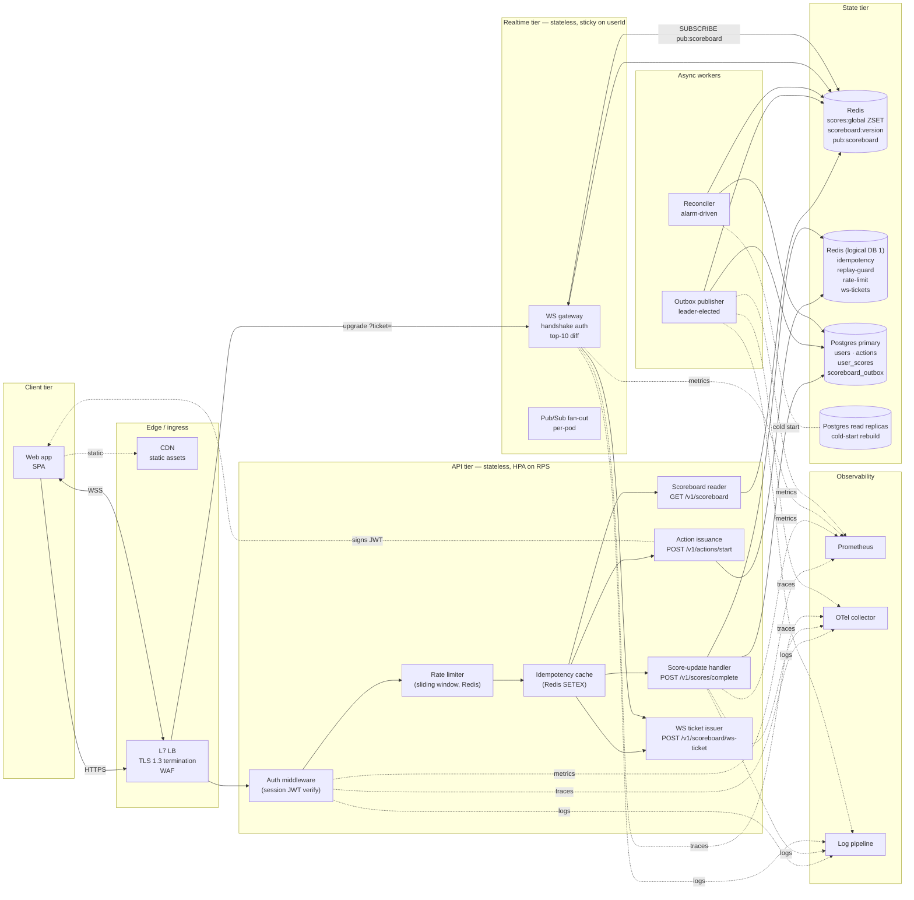
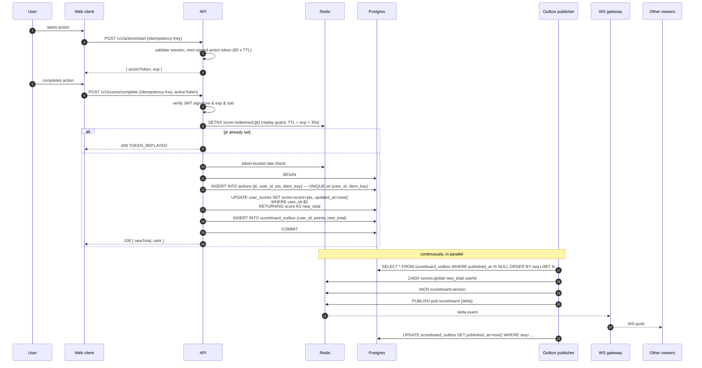

# Problem 6 — Live Scoreboard Module

---

## 1. Context & Requirements

### 1.1 Functional requirements (verbatim from the brief)

1. We have a website with a score board showing the **top 10 user scores**.
2. The score board must update **live**.
3. A user performs an action (we don't care what); completing it **increases** their score.
4. Action completion dispatches an API call to update the score.
5. We must **prevent unauthorised users from increasing scores**.

### 1.2 Non-functional requirements (derived)

| NFR                                       | Target                                                     |
| ----------------------------------------- | ---------------------------------------------------------- |
| Scoreboard read latency (p99)             | < 100 ms                                                   |
| Score-update propagation to clients (p99) | < 500 ms                                                   |
| API write throughput                      | 5 000 score updates / sec sustained, 20 000/s burst        |
| Connected scoreboard viewers              | 50 000 concurrent                                          |
| Availability                              | 99.9 % (SLO)                                               |
| Score replay/forge resistance             | Mathematically prevent forging without the server's secret |
| Audit                                     | Every score change is reconstructible from a durable log   |

### 1.3 Out of scope (explicitly)

- The action mechanic itself (game logic, completion detection).
- Personalised leaderboards / friend boards / regional boards (see §10 for
  how to extend).
- Mobile push notifications (separate concern; the WS channel suffices).

---

## 2. Glossary

| Term                | Meaning                                                                |
| ------------------- | ---------------------------------------------------------------------- |
| **Action**          | A unit of work the user performs that yields score points              |
| **Action Token**    | A short-lived, server-signed JWT that authorises _one_ score increment |
| **Idempotency Key** | Client-supplied UUID to make a write retry-safe                        |
| **Top-N**           | The current top-10 scoreboard, sourced from Redis ZSET                 |
| **Live channel**    | The WebSocket room (`scoreboard:global`) that broadcasts changes       |

---

## 3. Architecture

The system is split into five tiers: **client**, **edge**, **API**,
**realtime**, and **state**, plus a small **async-workers** plane for
the outbox publisher and the reconciler. Each tier is independently
deployable and independently scaled.



### 3.1 Tiers

| Tier                  | Responsibility                                                                                                                      | Stateless?                            | Scale axis                                  |
| --------------------- | ----------------------------------------------------------------------------------------------------------------------------------- | ------------------------------------- | ------------------------------------------- |
| **Client**            | UI, optimistic rendering, reconnect logic                                                                                           | n/a                                   | n/a                                         |
| **Edge**              | TLS, WAF, rate-limit at the IP layer, request-id stamp                                                                              | yes                                   | LB capacity                                 |
| **API**               | All synchronous request handling: auth → rate limit → idempotency → business logic. Reads from Redis ZSET. Writes to Postgres only. | yes                                   | HPA on CPU + RPS                            |
| **Realtime**          | Long-lived WS connections; subscribes to `pub:scoreboard`; computes top-10 diff; pushes to clients.                                 | yes (per connection)                  | HPA on connection count + CPU               |
| **Async workers**     | Drain outbox → Redis. Repair drift.                                                                                                 | leader-elected (one writer at a time) | sharded by `hash(user_id)` if scale demands |
| **State — hot**       | Redis cluster: ZSET, version counter, Pub/Sub channel.                                                                              | no                                    | shard on userId                             |
| **State — auxiliary** | Redis cluster (separate logical DB or instance): idempotency, replay guard, rate-limit, WS tickets. Eviction-friendly.              | no                                    | independent of hot                          |
| **State — durable**   | Postgres: users, actions (audit), user_scores (materialised total), scoreboard_outbox (transactional handoff). Source of truth.     | no                                    | primary + read replicas                     |
| **Observability**     | Metrics, traces, logs. Out-of-band.                                                                                                 | yes                                   | n/a                                         |

### 3.2 Component responsibilities

**API tier — module-level**

- `AuthN` — verify session JWT (signature, exp, sub, kid). Strip and
  attach `userId` to the request context. Reject on any failure.
- `RL` — sliding-window rate limit using `ZADD + ZREMRANGEBYSCORE +
ZCARD` against the auxiliary Redis. Key per `(userId, action_type)`
  for `/scores/complete`; per `userId` for everything else.
- `Idem` — checks `score:idem:{userId}:{key}` before any mutation. Hit →
  return cached body verbatim. Miss → continue, cache the response after
  the handler succeeds.
- `ActionSvc` — mints the signed action token (`HS256`/`EdDSA`, 60 s TTL,
  per-action `pts` from `action_types` config). Pure compute; no PG.
- `ScoreSvc` — verifies the action token, redeems `score:redeemed:{jti}`
  via `SETNX`, runs the PG transaction (`actions` + `user_scores` +
  `scoreboard_outbox` — see §6), returns `(newTotal, rank)`. Never
  writes Redis ZSET directly; that's the publisher's job.
- `Board` — single Redis call: `ZRANGE scores:global REV LIMIT 0 N
WITHSCORES`. Joins `displayName` from `user:{id}:meta` cache; falls
  back to PG on cache miss.
- `Tickets` — issues 30 s single-use JWTs for the WS handshake. Stored
  in auxiliary Redis with `SETEX … 30 EX NX` so the same ticket cannot
  be reused.

**Realtime tier**

- `WSGW` — accepts the HTTP `Upgrade`, validates the ticket, opens the
  socket. On `subscribe`, sends a snapshot, then forwards diffed deltas
  while the connection lives. Maintains `ping`/`pong` for
  detection. Subscribes once per pod to `pub:scoreboard`; broadcasts
  fan-out is per pod.

**Async workers**

- `OB` (outbox publisher) — polls `scoreboard_outbox WHERE
published_at IS NULL`. For each row, runs a Redis pipeline:
  `ZADD scores:global new_total userId` (idempotent absolute write) +
  `INCR scoreboard:version` + `PUBLISH pub:scoreboard {…}`. Marks the
  outbox row published. Leader-elected via Postgres advisory lock or
  Kubernetes Lease.
- `Recon` (reconciler) — alarm-driven (triggers on
  `outbox_lag_seconds > 5` or after a Redis failover). Recomputes the
  ZSET from `user_scores`, diffs, repairs.

### 3.3 Data ownership & flow direction

The most important rule: **only the outbox publisher writes the
`scores:global` ZSET.** API pods write only Postgres. This single-writer
discipline is what makes the broadcast idempotent — there is exactly one
party that decides the order of `INCR scoreboard:version` and the
content of every `pub:scoreboard` message.

```
write path:   API pod → Postgres tx → outbox publisher → Redis ZSET
read path:    API pod → Redis ZSET   (top-10)
              API pod → Postgres     (audit, user history)
live path:    Outbox publisher → Redis Pub/Sub → WS gateway → client
```

API write latency is **decoupled from Redis health**. If Redis goes
down, the API still writes Postgres (so audits and idempotency from PG
are intact); the broadcast lags until the publisher catches up. The
client experiences "scoreboard not updating" rather than "actions not
working".

### 3.4 Inter-component contracts

| From → To        | Protocol            | Auth                                                | Notes                             |
| ---------------- | ------------------- | --------------------------------------------------- | --------------------------------- |
| Web → LB (HTTP)  | HTTPS / TLS 1.3     | Session JWT (Bearer)                                | HSTS preload                      |
| Web → LB (WS)    | WSS                 | Single-use ticket query param                       | 30 s TTL, `SETNX`-redeemed        |
| LB → API         | HTTP (mTLS in mesh) | request-id pass-through                             | trust-proxy hop = 1               |
| LB → WSGW        | HTTP upgrade        | ticket validated by WSGW                            | sticky on `userId` hash           |
| API → Redis hot  | RESP3               | ACL: read+ZRANGE only                               | no `ZADD`/`ZINCRBY` from API pods |
| API → Redis aux  | RESP3               | ACL: read+write idem/replay/rate                    | logical DB 1                      |
| API → PG         | TLS, conn pool      | role: `api` (rw on actions, user_scores, outbox)    | LISTEN/NOTIFY unused              |
| OB → PG          | TLS, conn pool      | role: `publisher` (rw on outbox; ro on user_scores) | leader-only                       |
| OB → Redis hot   | RESP3               | ACL: write to `scores:global` and `pub:scoreboard`  | sole writer                       |
| WSGW → Redis hot | RESP3               | ACL: read + SUBSCRIBE                               | no writes                         |

ACL separation matters: a compromised API pod cannot directly poison the
ZSET because its Redis credentials don't carry `ZADD` permission on
`scores:global`. The outbox publisher's credentials do — and the
publisher only ever runs trusted code.

### 3.5 Failure-mode summary

| Failure                              | Effect on API                                                                 | Effect on scoreboard                                                                      |
| ------------------------------------ | ----------------------------------------------------------------------------- | ----------------------------------------------------------------------------------------- |
| Hot Redis down                       | reads degrade (Board returns stale snapshot from PG fallback)                 | live updates pause; outbox grows; clients show "reconnecting"                             |
| Auxiliary Redis down                 | rate limit + idempotency cache unavailable → API fails closed (503) on writes | unaffected once API recovers                                                              |
| Postgres primary down                | writes fail (5xx); reads hit replicas                                         | outbox doesn't drain new rows; existing top-10 still served from Redis                    |
| Outbox publisher down                | unaffected                                                                    | live updates pause; alarm fires within 5 s on `outbox_lag_seconds`                        |
| WS gateway pod lost                  | unaffected                                                                    | clients on that pod reconnect to a sibling; another pod has the same Pub/Sub subscription |
| Action-token signing key compromised | rotate `kid`, force re-issuance                                               | scoreboard inflated by at most `MAX_PTS · token_window` (see DB cap)                      |

Each row maps 1:1 to a runbook entry — see §11 hand-off checklist.

### 3.6 Why this shape

- **Redis ZSET + Pub/Sub** is the canonical low-latency leaderboard
  pattern. `ZRANGE … REV LIMIT 0 10` is sub-millisecond at any
  reasonable cardinality.
- **Postgres as source of truth** gives durable audit (`actions`),
  idempotency (`UNIQUE(user_id, idempotency_key)`), and a clean rebuild
  path on Redis loss.
- **Transactional outbox** removes the dual-write window that would
  otherwise exist between PG and Redis (see §6.1 for the proof).
- **Single-writer ZSET** + **idempotent broadcast** (`ZADD <new_total>`,
  not `ZINCRBY`) means duplicate publishes are safe — important because
  the outbox publisher is at-least-once.
- **Stateless API + WS tier** scales horizontally. State is fully
  externalised. New pods start cold and serve immediately.
- **Auxiliary Redis separated from hot Redis** lets each be tuned
  independently — `allkeys-lru` on the aux instance for idempotency
  eviction; `noeviction` on the hot instance because losing scores is
  unacceptable.

---

## 4. API contract

All endpoints sit behind the authenticated API gateway. Bearer token (JWT)
required on every call.

### 4.1 `POST /v1/actions/start` — issue an action token

> Called when the user **begins** the action, not when they finish it. This
> is the linchpin of the anti-cheat design: the score increment is
> server-decided, not client-supplied.

Request

```http
POST /v1/actions/start
Authorization: Bearer <session-jwt>
Content-Type: application/json
Idempotency-Key: 0a3f8d9e-...
{
  "actionType": "puzzle_complete"
}
```

Response `200`

```json
{
  "ok": true,
  "data": {
    "actionToken": "eyJhbGciOiJIUzI1NiIsImtpZCI6...",
    "expiresAt": "2026-05-02T10:35:00Z"
  }
}
```

The action token is a short-lived (60 s) JWT signed with `HS256` and the
service's rotating HMAC secret. Claims:

```jsonc
{
  "sub": "user_8e1f...", // user id (must match Bearer)
  "act": "puzzle_complete", // action type
  "pts": 50, // server-decided point value
  "jti": "1f5c…", // unique id — used for replay defence
  "iat": 1700000000,
  "exp": 1700000060, // 60 s window
  "kid": "v3", // signing-key version
}
```

### 4.2 `POST /v1/scores/complete` — submit completion

Request

```http
POST /v1/scores/complete
Authorization: Bearer <session-jwt>
Content-Type: application/json
Idempotency-Key: 0a3f8d9e-...
{
  "actionToken": "eyJ…"
}
```

Response `200`

```json
{
  "ok": true,
  "data": {
    "userId": "user_8e1f…",
    "pointsAdded": 50,
    "newTotal": 1240,
    "rank": 7
  }
}
```

Errors

| Code                | Status | Cause                                                |
| ------------------- | ------ | ---------------------------------------------------- |
| `TOKEN_EXPIRED`     | 401    | `actionToken` past `exp`                             |
| `TOKEN_INVALID`     | 401    | bad signature, unknown `kid`, or `sub` mismatch      |
| `TOKEN_REPLAYED`    | 409    | `jti` already redeemed                               |
| `IDEMPOTENT_REPLAY` | 200    | same `Idempotency-Key` → returns the original result |
| `RATE_LIMITED`      | 429    | per-user/min cap exceeded                            |

### 4.3 `GET /v1/scoreboard` — top-N snapshot

```http
GET /v1/scoreboard?limit=10
```

```json
{
  "ok": true,
  "data": [
    { "rank": 1, "userId": "user_…", "displayName": "Anya", "score": 9850 },
    ...
  ],
  "version": 18432
}
```

`version` is the monotonically increasing scoreboard revision. Clients
include it in WS subscribe to receive only newer deltas.

### 4.4 `WS /v1/scoreboard/live` — live updates

WebSocket auth uses a **short-lived ticket** rather than the long-lived
session token. The client first calls `POST /v1/scoreboard/ws-ticket`
(authed via the normal Bearer header) to receive a single-use, 30-second
JWT. It then opens the WSS connection at `/v1/scoreboard/live?ticket=…`.
The server validates the ticket on `upgrade` and rejects the handshake
on failure. This avoids putting bearer tokens in URLs (logs, browser
history) and avoids the `Sec-WebSocket-Protocol`-as-auth anti-pattern.

Client → server

```json
{ "type": "subscribe", "since": 18432 }
```

Server → client (event types)

```json
{ "type": "snapshot", "version": 18432, "top10": [ ... ] }

{ "type": "delta", "version": 18433, "changes": [
    { "userId": "user_…", "score": 1240, "rank": 7, "previousRank": 9 }
] }

{ "type": "ping", "ts": 1700000000 }
```

The server pushes a `delta` event whenever an accepted score change
**enters, leaves, or reorders the top-10**. The publisher computes this
by reading the previous and current top-10 from the ZSET in a single
pipelined call and diffing them. Score changes that don't affect the
top-10 are silently absorbed — clients only ever see updates that
require re-render. If the user's connection drifts > 60 s without a
`pong`, the server closes it; the client reconnects with the latest known
`version`.

---

## 5. Data model

### 5.1 Postgres (source of truth, durable)

```sql
CREATE TABLE users (
  id            UUID PRIMARY KEY,
  display_name  TEXT NOT NULL,
  created_at    TIMESTAMPTZ NOT NULL DEFAULT now()
);

CREATE TABLE actions (
  -- Append-only audit log of every credited score change.
  id              UUID PRIMARY KEY,                -- = jti from action token
  user_id         UUID NOT NULL REFERENCES users(id),
  action_type     TEXT NOT NULL,
  points          INTEGER NOT NULL CHECK (points > 0),
  idempotency_key UUID NOT NULL,
  redeemed_at     TIMESTAMPTZ NOT NULL DEFAULT now(),
  UNIQUE (user_id, idempotency_key)               -- idempotency
);

CREATE INDEX idx_actions_user_redeemed ON actions(user_id, redeemed_at DESC);

CREATE TABLE user_scores (
  -- Materialised total. Source of truth on cold start; rebuildable from `actions`.
  user_id   UUID PRIMARY KEY REFERENCES users(id),
  score     BIGINT NOT NULL DEFAULT 0,
  updated_at TIMESTAMPTZ NOT NULL DEFAULT now()
);

CREATE TABLE scoreboard_outbox (
  -- Transactional outbox. Every accepted score change writes one row in
  -- the *same* PG transaction as the actions/user_scores update. A
  -- separate worker (the "outbox publisher") drains it to Redis + Pub/Sub.
  -- This eliminates the dual-write window that would otherwise exist
  -- between Postgres and Redis.
  seq         BIGSERIAL PRIMARY KEY,
  user_id     UUID NOT NULL REFERENCES users(id),
  points      INTEGER NOT NULL,
  new_total   BIGINT NOT NULL,
  created_at  TIMESTAMPTZ NOT NULL DEFAULT now(),
  published_at TIMESTAMPTZ
);
CREATE INDEX idx_outbox_unpublished ON scoreboard_outbox (seq)
  WHERE published_at IS NULL;
```

### 5.2 Redis (hot path)

| Key                         | Type               | Purpose                                                                             |
| --------------------------- | ------------------ | ----------------------------------------------------------------------------------- |
| `scores:global`             | ZSET               | `(score → userId)`. `ZRANGE … REV WITHSCORES LIMIT 0 10` is the entire top-10 read. |
| `user:{id}:meta`            | HASH               | `displayName`, `lastUpdated` — cached to avoid PG hit on read                       |
| `score:redeemed:{jti}`      | STRING (TTL 5 min) | replay defence — `SETNX` returns 0 if already redeemed                              |
| `score:idem:{userId}:{key}` | STRING (TTL 24 h)  | idempotency cache — value is the cached response                                    |
| `score:rate:{userId}`       | STRING + EXPIRE    | per-user rate-limit counter                                                         |
| `scoreboard:version`        | INTEGER (counter)  | monotonic version, bumped on every accepted update                                  |
| `pub:scoreboard`            | Pub/Sub channel    | publishes JSON deltas; WS gateways subscribe                                        |

Redis is the **read-only-fast-path**: any client request for the top-10
hits Redis (sub-ms). Postgres is touched only on writes (inside a
transaction, alongside the Redis write — see §6) and on cold-start rebuild.

---

## 6. Score-update flow (the critical path)

The flow uses a **transactional outbox** so that the score change in
Postgres and the broadcast to Redis are linked through a single durable
write. This avoids the dual-write window where a process crash between
"PG commit" and "Redis ZINCRBY" would leave the scoreboard out of sync.



### 6.1 Why the outbox eliminates the dual-write problem

The transaction commits **both** the score change _and_ the outbox row
atomically. Three crash scenarios:

| Crash point                                                | Effect                                                                                            |
| ---------------------------------------------------------- | ------------------------------------------------------------------------------------------------- |
| Before PG commit                                           | Nothing happened; client retries with same `Idempotency-Key`. Safe.                               |
| After PG commit, before publisher reads                    | Row is in outbox; publisher picks it up on next tick (≤ 1 s).                                     |
| After publisher writes Redis, before `published_at` update | Row gets republished; ZSET write is idempotent (`ZADD` with absolute score, not `ZINCRBY`). Safe. |

Note we use `ZADD <new_total>` (absolute), not `ZINCRBY <points>`. That
is the second crucial change: an idempotent broadcast, so duplicate
delivery cannot double-credit the leaderboard.

### 6.2 Concurrency on `user_scores`

Concurrent updates to the same `user_id` could race. We rely on
Postgres's row-level lock taken implicitly by `UPDATE … WHERE user_id =
$1` — under the default isolation (`READ COMMITTED`), the second
transaction blocks until the first commits, then reads the updated value.
The `RETURNING score` clause gives the caller the post-update total
without a second read. The outbox row is therefore always consistent
with `user_scores.score` at the moment of commit.

### 6.3 Idempotency vs replay defence — two layers

- **Replay defence (`SETNX score:redeemed:{jti}`)** prevents a stolen
  action token from being redeemed twice. TTL slightly exceeds the
  token's `exp` (e.g. 90 s) so it covers in-flight retries plus clock
  skew without bloating Redis memory.
- **Idempotency-Key** prevents _legitimate_ network retries from
  double-writing. Cached for 24 h. The `actions` table also enforces it
  at the engine level via `UNIQUE (user_id, idempotency_key)` — a
  defence-in-depth final guard.

---

## 7. Security & anti-cheat

This is the most important section of the document. The five layers below
each defend against a different attack class.

### 7.1 Authentication

- All HTTP endpoints require a session JWT (`Bearer <token>`).
- WebSocket auth happens on the upgrade request; tokens older than the
  session TTL are refused.
- Tokens are HS256-signed with a key rotated **monthly**; `kid` claim
  carries the version so we can run two valid keys during rotation.

### 7.2 Action-token model (the linchpin)

The client never tells the server _how many points_ to add. The server
issues a **signed action token** at action start that fixes:

1. The _user_ (`sub`).
2. The _action type_ (`act`).
3. The _point value_ (`pts`) — server-decided, non-negotiable.
4. A unique `jti` and 60-second `exp`.

When the action completes, the client returns the **same** token. The
server verifies signature → not-expired → `sub` matches the bearer →
`jti` not previously redeemed (Redis `SETNX`). Any failure rejects the
write.

**This defeats:**

- Forging a score (no signing key → no valid token).
- Choosing a higher point value (`pts` is signed, can't be edited).
- Replaying a successful completion (Redis `jti` guard, 5-min window).
- Cross-account theft (`sub` is bound; mismatch → 401).

### 7.3 Idempotency

Every write accepts an `Idempotency-Key` (UUID). The first call writes the
result to `score:idem:{userId}:{key}` (TTL 24 h). Subsequent calls with the
same key short-circuit and return the cached response. This makes network
retries safe without the server having to reason about partial state.

### 7.4 Rate limiting

Token-bucket per `(userId, action_type)`:

| Action                     | Limit                |
| -------------------------- | -------------------- |
| `*`                        | 30 / min, 200 / hour |
| Specific high-value action | 5 / min              |

Implemented as **sliding-window** in Redis: `ZADD score:rate:{userId}
<now> <jti>` followed by `ZREMRANGEBYSCORE … 0 (now-windowMs)` then
`ZCARD`. This avoids the fixed-window edge-pile-up bug
(naïve `INCR + EXPIRE` lets a user fire 60 calls across the boundary
of a 60-second window). The added cost is one extra Redis round-trip
per request — acceptable given how cheap it is vs the cost of
abuse.

### 7.5 Anomaly detection

- Track `actions_per_minute_per_user` as a metric.
- Alert when a user exceeds 3× their 7-day rolling p95 → automatic shadow-
  ban (writes accepted into PG, _not_ into the ZSET) until manual review.
- Track inter-arrival time variance. Bots tend to have suspiciously regular
  cadence; humans don't.

### 7.6 Defence-in-depth

- TLS 1.3 everywhere. HSTS preload.
- Helmet + strict CSP on the web client.
- WAF rule for `Authorization` length, `Idempotency-Key` shape, JSON depth.
- Audit log (`actions` table) is the ground truth for forensics.

---

## 8. Observability

### 8.1 Metrics

| Metric                                 | Type      | Purpose                                                 |
| -------------------------------------- | --------- | ------------------------------------------------------- |
| `score_update_total{action,result}`    | counter   | accepted vs rejected                                    |
| `score_update_latency_seconds`         | histogram | `/scores/complete` p50/p95/p99                          |
| `auth_failure_total{reason}`           | counter   | invalid / expired / replayed                            |
| `replay_attempts_total`                | counter   | `jti` collisions                                        |
| `rate_limit_hits_total{userId_bucket}` | counter   | bucket-anonymised                                       |
| `ws_connected_clients`                 | gauge     | live WS connections                                     |
| `outbox_unpublished_rows`              | gauge     | depth of `scoreboard_outbox WHERE published_at IS NULL` |
| `outbox_lag_seconds`                   | gauge     | `now() - min(created_at) WHERE published_at IS NULL`    |

### 8.2 Logs

Structured JSON. Every line carries `requestId`, `userId`, `action`,
`result`, `latencyMs`. PII redaction at the logger layer.

### 8.3 Traces

OpenTelemetry spans:
`http.request → auth.verify → token.verify → redis.replayCheck →
pg.tx → redis.zincrby → redis.publish`. Each span tagged with
`requestId` so cross-service traces stitch together.

### 8.4 Alerts

| Alert                   | Condition                                                   |
| ----------------------- | ----------------------------------------------------------- |
| `Score updates failing` | `score_update_total{result="error"}` rate > 0.5 % for 5 min |
| `Replay attempts spike` | `replay_attempts_total` > 100 / 5 min                       |
| `Outbox lagging`        | `outbox_lag_seconds` > 5 (publisher unhealthy)              |
| `Outbox backlog`        | `outbox_unpublished_rows` > 1 000                           |
| `WS gateway saturation` | `ws_connected_clients` > 80 % capacity                      |

---

## 9. Capacity & scaling

| Layer      | Strategy                                                                                                                 |
| ---------- | ------------------------------------------------------------------------------------------------------------------------ |
| API        | Stateless, horizontally scaled behind LB. HPA on CPU + RPS.                                                              |
| WS gateway | Stateless. Sticky sessions or consistent hashing on `userId`. Redis Pub/Sub for cross-pod fan-out.                       |
| Redis      | Single-shard fits 50k users easily. Move to Redis Cluster when ZSET memory > 50 % node RAM, sharding by user-prefix.     |
| Postgres   | Single primary + read replicas. Writes are append-mostly; partition `actions` by month if cardinality becomes a problem. |
| Pub/Sub    | At ~5 000 deltas/sec a single Redis instance is fine. Above that, consider Kafka/NATS for durable fan-out.               |

**Back-of-envelope**: 50 000 concurrent WS clients × 1 delta/sec average
= 50k messages/sec server-side outbound — comfortably within a single WS
gateway pod's capacity (Node + uWebSockets benchmarks ~250k msg/sec).

---

## 10. Improvements & open questions

> Listed deliberately as suggestions for the implementing team, not
> blockers.

1. **CRDT-based ZSET** — for multi-region active/active, replace the
   ZSET with a CRDT counter per user. Higher write cost, no central
   region.
2. **Personal/regional boards** — keyed ZSETs (`scores:region:{region}`)
   updated alongside the global one. Same broadcast model.
3. **Action-token point ranges** — for actions where the point value
   depends on completion time / quality, sign the _bounds_ `(pts_min,
pts_max)` and let the server clamp the client-supplied value. Still
   safer than a raw client-side number.
4. **Public-key signing (RS256)** — if action tokens are ever consumed by
   a different service from the issuer, switch to asymmetric signing so
   verifiers don't need the secret.
5. **Fraud-detection ML** — feed `actions_per_minute`, inter-arrival
   variance, IP/device clustering into an offline model; promote
   suspected accounts to shadow-ban automatically.
6. **WebSocket → SSE fallback** — corporate networks often block WS.
   `/v1/scoreboard/live/sse` gives a no-fuss alternative; same JSON delta
   shape.
7. **Score decay** — does score live forever? If a season concept exists,
   archive `actions` table by season and reset the ZSET.
8. **Top-N vs Top-N±buffer** — fetching `LIMIT 12` instead of 10 lets the
   client display "rising" indicators without a second round-trip.
9. **Per-action signing key** — for ultra-high-value actions, derive a
   per-action key from `HKDF(master_key, action_type)` so a leak of one
   action's key doesn't compromise others.

---

## 11. Implementation hand-off checklist

- [ ] Postgres migrations for `users`, `actions`, `user_scores`.
- [ ] Redis configuration: WAL persistence, `maxmemory-policy allkeys-lru`,
      ACL with separate users for hot path vs reconciler.
- [ ] Action-token issuer module (issuance, rotation, key versioning).
- [ ] `/v1/actions/start`, `/v1/scores/complete`, `/v1/scoreboard`.
- [ ] WS gateway service — auth on upgrade, Pub/Sub fan-out, ping/pong.
- [ ] Reconciler worker — 60 s tick, repair Redis from PG.
- [ ] Idempotency middleware (24 h cache).
- [ ] Rate-limiter middleware (per user, per action).
- [ ] Metrics + traces + structured logs (§8).
- [ ] Runbook: replay-attack response, secret rotation, Redis failover,
      reconciler lag mitigation.
- [ ] Load test (k6) hitting the throughput targets in §1.2.
- [ ] Game-day: simulate Redis outage and verify WS gateway behaviour.

---

## 12. Diagrams summary

The two Mermaid diagrams above (component flow §3 and sequence §6) are
the canonical reference. Render them in any Mermaid-aware viewer
(GitHub, GitLab, VS Code preview).
