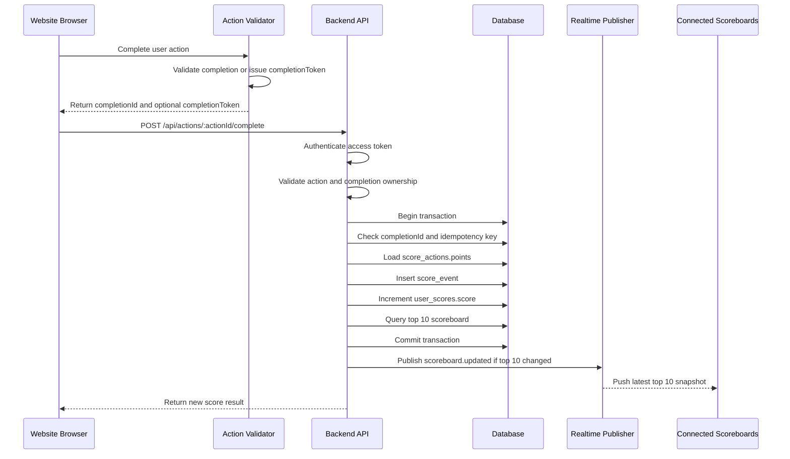

# Problem 6: Scoreboard API Module Specification

## Overview

This document specifies a backend module for a live scoreboard feature.

The module is responsible for:

- Maintaining user scores.
- Returning the current top 10 users by score.
- Updating scores after an authorized user action is completed.
- Broadcasting live scoreboard changes to connected clients.
- Preventing users from increasing scores without authorization.

The backend engineering team can implement this module inside an existing API service or as a dedicated service behind the same API gateway.

## Goals

- Show the top 10 users on the website scoreboard.
- Update the scoreboard live when scores change.
- Accept score updates only when they come from a trusted, authorized action-completion flow.
- Keep score updates auditable and idempotent.

## Non-Goals

- Defining the user action itself.
- Building frontend UI.
- Supporting arbitrary manual score edits from users.
- Supporting historical leaderboard pages beyond the top 10.

## Core Concepts

### User

An authenticated account that can appear on the scoreboard.

### Action Completion

A trusted event proving that a user completed a score-earning action. The scoreboard module must not trust a plain client request that says, "increase my score." The client may only request completion of an action. The backend decides whether the action is valid and how many points it is worth.

### Score Event

An immutable record of one authorized score increase.

### Scoreboard Snapshot

The current top 10 users ordered by score descending.

## API Endpoints

### Get Top Scoreboard

```http
GET /api/scoreboard/top?limit=10
Authorization: Bearer <access_token>
```

Returns the current top 10 users.

Response:

```json
{
  "data": [
    {
      "rank": 1,
      "userId": "user_123",
      "displayName": "Jane",
      "score": 4200,
      "updatedAt": "2026-05-03T12:00:00.000Z"
    }
  ]
}
```

Rules:

- Sort by `score DESC`.
- Use a stable tie-breaker such as `updatedAt ASC` then `userId ASC`.
- Do not expose private user data.
- `limit` defaults to `10` and must not exceed `10` for this module.

### Get My Scoreboard Position

```http
GET /api/scoreboard/me
Authorization: Bearer <access_token>
```

Returns the authenticated user's score and current rank.

Response:

```json
{
  "data": {
    "userId": "user_123",
    "rank": 7,
    "score": 1500,
    "updatedAt": "2026-05-03T12:00:00.000Z"
  }
}
```

### Subscribe To Live Scoreboard Updates

Recommended first implementation: Server-Sent Events. Use WebSockets only if the product later needs bidirectional live behavior.

SSE option:

```http
GET /api/scoreboard/live
Authorization: Bearer <access_token>
Accept: text/event-stream
```

Event payload:

```json
{
  "type": "scoreboard.updated",
  "data": [
    {
      "rank": 1,
      "userId": "user_123",
      "displayName": "Jane",
      "score": 4200,
      "updatedAt": "2026-05-03T12:00:00.000Z"
    }
  ]
}
```

Rules:

- Send the latest top 10 snapshot when the connection opens.
- Broadcast a new snapshot only when the top 10 changes.
- Require authentication before opening the stream.
- Apply connection limits per user/IP.

### Complete Action And Award Score

```http
POST /api/actions/:actionId/complete
Authorization: Bearer <access_token>
Idempotency-Key: <unique_request_key>
Content-Type: application/json
```

Request:

```json
{
  "completionId": "completion_abc123",
  "completionToken": "optional_signed_action_completion_token"
}
```

Response:

```json
{
  "data": {
    "eventId": "score_event_123",
    "userId": "user_123",
    "awardedPoints": 50,
    "totalScore": 4250,
    "rank": 4,
    "createdAt": "2026-05-03T12:00:00.000Z"
  }
}
```

Rules:

- The authenticated user must match the user in the verified action completion data.
- `completionId` must be unique and can only be rewarded once.
- The server must load the point value from a server-owned action rule.
- The server must reject any request body containing client-provided `score`, `points`, `scoreDelta`, or `rank`.
- The operation must be atomic: create event, update score, and publish update together or not at all.
- Repeated requests with the same `Idempotency-Key` should return the original result.

## Authorization And Abuse Prevention

The server must not trust the client as the source of truth for score increases.

Required checks:

- Verify the access token and identify the authenticated user.
- Verify the action is enabled in the server-owned `score_actions` table or config.
- Verify `completionToken` with a trusted action service secret or public key when the action is completed outside this API service.
- Confirm the completion proof includes:
  - `userId`
  - `actionId`
  - `completionId`
  - `issuedAt`
  - `expiresAt`
- Reject expired completion tokens.
- Reject completion tokens whose `userId` does not match the authenticated user.
- Reject duplicate `completionId` values.
- Calculate the final awarded points on the server from configured action rules.
- Rate-limit score submission attempts per user and IP.
- Log rejected attempts for abuse monitoring.

Recommended proof token format:

- Short-lived JWT signed by the trusted action-completion service, or
- HMAC signature over `userId`, `actionId`, `completionId`, and expiration timestamp.

## Data Model

### `user_scores`

Stores the current score per user.

| Column | Type | Notes |
|---|---|---|
| `user_id` | string / uuid | Primary key |
| `score` | integer | Non-negative total score |
| `updated_at` | timestamp | Last score update time |

Indexes:

- Primary key on `user_id`.
- Index on `(score DESC, updated_at ASC, user_id ASC)` for top 10 reads.

### `score_actions`

Stores server-owned action reward configuration.

| Column | Type | Notes |
|---|---|---|
| `id` | string / uuid | Primary key, also used as `:actionId` |
| `name` | string | Human-readable action name |
| `points` | integer | Approved reward amount |
| `active` | boolean | Whether scoring is active |
| `max_awards_per_user` | integer / null | Optional per-user award limit |
| `created_at` | timestamp | Creation time |
| `updated_at` | timestamp | Last rule update time |

Constraints:

- `points > 0`.
- Only active actions can award points.

### `score_events`

Stores immutable score updates.

| Column | Type | Notes |
|---|---|---|
| `id` | string / uuid | Primary key |
| `user_id` | string / uuid | User receiving score |
| `action_id` | string / uuid | Completed action type |
| `completion_id` | string | Unique action completion identifier |
| `points_awarded` | integer | Server-approved score increment |
| `idempotency_key` | string | Unique per user request |
| `metadata` | json / jsonb | Optional non-sensitive debug context |
| `created_at` | timestamp | Event creation time |

Constraints:

- Unique index on `completion_id`.
- Unique index on `(user_id, idempotency_key)`.
- Index on `(user_id, created_at DESC)`.
- `points_awarded > 0`.

## Execution Flow



## Implementation Notes

Score update transaction:

1. Start database transaction.
2. Check whether `(userId, idempotencyKey)` already exists.
3. If it exists, return the stored result without applying another score increment.
4. Verify `completionId` has not already been used.
5. Load the enabled `score_actions` row for `actionId`.
6. Insert `score_events`.
7. Upsert and increment `user_scores`.
8. Query top 10.
9. Commit.
10. Publish realtime update after commit.

Realtime delivery:

- Prefer publishing after the database commit so clients never see rolled-back data.
- Use Redis Pub/Sub, a message queue, or the platform event bus when the API runs multiple instances.
- If using SSE, keep events small and send full top 10 snapshots instead of partial patches.

Error responses:

| Status | Reason |
|---|---|
| `400` | Invalid request body |
| `401` | Missing or invalid access token |
| `403` | Action completion does not belong to authenticated user |
| `404` | Action not found |
| `409` | Duplicate completion already rewarded |
| `422` | Action is valid but not scoreable |
| `429` | Rate limit exceeded |
| `500` | Unexpected server error |

## Security Requirements

- Never accept a raw score increment from an untrusted client.
- Never accept `score`, `points`, `scoreDelta`, or `rank` from an untrusted client.
- Keep signing keys outside source control.
- Rotate completion-token signing keys.
- Use short completion-token expiry, for example 1 to 5 minutes.
- Validate all request bodies with a schema validator.
- Use HTTPS only.
- Add audit logs for accepted and rejected score attempts.
- Alert on high rejection rates, repeated duplicate completions, and unusual score velocity.

## Additional Improvements

- Add a background reconciliation job that rebuilds `user_scores` from `score_events` and reports drift.
- Cache the top 10 scoreboard in Redis for fast reads, invalidated after accepted score updates.
- Add a fraud scoring layer for impossible action frequency or abnormal score growth.
- Add admin-only endpoints to disable a score rule or quarantine a suspicious user.
- Add integration tests covering idempotency, duplicate completions, invalid proof tokens, and concurrent updates.
- Add load tests for realtime fan-out if the scoreboard has many connected viewers.
- Start with PostgreSQL-only leaderboard reads. Add Redis sorted sets only when read traffic or realtime fan-out requires it.
