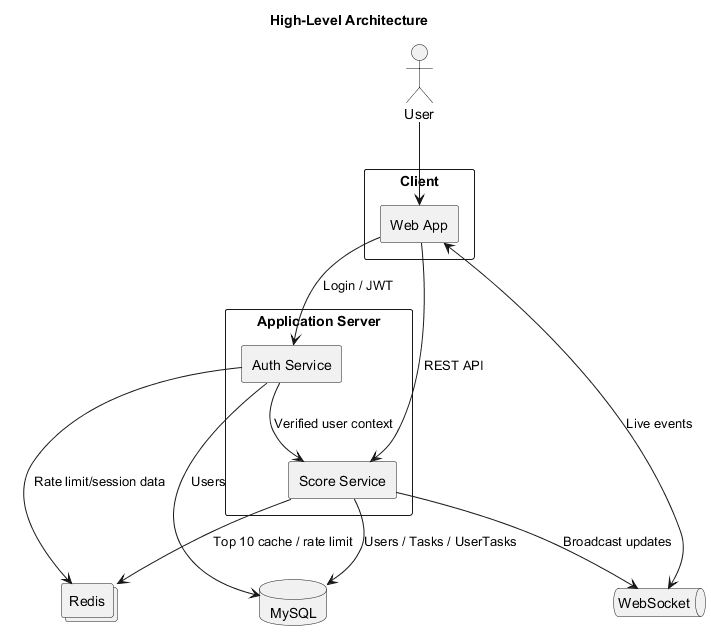
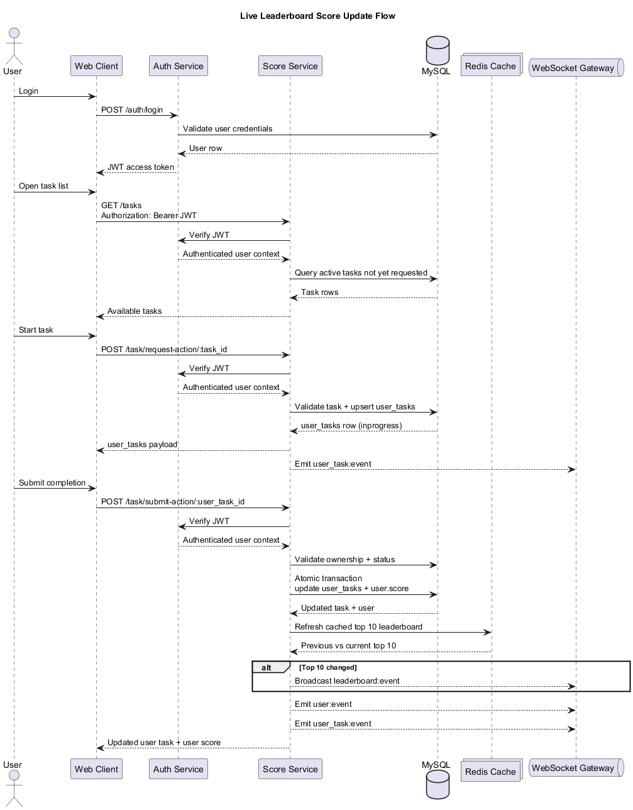

# Problem 6: Architecture Specification

This document specifies a backend API module for a live leaderboard system. It is written for a backend engineering team that will implement the service.

## Table of Contents

- [Problem 6: Architecture Specification](#problem-6-architecture-specification)
  - [Table of Contents](#table-of-contents)
  - [1. Scope](#1-scope)
  - [2. High-Level Architecture](#2-high-level-architecture)
  - [3. High-Level Architecture Diagram](#3-high-level-architecture-diagram)
  - [4. Functional Requirements](#4-functional-requirements)
  - [5. Data Model](#5-data-model)
  - [6. API Specification](#6-api-specification)
    - [6.1 Login](#61-login)
    - [6.2 Query Leaderboard](#62-query-leaderboard)
    - [6.3 List Available Tasks](#63-list-available-tasks)
    - [6.4 List User Tasks By Status](#64-list-user-tasks-by-status)
    - [6.5 Request Action](#65-request-action)
    - [6.6 Submit Action Completion](#66-submit-action-completion)
    - [6.7 Get User Profile \& Score](#67-get-user-profile--score)
  - [7. WebSocket Specification](#7-websocket-specification)
    - [7.1 `leaderboard:event`](#71-leaderboardevent)
    - [7.2 `user:event`](#72-userevent)
    - [7.3 `user_task:event`](#73-user_taskevent)
  - [8. Execution Flow Diagrams](#8-execution-flow-diagrams)
  - [9. Security \& Authorization](#9-security--authorization)
    - [JWT](#jwt)
    - [Password Storage](#password-storage)
    - [Score Update Protection](#score-update-protection)
    - [Rate Limiting](#rate-limiting)
    - [Additional Controls](#additional-controls)
  - [10. Non-Functional Expectations](#10-non-functional-expectations)
  - [11. Suggested Implementation Notes](#11-suggested-implementation-notes)
  - [12. Future Improvements](#12-future-improvements)

## 1. Scope

The module supports:

- user authentication with JWT;
- task discovery and task execution requests;
- score updates after a task is completed;
- prevention of duplicate task requests for the same user and task;
- prevention of duplicate task completion and duplicate score awards;
- live leaderboard updates through WebSocket;
- protection against unauthorized score changes.

Out of scope:

- the internal business logic of how a user completes a task;
- frontend implementation details;
- admin tooling.

## 2. High-Level Architecture

The application server is intentionally split into two logical services inside the backend API:

- `Auth Service`: validates credentials, issues JWT, validates JWT for HTTP and WebSocket connections.
- `Score Service`: serves leaderboard/task endpoints, validates task actions, updates scores, refreshes cache, and emits real-time events.

Supporting infrastructure:

- `MySQL`: source of truth for users, tasks, and user task state.
- `Redis`: distributed rate limiting and cached top-10 leaderboard.
- `WebSocket Gateway`: authenticated real-time channel for leaderboard, user, and user-task events.

## 3. High-Level Architecture Diagram

PlantUML source: [high-level-architecture.puml](./diagram/high-level-architecture.puml)



## 4. Functional Requirements

1. The website shows the top users by score, defaulting to top 10.
2. The leaderboard must update live without requiring manual refresh.
3. A user can request an available task/action.
4. Completing that action triggers an API call that may increase the user score.
5. Unauthorized or malicious score updates must be rejected.

## 5. Data Model

Recommended relational schema:

```sql
CREATE TABLE users (
    id CHAR(36) PRIMARY KEY DEFAULT (UUID()),
    email VARCHAR(255) UNIQUE NOT NULL,
    password VARCHAR(255) NOT NULL,
    nick_name VARCHAR(50) UNIQUE NOT NULL,
    score BIGINT DEFAULT 0,
    created_at TIMESTAMP DEFAULT CURRENT_TIMESTAMP,
    updated_at TIMESTAMP DEFAULT CURRENT_TIMESTAMP
);

CREATE TABLE tasks (
    id CHAR(36) PRIMARY KEY DEFAULT (UUID()),
    name VARCHAR(255) NOT NULL,
    description TEXT,
    status SMALLINT NOT NULL DEFAULT 1, -- 0 inactive, 1 active
    score BIGINT DEFAULT 0,
    created_at TIMESTAMP DEFAULT CURRENT_TIMESTAMP,
    updated_at TIMESTAMP DEFAULT CURRENT_TIMESTAMP
);

CREATE TABLE user_tasks (
    id CHAR(36) PRIMARY KEY DEFAULT (UUID()),
    user_id CHAR(36) NOT NULL,
    task_id CHAR(36) NOT NULL,
    status SMALLINT NOT NULL DEFAULT 1, -- 1 inprogress, 2 complete, 9 expired
    score BIGINT DEFAULT 0,
    created_at TIMESTAMP DEFAULT CURRENT_TIMESTAMP,
    updated_at TIMESTAMP DEFAULT CURRENT_TIMESTAMP ON UPDATE CURRENT_TIMESTAMP,
    CONSTRAINT fk_user_tasks_user FOREIGN KEY (user_id) REFERENCES users(id),
    CONSTRAINT fk_user_tasks_task FOREIGN KEY (task_id) REFERENCES tasks(id)
);

CREATE UNIQUE INDEX ux_user_tasks_user_task
    ON user_tasks(user_id, task_id);

CREATE INDEX ix_users_score_desc
    ON users(score DESC, updated_at DESC);

CREATE INDEX ix_tasks_status_updated_at
    ON tasks(status, updated_at DESC);

CREATE INDEX ix_user_tasks_user_status_updated_at
    ON user_tasks(user_id, status, updated_at DESC);
```

Notes:

- `users.score` is the current aggregated score used for ranking.
- `tasks.score` is the amount added to the user score when the task is successfully completed.
- `user_tasks.score` stores the awarded score snapshot for audit/debugging after completion.
- `user_tasks(user_id, task_id)` must remain unique to stop duplicate claims for the same task.

## 6. API Specification

All protected endpoints require:

```http
Authorization: Bearer <jwt_token>
```

### 6.1 Login

`POST /auth/login`

Request:

```json
{
  "email": "player1@example.com",
  "password": "user-input-password"
}
```

Response:

```json
{
  "success": true,
  "data": {
    "token": "jwt_token",
    "expiresIn": 3600,
    "user": {
      "userId": "uuid-123",
      "nick_name": "player1",
      "email": "player1@example.com",
      "score": 15000
    }
  }
}
```

Behavior:

- receive the user's password over TLS and compare it against the stored password hash;
- issue signed JWT containing `sub`, `email`, `nick_name`;
- reject invalid credentials with `401 INVALID_CREDENTIALS`.

**Note:** **Passwords must never be stored or transmitted as reusable plaintext outside the immediate login request. The persistence layer should store only a password hash, and the recommended hashing algorithms are `Argon2id` or `bcrypt`, not MD5 or reversible encryption.**

### 6.2 Query Leaderboard

`GET /leaderboard?top=xx`

Rules:

- default `top = 10`;
- maximum `top = 100`;
- sort by `score DESC`, then `updated_at ASC` or `id ASC` for deterministic ranking;
- prefer Redis cache for top 10, fallback to MySQL for non-default `top`.

Response:

```json
{
  "success": true,
  "data": {
    "leaderboard": [
      {
        "rank": 1,
        "userId": "uuid-123",
        "nick_name": "player1",
        "email": "player1@example.com",
        "score": 15000
      },
      {
        "rank": 2,
        "userId": "uuid-456",
        "nick_name": "player2",
        "email": "player2@example.com",
        "score": 12500
      }
    ],
    "lastUpdated": "2026-01-25T10:30:00Z"
  }
}
```

Errors:

- `400 INVALID_TOP_LIMIT` when `top < 1` or `top > 100`;
- `401 UNAUTHORIZED` when JWT is missing or invalid.

### 6.3 List Available Tasks

`GET /tasks?page=1&limit=20`

Behavior:

- return active tasks not yet present in `user_tasks` for the authenticated user;
- sort by `tasks.updated_at DESC`;
- support pagination with `page` and `limit`;
- default `page = 1`, default `limit = 20`, maximum `limit = 100`.

Response:

```json
{
  "success": true,
  "data": {
    "page": 1,
    "limit": 20,
    "total": 1,
    "items": [
      {
        "taskId": "uuid-task-1",
        "name": "Test action",
        "description": "A test description",
        "status": 1,
        "score": 100,
        "updatedAt": "2026-01-25T10:30:00Z"
      }
    ]
  }
}
```

### 6.4 List User Tasks By Status

`GET /user-tasks?status=xx&page=1&limit=20`

Behavior:

- query `user_tasks` for the authenticated user;
- optional `status` filter;
- sort by `updated_at DESC`;
- support pagination with `page` and `limit`;
- default `page = 1`, default `limit = 20`, maximum `limit = 100`.

Response:

```json
{
  "success": true,
  "data": {
    "page": 1,
    "limit": 20,
    "total": 1,
    "items": [
      {
        "userTaskId": "uuid-user-task-1",
        "taskId": "uuid-task-1",
        "status": 1,
        "score": 0,
        "updatedAt": "2026-01-25T10:30:00Z"
      }
    ]
  }
}
```

### 6.5 Request Action

`POST /task/request-action/:task_id`

Request:

```json
{
  "action_type": "start_action"
}
```

Validation:

- verify `task_id` exists in `tasks`;
- verify task is active;
- verify `(user_id, task_id)` does not already exist in `user_tasks`;
- enforce one active/requested record per `(user_id, task_id)` so the same task cannot be started twice by the same user;
- reject bad `action_type`.

Success behavior:

- insert a new `user_tasks` row with `status = 1` (`inprogress`);
- return inserted `user_tasks`;
- emit `user_task:event`.

Duplicate-prevention requirements:

- the service must reject duplicate start requests for the same `(user_id, task_id)`;
- the unique index on `user_tasks(user_id, task_id)` is the final database guardrail;
- the API should still handle race conditions explicitly and translate unique-key conflicts into a business error response instead of a generic `500`.

Suggested errors:

- `404 TASK_NOT_FOUND`
- `409 TASK_ALREADY_REQUESTED`
- `409 TASK_INACTIVE`
- `409 TASK_DUPLICATE_REQUEST`
- `400 INVALID_ACTION_TYPE`

### 6.6 Submit Action Completion

`POST /task/submit-action/:user_task_id`

Request:

```json
{
  "action_type": "complete_action"
}
```

Validation:

- verify `user_task_id` exists;
- verify the row belongs to the authenticated user;
- verify current status is `1` (`inprogress`);
- reject any completion attempt for a task that is already `complete` or otherwise no longer eligible for scoring;
- reject invalid `action_type`.

Success behavior:

1. start a database transaction;
2. set `user_tasks.status = 2`;
3. copy awarded score into `user_tasks.score`;
4. increment `users.score` atomically by `tasks.score`;
5. commit transaction;
6. refresh top-10 leaderboard cache in Redis;
7. if the top 10 changed, broadcast `leaderboard:event`;
8. emit `user:event` and `user_task:event`;
9. return updated `user_tasks` and user profile.

Duplicate-prevention requirements:

- task completion must be idempotent from the scoring perspective: the same `user_task` must never award points more than once;
- the transaction must lock/read the current `user_tasks` row and abort if the status is no longer `inprogress`;
- if two completion requests arrive concurrently, only one may commit the score update, and the other must receive a deterministic conflict error;
- leaderboard cache refresh and WebSocket emission must happen only after the single successful completion commit.

Multi-instance handling in detail:

1. each API service instance may receive the same completion request at nearly the same time, so duplicate protection cannot rely on in-memory state;
2. the source of truth must be the shared MySQL database, using a single transaction on the same `user_tasks` row;
3. inside the transaction, the service should run `SELECT ... FOR UPDATE` on the target `user_tasks` record so only one API service instance can hold the row lock at a time;
4. the first API service instance that acquires the lock re-checks `status = 1` (`inprogress`), updates `user_tasks.status = 2`, writes `user_tasks.score`, and increments `users.score`;
5. any other API service instance waits for the lock, then reads the already-updated row, sees that `status != 1`, and must return a conflict such as `409 USER_TASK_ALREADY_COMPLETED` or `409 USER_TASK_DUPLICATE_COMPLETION`;
6. because the score increment happens in the same transaction as the status change, only one API service instance can ever commit the score award;
7. Redis cache refresh and WebSocket broadcasting must happen only after the winning transaction commits successfully, so downstream systems also observe a single completion event.

Recommended transaction outline:

```sql
BEGIN;

SELECT id, user_id, task_id, status, score
FROM user_tasks
WHERE id = ?
FOR UPDATE;

-- Application checks:
-- 1. row exists
-- 2. row belongs to authenticated user
-- 3. status = 1 (inprogress)

SELECT id, score
FROM tasks
WHERE id = ?
  AND status = 1;

UPDATE user_tasks
SET status = 2,
    score = ?
WHERE id = ?
  AND status = 1;

UPDATE users
SET score = score + ?
WHERE id = ?;

COMMIT;
```

Recommended API-side safeguards in addition to row locking:

- attach an idempotency key or request ID to the completion request for safer retry behavior across gateways, timeouts, or client retries;
- log the winning completion request ID together with `user_task_id`;
- if `UPDATE user_tasks ... WHERE status = 1` affects `0` rows, treat it as a duplicate/already-completed request instead of retrying blindly;
- never publish leaderboard or user events before the database commit succeeds.

Success response:

```json
{
  "success": true,
  "data": {
    "userTask": {
      "userTaskId": "uuid-user-task-1",
      "taskId": "uuid-task-1",
      "status": 2,
      "score": 100
    },
    "user": {
      "userId": "uuid-123",
      "nick_name": "player1",
      "email": "player1@example.com",
      "score": 15100
    }
  }
}
```

Suggested errors:

- `404 USER_TASK_NOT_FOUND`
- `403 USER_TASK_FORBIDDEN`
- `409 USER_TASK_INVALID_STATUS`
- `409 USER_TASK_ALREADY_COMPLETED`
- `409 USER_TASK_DUPLICATE_COMPLETION`
- `400 INVALID_ACTION_TYPE`

### 6.7 Get User Profile & Score

`GET /users/me`

Response:

```json
{
  "success": true,
  "data": {
    "userId": "uuid-123",
    "nick_name": "player1",
    "email": "player1@example.com",
    "score": 15100,
    "createdAt": "2026-01-25T10:00:00Z",
    "updatedAt": "2026-01-25T10:35:00Z"
  }
}
```

## 7. WebSocket Specification

Connection:

```ts
const socket = io("wss://xxx.xxx", {
  auth: {
    token: "jwt_token"
  }
});
```

Authentication:

- the WebSocket gateway verifies the JWT during handshake;
- if verification fails, the connection is rejected;
- the authenticated `userId` becomes the room/channel key for user-scoped events.

Events:

### 7.1 `leaderboard:event`

Broadcast only when cached top 10 changes.

```json
{
  "leaderboard": [
    {
      "rank": 1,
      "userId": "uuid-123",
      "nick_name": "player1",
      "email": "player1@example.com",
      "score": 15100
    }
  ],
  "updatedAt": "2026-01-25T10:33:00Z"
}
```

### 7.2 `user:event`

Emit only to the affected user.

```json
{
  "userId": "uuid-123",
  "nick_name": "player1",
  "email": "player1@example.com",
  "score": 5700,
  "rank": 15
}
```

### 7.3 `user_task:event`

Emit only to the affected user.

```json
{
  "userId": "uuid-123",
  "taskId": "uuid-task-1",
  "status": 2,
  "task": {
    "name": "Test action",
    "description": "A test description",
    "status": 1,
    "score": 100
  }
}
```

## 8. Execution Flow Diagrams

PlantUML source: [execution-flow.puml](./diagram/execution-flow.puml)



End-to-end flow:

1. User logs in and receives a JWT.
2. Client opens WebSocket connection with that JWT.
3. Client loads available tasks through `GET /tasks`.
4. User chooses a task and requests it through `POST /task/request-action/:task_id`.
5. Service creates an `inprogress` record in `user_tasks`.
6. Client completes the task and submits `POST /task/submit-action/:user_task_id`.
7. Score service validates ownership and current status.
8. Score service updates `user_tasks` and `users.score` inside one transaction.
9. Service refreshes top-10 leaderboard cache.
10. If the top 10 changes, the service broadcasts `leaderboard:event`.
11. Service also emits `user:event` and `user_task:event` to the affected user.

## 9. Security & Authorization

### JWT

- login issues a signed JWT using a strong server-side secret or asymmetric key pair;
- JWT payload should include `sub` as the user ID plus minimal identity claims;
- JWT expiration should be short-lived, for example 15 to 60 minutes;
- every protected HTTP request and WebSocket connection must verify signature, expiration, and subject.

### Password Storage

- store password hashes only, never plain text;
- use Argon2id or bcrypt with current secure cost parameters.

### Score Update Protection

- never allow direct score update endpoints from the client;
- only `submit-action` can increase score;
- `submit-action` must validate task ownership, task status, and current user identity;
- the transaction must update score exactly once for each `user_task`.

### Rate Limiting

- use Redis-backed distributed global rate limiting so limits hold across multiple API instances;
- apply stricter limits to login and task submission endpoints;
- recommended dimensions: `ip`, `userId`, and route key;
- return `429 TOO_MANY_REQUESTS` when the limit is exceeded.

### Additional Controls

- audit every rejected completion attempt with user ID, task ID, and reason;
- validate UUID input and enum/status input strictly;
- use idempotency protection for completion requests where feasible;
- use TLS for HTTP and WebSocket traffic.

## 10. Non-Functional Expectations

- leaderboard read latency should remain low for top-10 queries because Redis serves the hot path;
- score updates must be atomic and consistent under concurrent submissions;
- event payloads should be small and stable because they fan out to many clients;
- API responses should always use deterministic error codes for client handling.

## 11. Suggested Implementation Notes

- prefer MySQL transactions with `SELECT ... FOR UPDATE` or equivalent row locking around `user_tasks` and `users`;
- keep the leaderboard cache write-through or refresh-on-change, not periodic-only;
- centralize auth logic so HTTP and WebSocket use the same JWT verification function;
- keep WebSocket broadcasting in a dedicated gateway/adapter instead of embedding socket logic in controllers.

## 12. Future Improvements

- add refresh tokens and token revocation for stronger session control;
- add task expiration rules and scheduled cleanup for stale `inprogress` rows;
- add audit/event tables if fraud investigation becomes important;
- add observability around transaction retries, cache hit rate, and WebSocket delivery failures.
