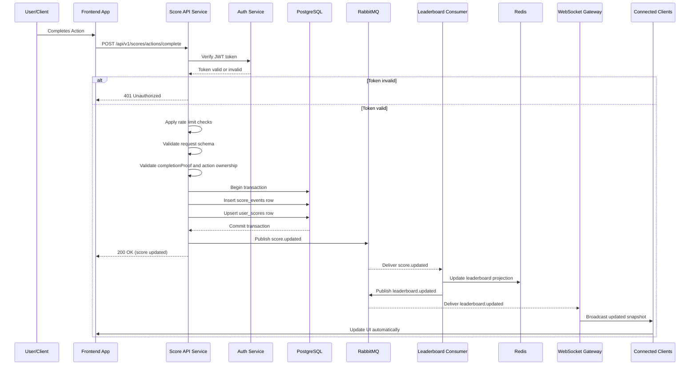

# Scoreboard API Module Specification

## Overview

This module handles score processing and real-time scoreboard delivery for a website that shows the top 10 users by score.

The implementation architecture assumed by this specification is:

- `WebSocket` for live scoreboard updates
- `PostgreSQL` as the source of truth for score state
- `Redis` for leaderboard caching
- `RabbitMQ` for asynchronous event delivery and cross-instance broadcast coordination

The module must let clients report that a user completed a valid action, update the user's score securely on the backend, and broadcast scoreboard changes to connected clients in near real time.

This specification is intended for a backend engineering team to implement inside the API service.

## Requirements Summary

1. **Scoreboard Display**: Show the top 10 user scores.
2. **Live Updates**: Update the scoreboard automatically when visible leaderboard data changes.
3. **Score Updates**: Accept an API call when a user completes a valid action.
4. **Authorization**: Ensure score-changing requests are accepted only from authenticated and authorized users.
5. **Security**: Prevent malicious users from directly injecting score changes or replaying the same action multiple times.

## Architecture Overview

### Components

1. **Action Completion API**
   Receives score-related action completion requests over HTTPS.
2. **Authentication and Authorization Service**
   Validates the caller identity and ensures the action belongs to the authenticated user.
3. **Score Processing Service**
   Verifies the submitted action proof and calculates awarded points on the server.
4. **PostgreSQL Score Storage**
   Stores immutable score events and current user scores.
5. **Redis Leaderboard Layer**
   Stores the current top leaderboard projection and supports fast reads.
6. **RabbitMQ Event Bus**
   Carries score update and leaderboard update events between backend components.
7. **Leaderboard Consumer**
   Consumes RabbitMQ score events, updates Redis, and emits leaderboard update events.
8. **WebSocket Gateway**
   Maintains client subscriptions and pushes live leaderboard snapshots to connected clients.
9. **Rate Limiting and Audit Logging**
   Protects the module from abuse and provides operational traceability.

### Recommended Processing Model

- The client reports a completed action, not a score increment.
- The backend validates the action through a trusted proof model.
- The backend calculates `awardedPoints` on the server.
- PostgreSQL stores the score update in a single transaction.
- After the PostgreSQL transaction commits, the API publishes a `score.updated` event to RabbitMQ.
- A leaderboard consumer receives the event, updates Redis, and publishes `leaderboard.updated`.
- The WebSocket gateway consumes leaderboard update events and broadcasts the updated leaderboard snapshot to all subscribed clients.

This model keeps score state authoritative, secure, and scalable.

## API Endpoints

### 1. Submit Completed Action

**Endpoint**: `POST /api/v1/scores/actions/complete`

**Description**: Accepts a completed action for score processing. The client does not send the score delta. The server validates the action and determines how many points to award.

**Request Headers**:

```text
Authorization: Bearer <JWT_TOKEN>
Idempotency-Key: <UUID>
Content-Type: application/json
```

**Request Body**:

```json
{
  "actionInstanceId": "4f3d0e48-60d9-45c5-8e4a-a7d1a1ddfd85",
  "actionType": "quiz-complete",
  "completionProof": "signed-or-one-time-proof-token",
  "timestamp": "2026-04-22T14:30:00Z",
  "metadata": {
    "sessionId": "4aaf4dc6-1110-4f55-8a4d-7056c45b4813",
    "clientVersion": "web-2026.04.22"
  }
}
```

**Field Notes**:

- `actionInstanceId`: Unique identifier for this specific action completion attempt.
- `actionType`: Logical action category recognized by backend scoring rules.
- `completionProof`: Trusted evidence that the action was completed by this user.
- `timestamp`: Optional client-observed completion time for debugging and replay checks.
- `metadata`: Optional non-authoritative context for validation and logging.

**Success Response** (`200 OK`):

```json
{
  "success": true,
  "message": "Score updated successfully",
  "data": {
    "userId": "user_123",
    "actionInstanceId": "4f3d0e48-60d9-45c5-8e4a-a7d1a1ddfd85",
    "actionType": "quiz-complete",
    "awardedPoints": 10,
    "newTotalScore": 1250,
    "scoreVersion": 87,
    "processedAt": "2026-04-22T14:30:01Z"
  }
}
```

**Error Responses**:

- `400 Bad Request`: Invalid request schema or unsupported action type.
- `401 Unauthorized`: Missing, expired, or invalid authentication token.
- `403 Forbidden`: Action proof is invalid or does not belong to the authenticated user.
- `409 Conflict`: The same `actionInstanceId` was already processed.
- `429 Too Many Requests`: Rate limit exceeded.
- `500 Internal Server Error`: Unexpected server-side failure.

### 2. Get Scoreboard

**Endpoint**: `GET /api/v1/scores/leaderboard?limit=10`

**Description**: Returns the current top N users on the leaderboard.

**Query Parameters**:

- `limit` (optional): Number of top users to return. Default `10`, maximum `10` for this module.

**Success Response** (`200 OK`):

```json
{
  "success": true,
  "data": {
    "version": 4321,
    "generatedAt": "2026-04-22T14:30:01Z",
    "leaderboard": [
      {
        "userId": "user_999",
        "username": "Alice",
        "score": 2800,
        "rank": 1,
        "lastUpdated": "2026-04-22T14:29:59Z"
      },
      {
        "userId": "user_123",
        "username": "Bob",
        "score": 1250,
        "rank": 2,
        "lastUpdated": "2026-04-22T14:30:01Z"
      }
    ]
  }
}
```

**Behavior Notes**:

- Prefer Redis for reads.
- Fall back to PostgreSQL if Redis is unavailable or empty.
- Return only public leaderboard fields.
- Include a monotonic `version` so clients can ignore stale real-time updates.

### 3. WebSocket Connection (Real-Time Updates)

**Endpoint**: `WS /api/v1/scores/stream`

**Description**: Provides real-time leaderboard snapshots to connected clients.

**Authentication**:

- If the leaderboard is public, the connection may be read-only and unauthenticated.
- If the leaderboard is private, authenticate during handshake using secure cookies or a short-lived WebSocket ticket obtained over HTTPS.
- Do not place long-lived bearer tokens in the query string.

**Client → Server**:

```json
{
  "type": "subscribe",
  "leaderboard": "global",
  "limit": 10,
  "lastKnownVersion": 4321
}
```

**Server → Client** (`leaderboard snapshot`):

```json
{
  "type": "leaderboard_snapshot",
  "data": {
    "version": 4321,
    "generatedAt": "2026-04-22T14:30:01Z",
    "leaderboard": [
      {
        "userId": "user_999",
        "username": "Alice",
        "score": 2800,
        "rank": 1,
        "lastUpdated": "2026-04-22T14:29:59Z"
      }
    ]
  }
}
```

**Server → Client** (`leaderboard update`):

```json
{
  "type": "leaderboard_update",
  "data": {
    "version": 4322,
    "generatedAt": "2026-04-22T14:30:02Z",
    "leaderboard": [
      {
        "userId": "user_999",
        "username": "Alice",
        "score": 2810,
        "rank": 1,
        "lastUpdated": "2026-04-22T14:30:02Z"
      }
    ]
  }
}
```

**WebSocket Rules**:

- The server broadcasts full visible snapshots, not score deltas.
- The client should ignore updates with `version` lower than or equal to its latest processed version.
- The server must reject any client message that attempts to change score state.
- The server should send an initial snapshot after subscription to avoid race conditions.

## Flow Diagram



## Implementation Details

### 1. Authentication and Authorization

- All score-changing requests must include a valid JWT token in the `Authorization` header.
- The backend must extract the user identity from the validated token and must not trust any client-supplied `userId`.
- The action proof must be validated against a trusted source and must be bound to the authenticated user.
- Frontend-side validation can improve user experience, but it does not count as a security control.

**Implementation Requirements**:

- token signature verification
- token expiration validation
- user session or revocation validation if supported by the platform
- action-to-user ownership validation
- optional role or entitlement checks if certain actions are restricted

### 2. Score Update Validation

- **Action Type Validation**: Verify that `actionType` is supported.
- **Proof Validation**: Verify that `completionProof` is authentic and valid for this action.
- **Duplicate Prevention**: Enforce uniqueness on `actionInstanceId`.
- **Replay Protection**: Reject expired proofs or already-consumed proofs.
- **Award Rules**: Compute `awardedPoints` on the server according to configured rules.
- **Timestamp Window**: Use the submitted timestamp only as supplemental validation and diagnostics, not as the primary trust signal.

**Important Rule**:

The request must never include `scoreIncrement`, `newScore`, or `rank` as authoritative input. Those values belong to the server only.

### 3. Rate Limiting

Implement rate limiting to reduce abuse:

- **Per User**: Limit how many action completion requests a single user can submit.
- **Per IP**: Apply a secondary defense against network-based abuse.
- **Per Action Type**: Optionally apply tighter limits for sensitive or high-value actions.

**Recommended Limits**:

- per user: `60` updates per minute, `1000` updates per hour
- per IP: `100` updates per minute

If a limit is exceeded:

- return `429 Too Many Requests`
- include a `Retry-After` header when possible
- record the event in abuse monitoring

### 4. Real-Time Updates

**Recommended Approach: WebSocket**

- Clients fetch the initial leaderboard over HTTP.
- Clients then open a WebSocket connection and subscribe to leaderboard updates.
- The server pushes a full top-10 snapshot whenever the visible leaderboard changes.
- WebSocket gateways in multiple instances receive the same message through RabbitMQ fan-out delivery.

**Fallback Option**:

- Polling may be supported as a non-primary fallback for clients that cannot keep a WebSocket connection.

**Broadcast Rule**:

Broadcast only when the visible top 10 changes, for example:

- a user enters the top 10
- a user leaves the top 10
- ranks change inside the top 10
- a user already in the top 10 gains points

### 5. Database Schema

**Users Table**:

```sql
CREATE TABLE users (
    user_id VARCHAR(255) PRIMARY KEY,
    username VARCHAR(255) NOT NULL,
    created_at TIMESTAMP WITH TIME ZONE NOT NULL DEFAULT CURRENT_TIMESTAMP
);
```

**User Scores Table**:

```sql
CREATE TABLE user_scores (
    user_id VARCHAR(255) PRIMARY KEY,
    total_score BIGINT NOT NULL DEFAULT 0,
    last_scored_at TIMESTAMP WITH TIME ZONE NOT NULL DEFAULT CURRENT_TIMESTAMP,
    version BIGINT NOT NULL DEFAULT 0,
    updated_at TIMESTAMP WITH TIME ZONE NOT NULL DEFAULT CURRENT_TIMESTAMP,
    FOREIGN KEY (user_id) REFERENCES users(user_id),
    CHECK (total_score >= 0),
    CHECK (version >= 0)
);

CREATE INDEX idx_user_scores_total_score_desc ON user_scores(total_score DESC);
```

**Score Events Table**:

```sql
CREATE TABLE score_events (
    id UUID PRIMARY KEY,
    user_id VARCHAR(255) NOT NULL,
    action_instance_id UUID NOT NULL,
    action_type VARCHAR(255) NOT NULL,
    awarded_points INT NOT NULL,
    validation_source VARCHAR(255) NOT NULL,
    metadata_json JSONB NOT NULL DEFAULT '{}'::jsonb,
    created_at TIMESTAMP WITH TIME ZONE NOT NULL DEFAULT CURRENT_TIMESTAMP,
    FOREIGN KEY (user_id) REFERENCES users(user_id),
    UNIQUE (action_instance_id),
    CHECK (awarded_points >= 0)
);

CREATE INDEX idx_score_events_user_created_at ON score_events(user_id, created_at DESC);
```

**Redis Structures**:

- `redis:global:zset`: Sorted set storing user score ranking candidates.
- `redis:user:<userId>:public`: Cached public display data for leaderboard rendering.
- `redis:global:top10:snapshot`: Serialized current top-10 snapshot.
- `redis:global:top10:version`: Current leaderboard version.

**RabbitMQ Topology**:

- Exchange `score.events`
  Used by the API service to publish `score.updated`.
- Queue `leaderboard.projection`
  Consumed by the leaderboard consumer to update Redis.
- Exchange `leaderboard.events`
  Fanout exchange used to distribute visible leaderboard updates.
- Queue pattern `ws.gateway.<instance-id>`
  Bound by each WebSocket gateway instance so every instance receives the same broadcast payload.

**Recommended Event Shape**:

RabbitMQ messages should carry absolute score state rather than only a delta. This makes consumers easier to keep idempotent.

Use publisher confirms when sending score events. If the team later needs stricter guaranteed delivery between PostgreSQL commit and RabbitMQ publish, add a transactional outbox relay as a hardening step.

Example `score.updated` payload:

```json
{
  "eventId": "evt_01HXYZ...",
  "type": "score.updated",
  "userId": "user_123",
  "actionInstanceId": "4f3d0e48-60d9-45c5-8e4a-a7d1a1ddfd85",
  "newTotalScore": 1250,
  "scoreVersion": 87,
  "occurredAt": "2026-04-22T14:30:01Z"
}
```

### 6. Security Considerations

1. **Server-Authoritative Scoring**: The backend calculates points. The client cannot choose score increments.
2. **Input Validation**: Validate and sanitize all input fields.
3. **SQL Injection Prevention**: Use parameterized queries or a safe ORM.
4. **Replay Prevention**: Use `actionInstanceId`, proof consumption checks, and uniqueness constraints.
5. **Audit Logging**: Log accepted and rejected score submission attempts.
6. **Transport Security**: Use HTTPS and WSS in production.
7. **Secrets Management**: Store JWT secrets, signing keys, and database credentials securely.
8. **WebSocket Security**: Enforce origin checks, connection limits, and malformed message handling.
9. **RabbitMQ Reliability**: Use durable exchanges, durable queues, publisher confirms, acknowledgements, and dead-letter queues.
10. **Data Exposure Control**: Return public leaderboard data only.

### 7. Error Handling

- Return stable HTTP status codes and machine-readable error codes.
- Do not expose internal stack traces or sensitive validation details to clients.
- Log server-side failures with request identifiers and enough context for diagnosis.
- Treat Redis, RabbitMQ, and WebSocket failures as recoverable if PostgreSQL writes have already succeeded.
- Ensure duplicate requests do not create duplicate score events.

### 8. Performance Considerations

- **Database Indexing**: Index score tables for write and read efficiency.
- **Redis Caching**: Serve leaderboard reads from Redis whenever possible.
- **RabbitMQ Messaging**: Decouple score writes from leaderboard projection and broadcast.
- **Connection Pooling**: Use database, Redis, and RabbitMQ connection pools.
- **Horizontal Scaling**: Allow multiple API, consumer, and WebSocket instances.
- **Selective Broadcasting**: Broadcast only when the visible leaderboard changes.
- **Idempotent Consumers**: Ensure repeated RabbitMQ deliveries do not corrupt Redis state.

## Testing Requirements

### Unit Tests

- score rule calculation
- request schema validation
- proof validation logic
- rate limiting logic
- WebSocket message validation

### Integration Tests

- API endpoint integration
- transactional score write flow
- duplicate action handling
- concurrent updates to the same user
- RabbitMQ publish and consume flow
- Redis projection updates
- WebSocket subscription and update delivery

### Security Tests

- invalid or expired JWT rejection
- replayed action rejection
- unauthorized action ownership checks
- rate limit enforcement
- malformed WebSocket message handling

## Additional Improvement Comments

### 1. Enhanced Security

- add anomaly detection for unusual score growth
- flag repeated failures from the same IP or device
- support one-time proof consumption and proof expiry windows
- add internal review tooling for suspicious score events

### 2. Performance Optimizations

- use Redis sorted sets and cached snapshots together
- tune RabbitMQ prefetch and consumer concurrency for higher throughput
- add compression for WebSocket payloads if connection volume becomes large
- consider read replicas for non-critical leaderboard fallback reads

### 3. Feature Enhancements

- add seasonal or time-scoped leaderboards
- add per-user rank lookup outside the top 10
- add regional or category-based leaderboard variants
- add notifications when a user enters or exits the top 10

### 4. Monitoring and Observability

- track request latency and error rate by endpoint
- track duplicate action attempts
- track RabbitMQ queue depth and consumer lag
- track RabbitMQ dead-letter count
- track Redis cache hit rate
- track active WebSocket connections and broadcast count
- alert on unusual score spikes or proof validation failures

### 5. User Experience

- provide an initial HTTP snapshot before opening WebSocket subscription
- use `version` ordering on the client to ignore stale updates
- reconnect WebSocket with exponential backoff
- expose a fallback polling mode for constrained environments if needed

### 6. Scalability Considerations

- keep RabbitMQ consumers separate from the main API process
- use RabbitMQ fanout for multi-instance WebSocket broadcast delivery
- keep the write path authoritative in PostgreSQL even if Redis is unavailable
- move WebSocket serving to a dedicated service if connection counts grow significantly

### 7. Data Integrity

- keep score writes transactional
- enforce uniqueness on `actionInstanceId`
- make RabbitMQ consumer processing idempotent
- prepare a runbook for rebuilding Redis from PostgreSQL
- monitor for queue backlog growth and dead-letter events

### 8. Documentation

- publish OpenAPI definitions for HTTP endpoints
- publish a WebSocket protocol document with message schemas
- document Redis key conventions
- document RabbitMQ exchange, queue, and routing-key conventions
- document deployment and recovery runbooks
- document architecture decisions that explain why the client cannot submit raw score increments

## Deployment Checklist

- [ ] Environment variables configured for JWT, PostgreSQL, Redis, RabbitMQ, and WebSocket settings
- [ ] Database migrations applied
- [ ] Redis connectivity configured
- [ ] RabbitMQ exchanges, queues, bindings, and dead-letter queues configured
- [ ] HTTPS and WSS enabled
- [ ] Rate limiting configured and tested
- [ ] Audit logging enabled
- [ ] Monitoring and alerting configured
- [ ] RabbitMQ consumer deployment verified
- [ ] WebSocket load balancer upgrade support verified
- [ ] Redis rebuild and RabbitMQ recovery runbooks prepared
- [ ] Load testing completed
- [ ] Security review completed
- [ ] API and WebSocket documentation published

## Technology Stack Recommendations

- **API Framework**: Express.js, NestJS
- **Database**: PostgreSQL
- **Cache**: Redis
- **Message Broker**: RabbitMQ
- **Real-Time Delivery**: Native WebSocket, `ws`, Socket.IO, or framework-native gateway support
- **Authentication**: JWT with secure session handling
- **Rate Limiting**: Redis-backed rate limiting middleware
- **Validation**: Zod, class-validator or equivalent
- **Monitoring**: Grafana, Datadog, or equivalent
- **Logging**: Pino, Winston, structured JSON logging, or equivalent
