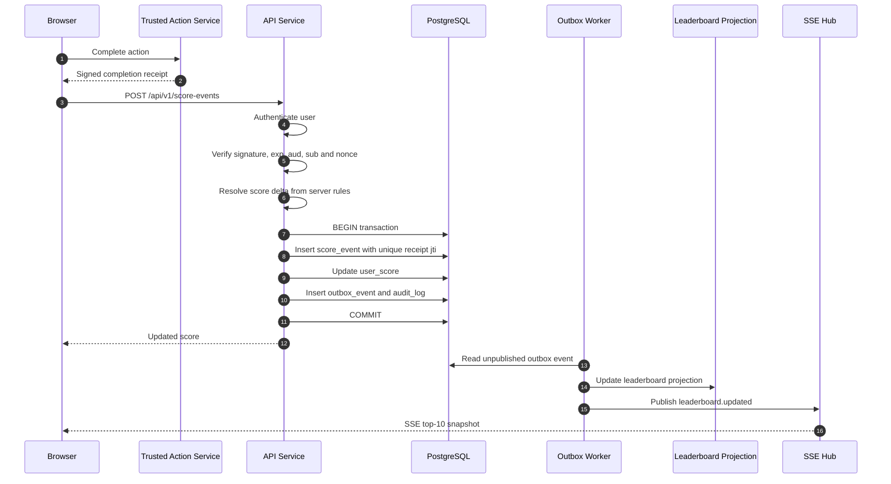

# Problem 6 — Secure Real-Time Scoreboard Module

## 1. Purpose

This document specifies a backend module that:

1. accepts authorised action-completion notifications;
2. increases the authenticated user's score;
3. prevents replayed or forged score updates;
4. returns the top 10 users;
5. pushes leaderboard changes to connected browsers in near real time.

The specification is intended for a backend engineering team to implement.

---

## 2. Critical security principle

**The client must never be allowed to submit an arbitrary score or score
increment.**

The browser may report that an action was completed, but the API service must
only apply a score change after validating evidence issued by a trusted
server-side component.

Accepted evidence is one of the following:

- a short-lived, signed action receipt issued by a trusted Action Service; or
- a server-to-server completion event authenticated with mTLS or a request
  signature; or
- an authoritative action-completion record that the Scoreboard Module can
  verify in a trusted database.

A request such as this must not be supported:

```json
{
  "userId": "another-user",
  "score": 99999999,
  "increment": 1000000
}
```

The user identity comes from the authenticated access token, and the score
delta comes from server-side action rules.

---

## 3. Scope

### In scope

- Submit an authorised action completion.
- Apply a server-controlled score increment.
- Make updates idempotent.
- Persist score history.
- Return the top 10 leaderboard.
- Broadcast live leaderboard updates.
- Store audit and trouble logs.
- Recover reliably from publish or cache failures.

### Out of scope

- The business logic that decides whether the underlying user action is
  complete.
- User registration and login.
- UI design.
- Rewards, badges, seasons, tournaments, and score expiration.

---

## 4. Proposed architecture

### Main components

| Component | Responsibility |
|---|---|
| HTTP Controller | Validates request shape and authentication context. |
| Completion Proof Validator | Verifies signed receipt, expiry, audience, user, action, and nonce. |
| Score Command Service | Applies idempotency and calculates the server-owned score delta. |
| Score Repository | Writes score event and current score in one database transaction. |
| Outbox Repository | Stores a reliable event in the same transaction. |
| Outbox Publisher | Publishes committed score changes asynchronously. |
| Leaderboard Projection | Updates the top-score read model or Redis sorted set. |
| Leaderboard Query Service | Returns the current top 10. |
| Realtime Hub | Sends leaderboard snapshots over Server-Sent Events. |
| Audit Log | Records successful score-changing operations. |
| Trouble Log | Records rejected requests and unexpected failures. |

### Recommended infrastructure

```text
PostgreSQL
  Source of truth for score events, totals, outbox, audit, and trouble logs.

Redis
  Optional fast leaderboard projection and pub/sub transport.

SSE
  Recommended for browser live updates because the data flow is server-to-client.
```

The module can initially run as one ExpressJS application. The internal
boundaries should remain explicit so the publisher or realtime component can be
split into separate processes later.

---

## 5. Execution flow

The rendered flow is available at:

```text
diagrams/score-update-flow.svg
diagrams/score-update-flow.png
```

Mermaid source:



### Detailed processing rules

1. The user completes an action.
2. A trusted Action Service produces a signed, short-lived completion receipt.
3. The browser calls the score endpoint with its access token, receipt, and
   idempotency key.
4. The API derives `userId` from the access token.
5. The API validates the receipt signature and claims.
6. The API verifies that the receipt user matches the authenticated user.
7. The API rejects an expired, reused, malformed, or unauthorised receipt.
8. The API resolves the score delta from server-side configuration.
9. A database transaction inserts the immutable score event.
10. The transaction updates the user's current score.
11. The transaction inserts an outbox event and audit record.
12. The API commits and returns the new score.
13. A background publisher updates the leaderboard projection.
14. The realtime hub sends the new top 10 to connected clients.

---

## 6. API specification

Base path:

```text
/api/v1
```

### 6.1 Submit an action completion

```http
POST /api/v1/score-events
Authorization: Bearer <access-token>
Idempotency-Key: <uuid>
Content-Type: application/json
```

Request:

```json
{
  "actionReceipt": "<signed-token>"
}
```

The receipt should contain claims equivalent to:

```json
{
  "iss": "trusted-action-service",
  "aud": "scoreboard-api",
  "sub": "user-id",
  "jti": "unique-action-instance-id",
  "actionType": "DAILY_CHALLENGE",
  "iat": 1785770000,
  "exp": 1785770060
}
```

The receipt must not contain a client-controlled numeric score delta. The API
maps `actionType` to a score rule.

Successful response:

```http
200 OK
```

```json
{
  "data": {
    "eventId": "a7c5e79c-2a7c-47d2-86e8-715151210402",
    "userId": "0be81df1-d3e0-41c0-8693-6fdf988249d0",
    "appliedDelta": 20,
    "score": 1240,
    "leaderboardVersion": 381,
    "applied": true
  }
}
```

Repeated request with the same valid idempotency key and same payload:

```http
200 OK
```

The API returns the original response with:

```json
{
  "applied": false
}
```

The score must not be increased again.

Errors:

| Status | Code | Meaning |
|---:|---|---|
| 400 | `VALIDATION_ERROR` | Invalid request shape. |
| 401 | `UNAUTHENTICATED` | Missing or invalid access token. |
| 403 | `INVALID_ACTION_RECEIPT` | Receipt invalid or does not belong to the user. |
| 409 | `IDEMPOTENCY_CONFLICT` | Same key reused with different request content. |
| 409 | `RECEIPT_ALREADY_USED` | Receipt `jti` already consumed by a different request. |
| 429 | `RATE_LIMITED` | Request rate exceeded. |
| 500 | `INTERNAL_SERVER_ERROR` | Unexpected error. |
| 503 | `DEPENDENCY_UNAVAILABLE` | Required dependency temporarily unavailable. |

### 6.2 Get top leaderboard

```http
GET /api/v1/leaderboard?limit=10
```

Rules:

- Default and maximum limit is 10.
- Public user profiles must expose only approved display data.
- Ties use deterministic secondary ordering:
  `score DESC, reached_score_at ASC, user_id ASC`.

Response:

```json
{
  "data": {
    "version": 381,
    "generatedAt": "2026-08-03T16:00:00.000Z",
    "entries": [
      {
        "rank": 1,
        "userId": "user-1",
        "displayName": "Player One",
        "score": 9820
      }
    ]
  }
}
```

### 6.3 Subscribe to live leaderboard updates

```http
GET /api/v1/leaderboard/stream
Accept: text/event-stream
Last-Event-ID: 380
```

Example SSE event:

```text
id: 381
event: leaderboard.updated
data: {"version":381,"entries":[{"rank":1,"userId":"user-1","score":9820}]}
```

Rules:

- Send the current full top-10 snapshot immediately after connection.
- Send heartbeat comments every 15–30 seconds.
- Support reconnect using `Last-Event-ID`.
- If a client misses events, send the newest full snapshot rather than replaying
  every historical ranking.
- Apply connection limits per user and IP.

---

## 7. Data model

### `user_scores`

Stores the current score for fast reads.

```sql
CREATE TABLE user_scores (
  user_id UUID PRIMARY KEY,
  score BIGINT NOT NULL DEFAULT 0 CHECK (score >= 0),
  version BIGINT NOT NULL DEFAULT 0,
  reached_score_at TIMESTAMPTZ NOT NULL,
  updated_at TIMESTAMPTZ NOT NULL
);

CREATE INDEX idx_user_scores_leaderboard
  ON user_scores(score DESC, reached_score_at ASC, user_id ASC);
```

### `score_events`

Immutable source of score changes.

```sql
CREATE TABLE score_events (
  id UUID PRIMARY KEY,
  user_id UUID NOT NULL,
  receipt_jti TEXT NOT NULL UNIQUE,
  idempotency_key TEXT NOT NULL,
  request_hash TEXT NOT NULL,
  action_type TEXT NOT NULL,
  score_delta BIGINT NOT NULL CHECK (score_delta > 0),
  score_after BIGINT NOT NULL,
  receipt_hash TEXT NOT NULL,
  created_at TIMESTAMPTZ NOT NULL,

  UNIQUE(user_id, idempotency_key)
);
```

### `outbox_events`

Provides reliable event publication.

```sql
CREATE TABLE outbox_events (
  id UUID PRIMARY KEY,
  aggregate_type TEXT NOT NULL,
  aggregate_id TEXT NOT NULL,
  event_type TEXT NOT NULL,
  payload JSONB NOT NULL,
  attempts INTEGER NOT NULL DEFAULT 0,
  available_at TIMESTAMPTZ NOT NULL,
  published_at TIMESTAMPTZ,
  created_at TIMESTAMPTZ NOT NULL
);
```

### `audit_logs`

Records successful security-sensitive changes.

Suggested fields:

```text
id
trace_id
request_id
user_id
action
score_event_id
receipt_jti
input_hash
result_hash
created_at
```

Do not store the raw access token or raw signed receipt.

### `trouble_logs`

Records rejected and failed requests.

Suggested fields:

```text
id
trace_id
request_id
user_id
method
path
status_code
error_code
message
details_json
duration_ms
created_at
```

Sensitive receipt contents and secrets must be redacted.

---

## 8. Transaction and consistency rules

The following operations must occur in one database transaction:

1. insert `score_events`;
2. update `user_scores`;
3. insert `outbox_events`;
4. insert `audit_logs`.

If any operation fails, roll back all four.

The database is the source of truth. Redis is a disposable projection.

### Idempotency

The implementation must enforce both:

```text
UNIQUE(receipt_jti)
UNIQUE(user_id, idempotency_key)
```

The stored `request_hash` prevents reuse of the same idempotency key with a
different request.

### Concurrency

Lock or atomically update the user's score row:

```sql
UPDATE user_scores
SET
  score = score + :delta,
  version = version + 1,
  reached_score_at = NOW(),
  updated_at = NOW()
WHERE user_id = :user_id
RETURNING score, version;
```

If a row may not exist, use `INSERT ... ON CONFLICT ... DO UPDATE`.

---

## 9. Leaderboard projection

### Baseline implementation

Read the top 10 directly from PostgreSQL using the leaderboard index.

Suitable when:

- traffic is moderate;
- leaderboard updates are not extremely frequent;
- operational simplicity is preferred.

### Scalable implementation

Use a Redis sorted set:

```text
Key: leaderboard:global
Member: userId
Score: current score
```

The outbox worker updates Redis after the database transaction commits.

Tie-breaking cannot rely only on a Redis numeric score without additional
encoding. Recommended options:

1. retrieve more than 10 candidates from Redis and apply deterministic ordering
   from PostgreSQL; or
2. maintain a dedicated leaderboard projection table with explicit rank fields.

A periodic reconciliation job must rebuild or verify the projection from
PostgreSQL.

---

## 10. Security requirements

### Authentication

- Require a valid user access token.
- Derive the user ID from the verified token.
- Never trust `userId` from request JSON.

### Action receipt validation

Validate:

```text
signature
issuer
audience
subject/user
action type
issued-at time
expiry time
unique jti/nonce
supported signing key id
```

Signing keys must be rotated and retrieved from a trusted key set.

### Replay prevention

- Store every consumed receipt `jti`.
- Apply a unique database constraint.
- Keep receipt expiry short.
- Reject duplicated receipt use even if it arrives concurrently.

### Score integrity

- Score rules are configured server-side.
- The receipt selects an action type, not a numeric score.
- Set a maximum delta per action.
- Set daily and hourly score velocity limits.
- Flag abnormal patterns for review.

### Transport and infrastructure

- TLS is mandatory.
- Use mTLS or signed requests for server-to-server calls.
- Apply rate limits by user, IP, and action type.
- Protect private log endpoints with administrator permissions.
- Redact tokens, receipts, keys, and personal data from logs.

---

## 11. Realtime delivery

SSE is preferred because leaderboard updates are one-way.

The realtime hub may run in-process for the initial version. For multiple API
instances, use Redis Pub/Sub, Redis Streams, NATS, or Kafka so every instance
receives the update.

The event payload should contain the full top-10 snapshot because:

- only 10 entries are required;
- reconnect logic is simpler;
- clients do not need to reproduce ranking rules;
- missed intermediate events do not matter.

Target:

```text
Committed score to browser update: P95 < 1 second
```

---

## 12. Failure handling

| Failure | Required behaviour |
|---|---|
| Receipt verification fails | Return 403 and write trouble log. |
| Duplicate receipt | Return deterministic duplicate response; do not increment. |
| Database transaction fails | Roll back and return 500/503. |
| Outbox publish fails | Keep event unpublished and retry with backoff. |
| Redis unavailable | Continue writing PostgreSQL; query PostgreSQL fallback. |
| SSE client disconnects | Clean up connection and allow reconnect. |
| Malformed request | Return 400 with request ID and write trouble log. |
| Unexpected exception | Return generic 500; store internal details in trouble log. |

Outbox retry policy:

```text
exponential backoff
maximum attempt threshold
dead-letter state after repeated failures
operator alert
manual replay capability
```

---

## 13. Observability

### Structured logs

Every request should include:

```text
timestamp
level
service
request_id
trace_id
user_id
route
method
status_code
duration_ms
error_code
```

### Metrics

```text
score_updates_total{result}
score_update_duration_ms
receipt_validation_failures_total{reason}
duplicate_receipts_total
idempotency_conflicts_total
leaderboard_query_duration_ms
leaderboard_publish_lag_ms
outbox_pending_total
outbox_publish_failures_total
sse_connections_active
sse_delivery_failures_total
```

### Alerts

- sustained receipt-validation failures;
- unusual score velocity;
- outbox backlog above threshold;
- leaderboard projection drift;
- elevated 5xx rate;
- SSE delivery lag above target.

---

## 14. Non-functional requirements

| Area | Target |
|---|---|
| Score update response | P95 < 200 ms excluding external proof lookup. |
| Leaderboard query | P95 < 100 ms. |
| Live update latency | P95 < 1 second after commit. |
| Availability | 99.9% initial target. |
| Durability | No committed score event may be lost. |
| Consistency | Score event and total updated atomically. |
| Security | No client-controlled score delta. |
| Auditability | Every accepted update traceable to one receipt and request. |

---

## 15. Test plan

### Unit tests

- receipt claim validation;
- action-to-delta mapping;
- idempotency hash comparison;
- score bounds;
- ranking tie-break rules;
- error mapping and redaction.

### Integration tests

- valid receipt increases score once;
- duplicate receipt does not increase score;
- same idempotency key returns original response;
- conflicting idempotency payload returns 409;
- expired or wrong-user receipt returns 403;
- transaction rollback leaves no partial data;
- outbox event exists after successful update;
- audit record exists after successful update;
- trouble record exists after rejected update;
- leaderboard returns deterministic top 10.

### Concurrency tests

- hundreds of simultaneous duplicate receipt submissions;
- simultaneous valid actions for the same user;
- simultaneous valid actions for different users;
- no lost updates;
- exactly one score event per receipt.

### Realtime tests

- initial snapshot on connect;
- update delivered after commit;
- reconnect using `Last-Event-ID`;
- multiple API instances receive the same event;
- disconnected clients are cleaned up.

### Security tests

- forged receipt;
- altered receipt payload;
- wrong audience or issuer;
- expired receipt;
- replayed receipt;
- another user's receipt;
- arbitrary score and user fields injected into JSON;
- rate-limit enforcement.

---

## 16. Acceptance criteria

The module is ready when:

1. a valid authorised completion increases the correct user's score once;
2. a forged or replayed request cannot increase a score;
3. the top 10 endpoint returns deterministic rankings;
4. connected clients receive a new snapshot after a committed score update;
5. database failure cannot leave partial score state;
6. publish failure cannot lose the committed update;
7. accepted changes produce audit records;
8. rejected or failed requests produce trouble records;
9. integration, concurrency, and security tests pass;
10. secrets and raw credentials never appear in logs.

---

## 17. Additional improvement comments

### 17.1 Use server-to-server completion events where possible

The strongest design is for the trusted Action Service to call the Scoreboard
Module directly. A browser-carried signed receipt is acceptable, but direct
server communication reduces client manipulation opportunities.

### 17.2 Consider event sourcing only when justified

`score_events` already provides an immutable ledger. Full event sourcing is not
required for the initial implementation. Keep `user_scores` as a transactional
projection and periodically reconcile it against the event ledger.

### 17.3 Add seasons without rewriting the module

Introduce a `leaderboard_id` or `season_id` in `score_events` and `user_scores`
before supporting multiple leaderboards. Do not hard-code one global board into
all repository interfaces.

### 17.4 Add abuse detection

Record score velocity and action diversity. Generate a security review event
when a user exceeds plausible thresholds instead of silently accepting every
individually valid receipt.

### 17.5 Protect administrative log APIs

Audit and trouble logs may contain operational or personal data. Expose them
only through authenticated administrator endpoints with pagination, retention,
and redaction policies.

### 17.6 Define score limits

Use `BIGINT`, reject arithmetic overflow, and define a maximum score. Never rely
on JavaScript `number` for unbounded integer values without explicit safe-range
checks.

### 17.7 Prefer full snapshots for top 10 updates

Sending the complete top 10 on each change is simpler and safer than sending
incremental rank movements. The payload is small and clients remain stateless.

---

## 18. Suggested implementation order

1. Database schema and migrations.
2. Receipt validator interface and test signing keys.
3. Transactional score command service.
4. Idempotency and replay constraints.
5. Leaderboard query endpoint.
6. Outbox worker.
7. SSE endpoint.
8. Audit and trouble logs.
9. Reconciliation job.
10. Load, concurrency, and security tests.
