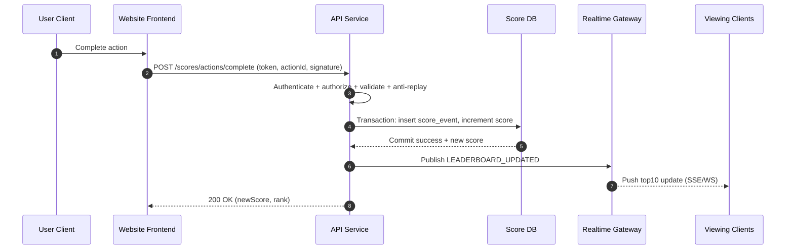

# Live Scoreboard API Module Specification

## 1. Purpose

This document specifies a backend module that powers a live top-10 scoreboard.
It is intended for a backend engineering team to implement in an API service.

The module must:

- Persist and update user scores.
- Expose the top 10 scores for display.
- Push live scoreboard updates to connected clients.
- Prevent unauthorized or malicious score inflation.

## 2. Scope

### In Scope

- Score update endpoint called when a user completes a valid action.
- Real-time publication of scoreboard changes.
- Top-10 query endpoint.
- Authentication, authorization, and anti-abuse controls.
- Auditability of score mutations.

### Out of Scope

- Definition of the user action itself.
- Frontend UI behavior details.
- User profile management.

## 3. Functional Requirements Mapping

1. Show top 10 user scores.
2. Support live scoreboard updates.
3. Completing an action increases score.
4. Frontend sends API request to update score after action completion.
5. Reject malicious or unauthorized score updates.

## 4. High-Level Architecture

Components:

- API Service: validates requests, enforces security, updates score state.
- Score Store: persistent database for user scores and score events.
- Realtime Gateway: WebSocket or Server-Sent Events (SSE) broadcaster.
- Cache/Leaderboard View: optional fast read model for top-10 queries.
- Message Bus (optional): decouples write path from realtime fan-out at scale.

Recommended pattern:

- Command path: client -> API -> DB transaction -> publish score-changed event.
- Query path: client -> API -> top-10 read model (cache or indexed query).

## 5. Data Model

### 5.1 Tables / Collections

`users`

- `id` (UUID, PK)
- `status` (active, suspended)

`scores`

- `user_id` (UUID, PK/FK to users)
- `score` (bigint, default 0)
- `updated_at` (timestamp)
- index: `(score DESC, updated_at ASC)` for leaderboard retrieval

`score_events` (append-only audit log)

- `id` (UUID, PK)
- `user_id` (UUID)
- `action_id` (string/UUID, unique for idempotency)
- `score_delta` (int, positive)
- `source` (web, mobile, internal)
- `created_at` (timestamp)
- unique index: `(action_id)`

### 5.2 Notes

- Use bigint for score to avoid overflow.
- Maintain immutable event log for fraud analysis and replay.

## 6. API Contract

Base path: `/api/v1`

### 6.1 Submit Score Update

`POST /scores/actions/complete`

Purpose:

- Register completion of a user action and increase score.

Authentication:

- Required: Bearer access token (user identity).

Authorization:

- User can only mutate own score unless service-account scope is present.

Request body:

```json
{
  "actionId": "a4f7ad86-7d0d-4a65-a488-76e5d0e5f2c9",
  "scoreDelta": 10,
  "actionType": "MATCH_WIN",
  "actionTimestamp": "2026-04-12T10:30:00Z",
  "nonce": "d0f9...",
  "signature": "base64-hmac-or-jws"
}
```

Validation rules:

- `actionId` required and unique (idempotency key).
- `scoreDelta` must match server-side policy for `actionType`; never trust client-provided raw points without verification.
- `actionTimestamp` must be within allowed clock skew window (for replay resistance).
- Signature must be valid for configured secret/public key.
- Reject suspended users.

Responses:

- `200 OK`: score accepted and applied (or idempotent replay with same result).
- `202 Accepted`: optional async processing mode.
- `400 Bad Request`: schema/validation failure.
- `401 Unauthorized`: missing/invalid auth.
- `403 Forbidden`: unauthorized user or invalid signature scope.
- `409 Conflict`: duplicated `actionId` with inconsistent payload.
- `429 Too Many Requests`: rate-limited.

Response body:

```json
{
  "userId": "3cb7f889-f53c-42ad-946f-772f3e0f82d4",
  "newScore": 2570,
  "appliedDelta": 10,
  "leaderboardRank": 4,
  "processedAt": "2026-04-12T10:30:01Z"
}
```

### 6.2 Get Top 10 Leaderboard

`GET /leaderboard?limit=10`

Purpose:

- Fetch current top-N users, default 10, max 100.

Response:

```json
{
  "generatedAt": "2026-04-12T10:30:01Z",
  "items": [
    {
      "rank": 1,
      "userId": "u1",
      "score": 3200
    }
  ]
}
```

### 6.3 Realtime Subscription

Option A: `GET /leaderboard/stream` (SSE)

Option B: `WS /realtime` with channel `leaderboard.top10`

Event payload:

```json
{
  "type": "LEADERBOARD_UPDATED",
  "version": 1842,
  "generatedAt": "2026-04-12T10:30:01Z",
  "items": [
    { "rank": 1, "userId": "u1", "score": 3200 },
    { "rank": 2, "userId": "u2", "score": 3110 }
  ]
}
```

Guarantees:

- At-least-once event delivery for realtime channel.
- Clients should handle duplicates by `version`.

## 7. Security and Abuse Prevention

Mandatory controls:

- Strong authentication (JWT or equivalent).
- Token audience/scope checks.
- Request signing for action completion payloads.
- Idempotency via `actionId` unique constraint.
- Per-user and per-IP rate limits.
- Server-side score policy enforcement (ignore untrusted client score math).
- Replay protection with nonce + timestamp + short validity window.
- Fraud rules:
  - detect impossible action frequencies,
  - detect abnormal score velocity,
  - quarantine suspicious updates for review.

Operational controls:

- Full audit log (`score_events`) with immutable storage policy.
- Alerting on threshold anomalies and signature validation failures.
- WAF and bot mitigation in front of API.

## 8. Consistency and Concurrency

Score update transaction must be atomic:

1. Validate auth + request integrity.
2. Check idempotency key.
3. Insert score event.
4. Update user score (`score = score + delta`).
5. Commit transaction.
6. Publish leaderboard update event.

Concurrency requirements:

- No lost updates under concurrent requests.
- Use DB row-level locking or atomic increment statements.

## 9. Performance and Scalability Targets

- Read endpoint p95 latency: < 100 ms.
- Score update p95 latency: < 200 ms (sync mode).
- Realtime fan-out delay target: < 1 second from commit.
- Throughput target to define with product traffic forecast (initially at least 1k updates/sec burst-capable).

Implementation guidance:

- Cache top-10 snapshot with short TTL (for example 1-3 seconds) or event-driven invalidation.
- Use pagination-capable leaderboard API to extend beyond top 10 in the future.

## 10. Observability

Metrics:

- `score_update_requests_total` (by status)
- `score_update_rejected_total` (by reason)
- `score_update_latency_ms`
- `leaderboard_query_latency_ms`
- `realtime_delivery_lag_ms`

Logs and tracing:

- Correlate every update request with `requestId`, `userId`, `actionId`.
- Distributed trace across API, DB, and realtime publisher.

## 11. Error Handling

Standard error format:

```json
{
  "error": {
    "code": "INVALID_SIGNATURE",
    "message": "Request signature validation failed",
    "details": {}
  }
}
```

Error codes (minimum):

- `INVALID_TOKEN`
- `FORBIDDEN`
- `INVALID_PAYLOAD`
- `DUPLICATE_ACTION_ID`
- `RATE_LIMITED`
- `INVALID_SIGNATURE`
- `REPLAY_DETECTED`

## 12. Execution Flow Diagram



## 13. Test Strategy (Implementation Acceptance)

Unit tests:

- Score policy validation by action type.
- Signature and nonce validation.
- Idempotency handling.

Integration tests:

- End-to-end score update transaction with concurrent writes.
- Duplicate `actionId` replay behavior.
- Unauthorized and malformed requests.

Realtime tests:

- Leaderboard event emitted after successful commit.
- Clients receive deduplicated ordered updates using `version`.

Security tests:

- Token tampering, signature tampering, replay attempts, and rate-limit bypass attempts.

## 14. Additional Comments and Improvement Opportunities

1. Prefer deriving `scoreDelta` on the server from `actionType` and authoritative business rules; treat client values as hints only.
2. Consider an event-driven architecture (event bus + consumer) if write throughput and fan-out grow significantly.
3. Add a risk engine that can soft-block suspicious users instead of hard-failing all updates.
4. Introduce seasonal leaderboard partitions to keep indexes compact and queries fast.
5. Define clear privacy policy for exposing user identity on leaderboard (for example display name aliasing).
6. Add dead-letter handling for failed realtime publishes to avoid silent data staleness.
7. Establish SLOs and alert thresholds early so production regressions are quickly detected.

## 15. Delivery Checklist for Backend Team

- Implement endpoints and auth middleware.
- Enforce idempotency and anti-replay guarantees.
- Add DB schema + indexes + migration scripts.
- Implement realtime broadcaster and client subscription contract.
- Add observability dashboards and security alerts.
- Provide OpenAPI spec and postman/contract tests.
- Validate load and concurrency against targets before release.
