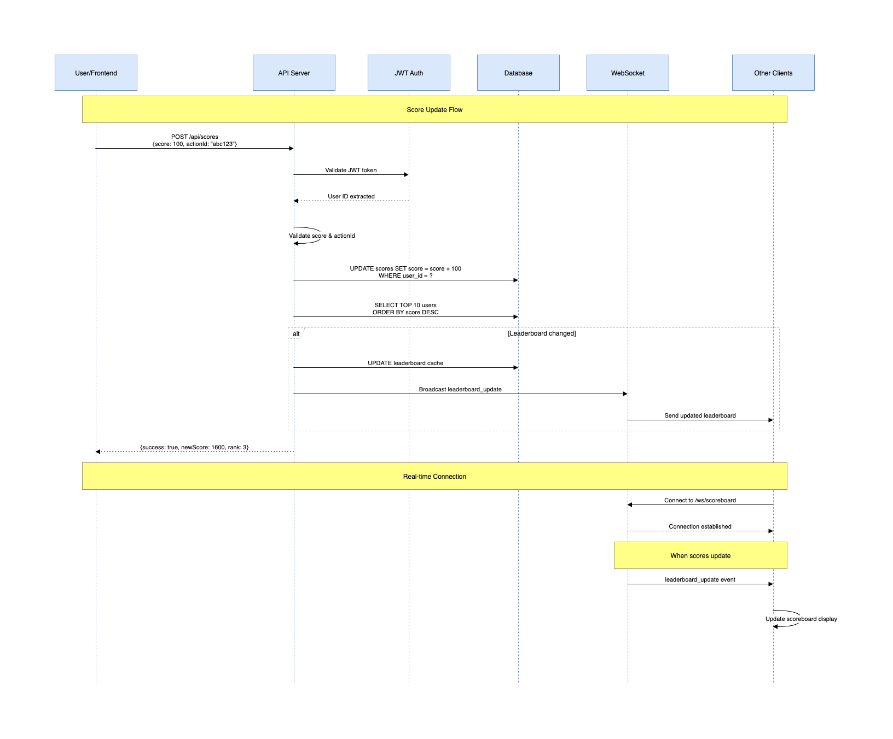

# Scoreboard API Module

## Overview

This module handles:

1. Displaying top 10 user scores
2. Live scoreboard updates when scores change
3. Secure score updates from user actions
4. Prevention of unauthorized score manipulation

## Diagram



## API Endpoints

### Get Leaderboard

```
GET /api/scoreboard
```

Returns the top 10 users with highest scores.

**Response:**

```json
{
  "success": true,
  "data": [
    {
      "userId": "123",
      "username": "player1",
      "score": 1500,
      "rank": 1
    }
  ]
}
```

### Update Score

```
POST /api/scores
Authorization: Bearer <token>
```

Updates a user's score after completing an action.

**Request:**

```json
{
  "score": 100,
  "actionId": "action_123"
}
```

**Response:**

```json
{
  "success": true,
  "data": {
    "newScore": 1600,
    "rank": 3,
    "leaderboardChanged": true
  }
}
```

### WebSocket Connection

```
WS /ws/scoreboard
```

Real-time connection for live scoreboard updates.

**Events:**

- `leaderboard_update`: Sent when top 10 changes
- `score_update`: Sent to user when their score changes

## Database Schema

### users table

```sql
CREATE TABLE users (
  id UUID PRIMARY KEY,
  username VARCHAR(50) UNIQUE NOT NULL,
  email VARCHAR(255) UNIQUE NOT NULL,
  password_hash VARCHAR(255) NOT NULL,
  created_at TIMESTAMP DEFAULT NOW()
);
```

### scores table

```sql
CREATE TABLE scores (
  id UUID PRIMARY KEY,
  user_id UUID REFERENCES users(id),
  score INTEGER NOT NULL DEFAULT 0,
  created_at TIMESTAMP DEFAULT NOW(),
  updated_at TIMESTAMP DEFAULT NOW()
);

CREATE INDEX idx_scores_user_id ON scores(user_id);
CREATE INDEX idx_scores_score ON scores(score DESC);
```

### leaderboard table (cached top 10)

```sql
CREATE TABLE leaderboard (
  rank INTEGER PRIMARY KEY,
  user_id UUID REFERENCES users(id),
  username VARCHAR(50) NOT NULL,
  score INTEGER NOT NULL,
  updated_at TIMESTAMP DEFAULT NOW()
);
```

## Authentication

Uses JWT tokens for API authentication:

- User logs in and receives JWT token
- Token must be included in Authorization header for score updates
- Token contains user ID to prevent score manipulation

## Security Measures

1. **JWT Authentication**: Only authenticated users can update scores
2. **Rate Limiting**: Max 10 score updates per minute per user
3. **Input Validation**: Score values must be positive integers
4. **Action Verification**: Each score update requires a valid actionId
5. **Audit Logging**: All score changes are logged with user ID and timestamp

## Implementation Flow

### Score Update Process

1. User completes an action on the website
2. Frontend sends POST request to `/api/scores` with JWT token
3. Server validates JWT token and extracts user ID
4. Server validates the score and actionId
5. Server updates user's score in database
6. Server checks if leaderboard top 10 changed
7. If changed, server updates leaderboard cache
8. Server broadcasts update via WebSocket to connected clients
9. Server returns response with new score and rank

### Real-time Updates

1. Clients connect to WebSocket endpoint `/ws/scoreboard`
2. Server maintains list of connected clients
3. When leaderboard changes, server broadcasts `leaderboard_update` event
4. Clients receive update and refresh their scoreboard display

## Technology Stack

- **Backend**: Node.js with Express.js
- **Database**: PostgreSQL with basic indexing
- **Real-time**: WebSocket (Socket.IO)
- **Authentication**: JWT tokens
- **Caching**: Simple in-memory cache for leaderboard

## Technical Requirements

### Required Dependencies

- **Express.js**: Web framework
- **Socket.IO**: WebSocket implementation
- **Sequelize**: PostgreSQL ORM
- **jsonwebtoken**: JWT authentication
- **express-rate-limit**: Rate limiting
- **bcryptjs**: Password hashing

### Key Implementation Points

1. **Action Replay Prevention**: Each actionId can only be used once
2. **Database Transactions**: Score updates must be atomic
3. **Leaderboard Caching**: Cache top 10 for 30 seconds to reduce DB load
4. **Rate Limiting**: 10 score updates per minute per user
5. **WebSocket Authentication**: Optional JWT auth for personalized updates
6. **Error Handling**: Consistent error response format across all endpoints

## Error Handling

### Common Errors

- `401 Unauthorized`: Invalid or missing JWT token
- `400 Bad Request`: Invalid score value or missing actionId
- `429 Too Many Requests`: Rate limit exceeded
- `500 Internal Server Error`: Database or server errors

### Error Response Format

```json
{
  "success": false,
  "error": {
    "code": "INVALID_TOKEN",
    "message": "JWT token is invalid or expired"
  }
}
```

## Environment Setup

### Required Environment Variables

```bash
DB_HOST=localhost
DB_PORT=5432
DB_NAME=scoreboard_db
DB_USER=postgres
DB_PASSWORD=your_password
JWT_SECRET=your_super_secret_jwt_key_here
PORT=3001
```

### Basic Setup Steps

1. Install PostgreSQL and create database
2. Install Node.js dependencies
3. Configure environment variables
4. Run database migrations to create tables
5. Start the server with WebSocket support

## Additional Improvements

### Performance Optimizations

1. **Leaderboard Caching**: Cache top 10 in Redis for faster reads
2. **Database Indexing**: Add composite index on (user_id, score) for faster queries
3. **Connection Pooling**: Use database connection pooling for better performance

### Security Enhancements

1. **Action Validation**: Verify actionId against completed actions to prevent replay attacks
2. **Score Limits**: Set maximum score increase per action to prevent abuse
3. **IP Rate Limiting**: Add IP-based rate limiting in addition to user-based limits

### Monitoring & Logging

1. **Health Checks**: Add `/health` endpoint for monitoring
2. **Metrics**: Track score update frequency and WebSocket connections
3. **Audit Trail**: Log all score changes with timestamps and user info

### Scalability Considerations

1. **Horizontal Scaling**: Use Redis for shared WebSocket state across multiple servers
2. **Database Optimization**: Consider read replicas for leaderboard queries
3. **CDN**: Cache static leaderboard data at edge locations

---
