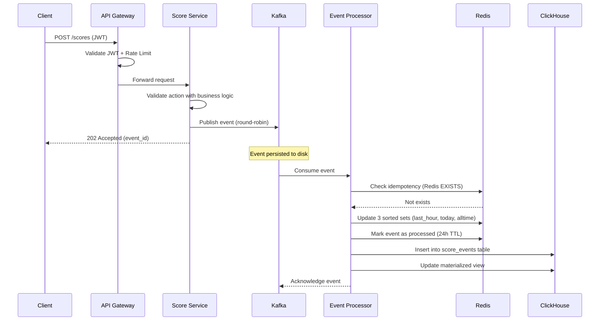
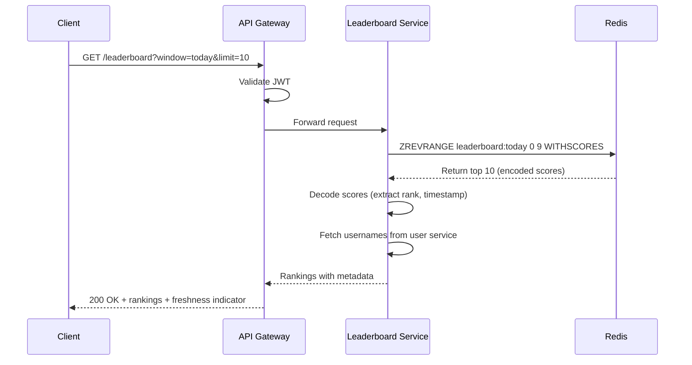
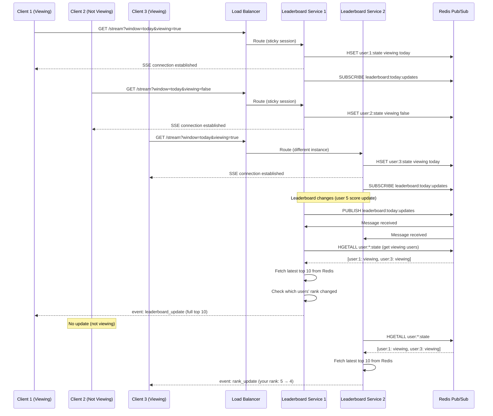
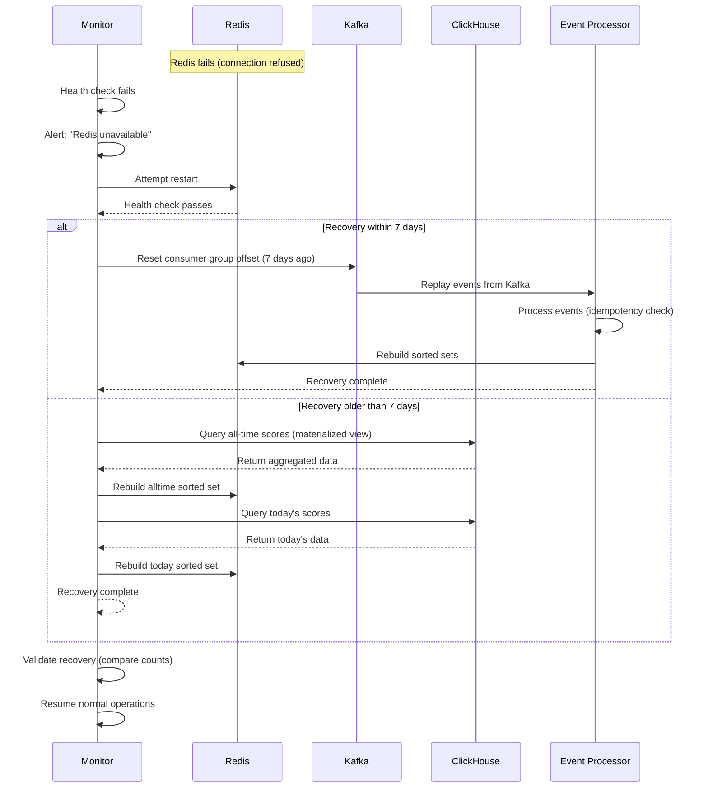
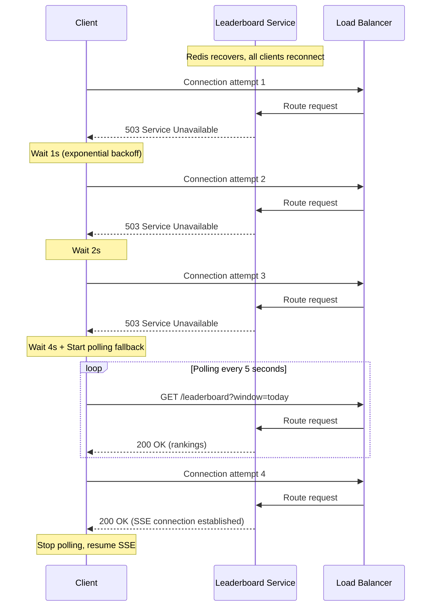
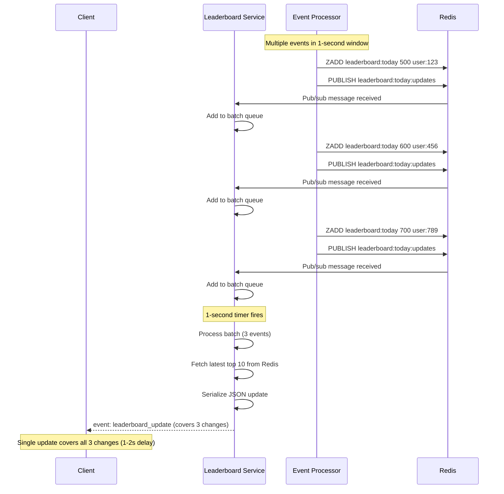
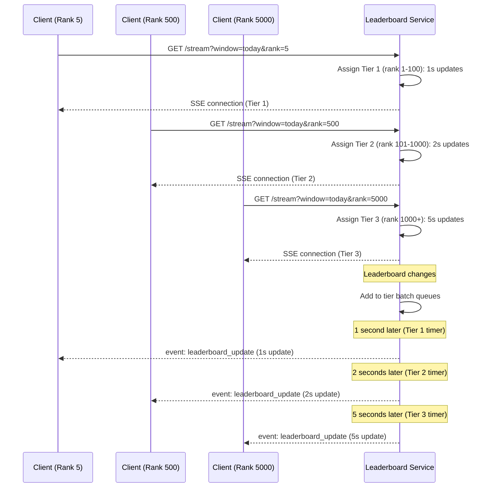

# Sequence Diagrams

All diagrams use Mermaid syntax and render natively in GitHub/GitLab.

## 1. Score Update Flow

The main write path for processing user actions and updating leaderboards.

**Key Points:**
- Asynchronous processing (client doesn't wait for Redis/ClickHouse)
- Single service processes events to both Redis and ClickHouse
- Idempotency prevents duplicate processing
- Round-robin partitioning ensures even load distribution

---

## 2. Leaderboard Query Flow

Read path for retrieving leaderboard rankings.

**Key Points:**
- Query time < 5ms (Redis sorted set operation)
- Score decoding extracts original score and timestamp
- Freshness indicator shows data age (e.g., "2 seconds old")
- No database queries (pure cache read)

---

## 3. Live Update Flow (SSE)

Real-time push updates to connected clients with horizontal scaling and selective broadcasting.

**Key Points:**
- **Horizontal scaling**: Multiple Leaderboard Service instances behind load balancer
- **Sticky sessions**: Clients stay on same instance (session affinity)
- **Redis pub/sub**: All instances receive updates simultaneously
- **Selective broadcasting**: Only active viewers receive updates (90% reduction)
- **Immediate updates**: No batching delay (100-200ms latency)
- **Targeted updates**: Users whose rank changed receive personalized `rank_update`
- **Each instance**: Handles ~10K connections independently

---

## 4. Redis Failure Recovery Flow

Disaster recovery when Redis fails and needs to be rebuilt.

**Key Points:**
- Automatic detection and alerting
- Two recovery strategies based on data age
- Kafka replay for recent data (< 7 days)
- ClickHouse query for older data (> 7 days)
- Validation ensures data consistency

---

## 5. Client Reconnection Flow (SSE Storm Prevention)

Exponential backoff prevents connection storm when Redis recovers.

**Key Points:**
- Exponential backoff: 1s, 2s, 4s, 8s, 16s, 32s, 60s (max)
- Polling fallback after 3 failed attempts
- Prevents DDoS-like reconnection storm
- Graceful degradation (polling → SSE)

---

## 6. Batching Flow (Future Improvement)

> **Status: Future Improvement** - Not implemented yet.
> To be added if message rate becomes unsustainable (50K+ TPS).

Events grouped into 1-second batches to reduce message rate.

**Key Points:**
- Events grouped into 1-second batches
- Single update covers multiple changes
- Update latency: 1-2 seconds (acceptable for leaderboards)
- Reduces message rate by 50-80% (10K → 2-5K updates/sec)
- Tradeoff: Slightly delayed updates (users wait up to 1 second)
- Implementation: Timer fires every 1 second, processes batch queue

---

## 7. Priority Tiers Flow (Future Improvement)

> **Status: Future Improvement** - Not implemented yet.
> To be added when concurrent users exceed 100K.

Higher-ranked users receive more frequent updates.

**Key Points:**
- Tier 1 (rank 1-100): 1-second updates (best experience)
- Tier 2 (rank 101-1000): 2-second updates (good experience)
- Tier 3 (rank 1000+): 5-second updates (acceptable experience)
- Reduces overall load by 50-70%
- Top users get best experience (they care most)
- Tradeoff: Lower-ranked users get less frequent updates
- Tier assignment updated when rank changes significantly
